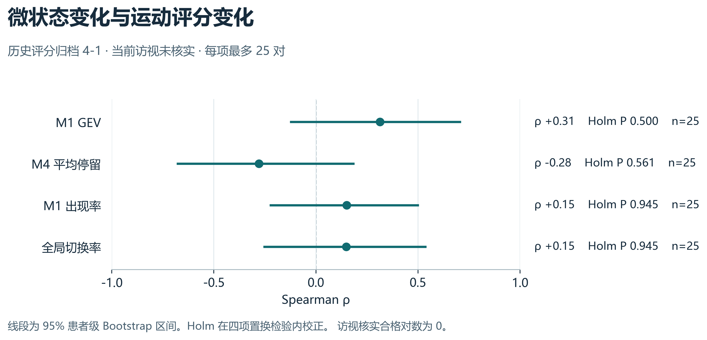

# 冻结 BOLD 微状态变化与运动评分变化的配对关联

**本样本未提供充分的关联证据。** 25 名 STN-DBS 患者的两侧影像和一版历史运动评分可按编号、扫描键和刺激条件对应。四项相关均未通过 Holm 校正，四个 95% 置信区间均跨 0。通过评分与当前扫描访视核实的是 0 对，访视核实路径尚无可估计结果。[配对核查](Behavior_Data_Audit.md) · [四项访视状态](../results/Verified_Visit_Associations.csv)

## 微状态改变越多，运动评分下降越多吗？

每位患者提供一个配对。行为变化定义为历史运动评分 OFF 减 ON，影像变化定义为 ON 减 OFF。正相关表示影像差值越大，ON 时记录的评分下降越多。负相关对于停留时间表示缩短越多时评分下降越多。使用 V6 冻结的 A3 指标，按患者置换行为值 10,000 次，按患者 Bootstrap 2,000 次。

$$
I_i=S_{i,\mathrm{OFF}}-S_{i,\mathrm{ON}},\qquad
\Delta X_i=X_{i,\mathrm{ON}}-X_{i,\mathrm{OFF}},\qquad
\rho_s=\mathrm{corr}\bigl(\mathrm{rank}(\Delta X),\mathrm{rank}(I)\bigr).
$$

| 冻结微状态指标 | 配对数 | Spearman ρ [95% CI] | 原始 P | 置换 P | 置换 Holm P | 置换 BH q |
|---|---:|---|---:|---:|---:|---:|
| M1 GEV | 25 | +0.313 [−0.128, +0.711] | 0.1272 | 0.1251 | 0.5003 | 0.3742 |
| M4 平均停留时间 | 25 | −0.279 [−0.683, +0.188] | 0.1774 | 0.1871 | 0.5612 | 0.3742 |
| M1 出现率 | 25 | +0.151 [−0.227, +0.504] | 0.4716 | 0.4725 | 0.9449 | 0.4816 |
| 全局切换率 | 25 | +0.148 [−0.258, +0.541] | 0.4796 | 0.4816 | 0.9449 | 0.4816 |

原始 P 为双侧 Spearman 近似。主要判据为四项置换 P 的 Holm 校正。区间基于固定模板和特征的患者重抽，包含当前队列内相关估计的抽样不确定性。M1 GEV 和 M4 停留的区间较宽，数据仍容许有一定幅度的关联。[全部显著及未显著条目](../results/Archived_Score_Associations.csv) · [预先固定的分析方案](../ANALYSIS_PLAN.md)

## 头动、单个患者和评分版本会改变判断吗？

| 指标 | ΔFD 调整配对数 | 调整后 ρ | 调整后置换 Holm P | 逐人留一 ρ 范围 |
|---|---:|---:|---:|---|
| M1 GEV | 25 | +0.305 | 0.6308 | +0.224 至 +0.456 |
| M4 平均停留时间 | 25 | −0.322 | 0.5531 | −0.403 至 −0.196 |
| M1 出现率 | 25 | +0.130 | 1.0000 | +0.065 至 +0.252 |
| 全局切换率 | 25 | +0.110 | 1.0000 | +0.052 至 +0.264 |

调整 ON−OFF 的平均头动差后，四项方向与未调整结果一致，均未通过校正。任意留出一人后，四项方向保持，M1 GEV 的最大单人留一偏移约 0.142。每项主分析及 FD 分析均有 10,000 次有效置换、2,000 次有效 Bootstrap 和 25 次可估计的主分析留一。历史评分改善有并列值，计算使用平均秩。已能核实顺序的 24 对均为 ON 先于 OFF，评分访视、量表版本和用药时点的缺口仍限制临床解释。[完整结果与诊断列](../results/Archived_Score_Associations.csv)

来源敏感性目前能确定**评分输入的变化**。既有 105 审计显示，两个版本的 50 条总分相同，备用版的 14 条总分有差异，涉及同一批 7 人的两侧记录，并改变这 7 人的 OFF−ON 分差。18 对两侧评分在三版中均一致。本轮只有历史参照版可直接重读，备用版效应和一致子集的效应仍待用逐人评分复算。来源敏感性表保留这几组的四项待估计记录。[来源敏感性表](../results/Score_Source_Sensitivity.csv) · [版本冲突与缺口](Behavior_Data_Audit.md)

## 历史发现与本轮结果各回答什么问题？

历史窄频分析曾在 DBS-ON 条件内发现 M4 出现率与运动评分负相关（Pearson r=−0.641，BH q=0.0232）。它比较患者之间同一条件的水平，模板依据 0.04–0.07 Hz 时序。本轮比较同一患者从 OFF 到 ON 的变化，使用 0.01–0.08 Hz 的冻结 A3 特征。两项分析的状态定义、统计单位下的变量和检验家族不同。本轮所用数据来自同一研究队列，结果属于探索性延伸。[历史条件内结果](../../reports/bold_microstates_v1/eeg_replacement_105/README.md) · [V6 原访视审计](../../V6_DBS_ON_OFF_Microstate_Dynamics/reports/V6_UPDRS_Association.md)

## 组会结论

| 问题 | 一句话结论 |
|---|---|
| 影像与评分能否逐人对齐？ | 参照版历史评分可按编号和条件连到 25 对冻结扫描，评分访视核实为 0 对。 |
| 微状态变化是否随评分下降而变？ | 四项校正后均未见充分的关联证据，M1 GEV 的点估计为正、M4 平均停留的点估计为负，区间均跨 0。 |
| 结果对头动或个别患者是否敏感？ | 头动调整及逐人留一保留四项方向，头动调整后四项仍未通过 Holm。 |
| 评分来源是否会改变结论？ | 既有审计确认备用版改变 7 对评分差，相关强度的来源敏感性仍需该版的逐人数据。 |

**汇报用语**　我们在 25 名 STN-DBS 患者中把冻结的微状态 ON−OFF 差值与历史运动评分 OFF−ON 差值配对，四项相关经校正均未达到显著，头动调整也未改变这一判断。当前可以报道同一队列里的探索结果，评分与扫描同期的关联及跨版本稳定性仍待核实。

复算时，三张结果表、汇总运行记录和两种格式的图均逐字节一致，原冻结输入的哈希一致。12 项针对性检查覆盖键错位、方向、单位、并列秩、常数、FD 缺失与四项 Holm 家族。逐人散点图存于授权工作区的私有目录。

[效应图 PDF](../figures/Association_Effect_Summary.pdf) · [复算入口](../README.md) · [软件版本、随机种子及汇总运行记录](../results/Run_Metadata.json)
