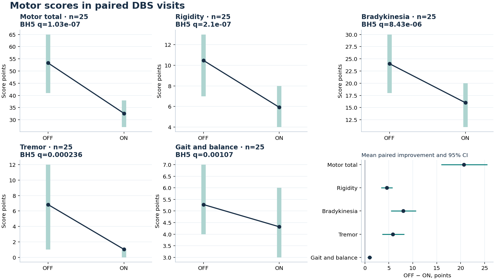
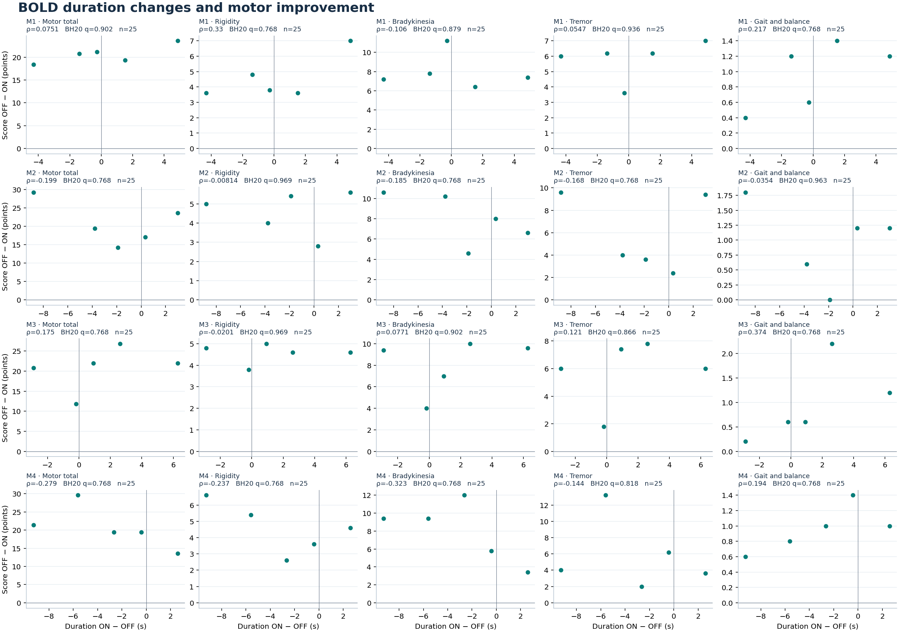

# STN 患者 DBS ON–OFF 运动行为变化及 BOLD 微状态关联

主分析 25 对患者。运动改善量为 OFF−ON，持续时间变化为 ON−OFF。

1. **ON 时改善的评分**　运动总分、强直、运动徐缓、震颤、步态与平衡通过本轮 BH5。
2. **持续时间变化**　M2（-2.231 秒）、M4（-3.069 秒）通过本轮 BH4。括号内为平均 ON−OFF。
3. **行为与持续时间的关联**　主分析 BH20 通过项 0/20。最小 q=0.7677。
4. **对应的症状维度**　总分和各分项均未获得校正后的关联证据。
5. **固定敏感性**　日期核实子集（22 对）的 BH20 通过项为无。头动质量窗（25 对）通过项为无。主分析以原冻结共同窗为准。

[数据与条目核查](Data_and_Score_Audit.md) · [冻结方案](../ANALYSIS_PLAN.md) · [运行清单](../results/Run_Manifest.json)

## 临床与持续时间配对结果

| 指标 | n | OFF 均值 | ON 均值 | 平均变化 [95% CI] | 检验 | 原始 P | BH q |
|---|---:|---:|---:|---:|---|---:|---:|
| 运动总分 | 25 | 53.32 | 32.64 | 20.68 [15.92, 25.6] | 配对 t | 2.068e-08 | 1.034e-07 |
| 强直 | 25 | 10.48 | 5.92 | 4.56 [3.4, 5.76] | 配对 t | 8.419e-08 | 2.105e-07 |
| 运动徐缓 | 25 | 24 | 16 | 8 [5.44, 10.68] | 配对 t | 5.059e-06 | 8.432e-06 |
| 震颤 | 25 | 6.84 | 1.04 | 5.8 [3.6, 8.2] | Wilcoxon 符号秩 | 0.000189 | 0.0002362 |
| 步态与平衡 | 25 | 5.28 | 4.32 | 0.96 [0.52, 1.44] | Wilcoxon 符号秩 | 0.001067 | 0.001067 |
| M1 持续时间（秒） | 25 | 8.01 | 8.091 | 0.08141 [-1.206, 1.362] | 配对 t | 0.9067 | 0.9067 |
| M2 持续时间（秒） | 25 | 10.51 | 8.283 | -2.231 [-3.983, -0.56] | 配对 t | 0.02188 | 0.04375 |
| M3 持续时间（秒） | 25 | 6.6 | 7.948 | 1.347 [0.1145, 2.668] | 配对 t | 0.05153 | 0.06871 |
| M4 持续时间（秒） | 25 | 11.98 | 8.916 | -3.069 [-4.734, -1.433] | 配对 t | 0.001604 | 0.006415 |

总分采用原表运动检查总分，33 项重算，正式版本待核实。高分对应更重的损害。改善率只作补充，OFF=0 时记为 NA。均值差区间为 9,999 次患者整对 Bootstrap 百分位。显著性依据各检验家族的 q 值。图中连线连接同一批患者的条件均值，浅色条为条件内四分位距。

[临床配对结果](../results/Clinical_Paired_Results.csv) · [持续时间结果](../results/Duration_Paired_Results.csv) · [临床全样本描述](../results/Clinical_Reference_Descriptives.csv)

## 20 项预定 Spearman 与固定敏感性

ρ<0 表示持续时间缩短越多，改善越大。ρ>0 表示持续时间增加越多，改善越大。四态乘五项全部进入同一个 BH20 家族。日期和头动敏感性各用同一清单独立校正。

| 状态 | 改善指标 | n | ρ | 原始 P | BH20 q | 日期 ρ / q | 质量 ρ / q |
|---|---|---:|---:|---:|---:|---:|---:|
| M1 | 运动总分 | 25 | 0.07506 | 0.7214 | 0.9018 | 0.2831 / 0.5523 | -0.03773 / 0.997 |
| M1 | 强直 | 25 | 0.3297 | 0.1075 | 0.7677 | 0.3247 / 0.5523 | 0.105 / 0.997 |
| M1 | 运动徐缓 | 25 | -0.1056 | 0.6152 | 0.8789 | -0.02489 / 0.9897 | -0.1022 / 0.997 |
| M1 | 震颤 | 25 | 0.05467 | 0.7952 | 0.9355 | 0.2652 / 0.5523 | 0.0007812 / 0.997 |
| M1 | 步态与平衡 | 25 | 0.2174 | 0.2965 | 0.7679 | 0.3848 / 0.5523 | 0.1242 / 0.997 |
| M2 | 运动总分 | 25 | -0.1994 | 0.3393 | 0.7679 | -0.1503 / 0.9171 | -0.1212 / 0.997 |
| M2 | 强直 | 25 | -0.008137 | 0.9692 | 0.9692 | 0.0005677 / 0.998 | -0.002325 / 0.997 |
| M2 | 运动徐缓 | 25 | -0.1847 | 0.3768 | 0.7679 | -0.2648 / 0.5523 | -0.02622 / 0.997 |
| M2 | 震颤 | 25 | -0.1679 | 0.4224 | 0.7679 | -0.04057 / 0.9897 | -0.1757 / 0.997 |
| M2 | 步态与平衡 | 25 | -0.03543 | 0.8665 | 0.9628 | -0.05598 / 0.9897 | -0.05395 / 0.997 |
| M3 | 运动总分 | 25 | 0.1751 | 0.4024 | 0.7679 | 0.0548 / 0.9897 | 0.2721 / 0.9161 |
| M3 | 强直 | 25 | -0.02015 | 0.9238 | 0.9692 | -0.07153 / 0.9897 | -0.07594 / 0.997 |
| M3 | 运动徐缓 | 25 | 0.07712 | 0.7141 | 0.9018 | 0.01697 / 0.9897 | 0.3162 / 0.9161 |
| M3 | 震颤 | 25 | 0.1215 | 0.5631 | 0.8662 | 0.02686 / 0.9897 | 0.1582 / 0.997 |
| M3 | 步态与平衡 | 25 | 0.374 | 0.06551 | 0.7677 | 0.3153 / 0.5523 | 0.409 / 0.8466 |
| M4 | 运动总分 | 25 | -0.2787 | 0.1774 | 0.7679 | -0.1763 / 0.8653 | -0.03426 / 0.997 |
| M4 | 强直 | 25 | -0.2367 | 0.2545 | 0.7679 | -0.2793 / 0.5523 | -0.2495 / 0.9161 |
| M4 | 运动徐缓 | 25 | -0.3231 | 0.1151 | 0.7677 | -0.2569 / 0.5523 | -0.01851 / 0.997 |
| M4 | 震颤 | 25 | -0.1445 | 0.4908 | 0.8179 | -0.03086 / 0.9897 | -0.005467 / 0.997 |
| M4 | 步态与平衡 | 25 | 0.194 | 0.3527 | 0.7679 | 0.353 / 0.5523 | 0.3011 / 0.9161 |

共享散点按时间差排序，每点平均至少五人。标注的 ρ 和 q 从患者级数据计算。私有图保留完整散点和临床逐人配对轨迹。

[主关联全表](../results/Duration_Motor_Associations.csv) · [固定敏感性全表](../results/Association_Sensitivities.csv)

## 文献和既往检验

本地《脑电微状态》是 Michel 与 Bréchet 的综述。Guo 等先评估 EEG 微状态的测量可靠性，再报告 D 持续时间与 UPDRS 正相关。本轮以此设计全四态的配对探索。冻结 BOLD A3 状态的持续时间以秒计。EEG D 和 BOLD M4 的对应关系未建立。 [综述](https://pubmed.ncbi.nlm.nih.gov/42103554/) · [Guo 等](https://pubmed.ncbi.nlm.nih.gov/38531478/)

V4 已检验同一队列的四态持续时间，原始检验的 BH4 支持 M2 和 M4 缩短，q 分别为 .04375 和 .006415。另一项历史分析已用 Spearman 检验 M4 持续时间与总分变化，ρ=−.279，原始 P=.1774，置换 Holm4=.5612、BH4=.3742。V8 日期不限制回归曾检验含 OFF 基线及 ΔFD 的 M4 持续时间与运动改善。总分 P=.6942、Holm3=1，震颤 P=.07649、BH9=.56820、Holm12=.9179。V9 的 M1/M4 连续表达与总分改善调整检验 Holm2 为 .51245 和 .44036，联合 Holm14 均为 1。本轮在同队列复核方法并扩展症状维度，原历史家族校正仍按各报告保留。 [V4 完整表](../../V4_Microstate_Statistical_Significance/results/All_Scalar_Results.csv) · [早期同队列行为分析](../../BOLD_Microstate_Behavior_Association/reports/BOLD_Microstate_Behavior_Association_Report.md) · [V8 日期不限制分析](../../BOLD_Microstate_STN_Original_Scores/reports/STN_Date_Unrestricted_Associations.md) · [V9 解释](../../BOLD_Microstate_Expression_Followup/reports/Final_Interpretation.md)

24 对可核实的扫描均先 ON 后 OFF，另 1 对顺序未知。评分记录两种 DBS 条件均为药物 OFF。主样本有 2 对日期记录冲突、1 对日期证据不足，仍保留已确认的身份和 DBS 条件。本轮结果解释限于 ON/OFF 条件相关变化和指标间关联。
