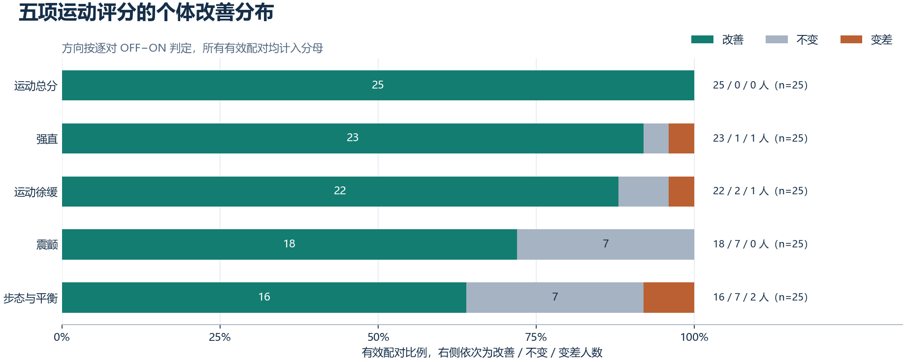
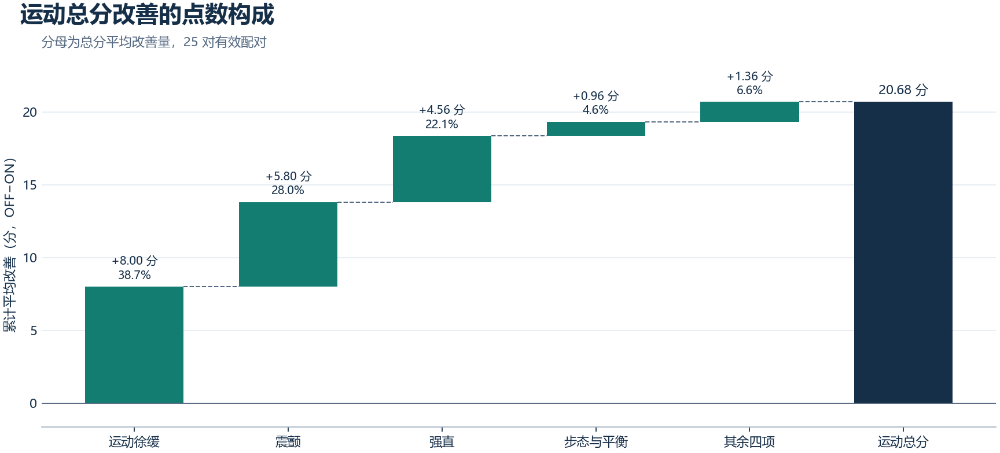
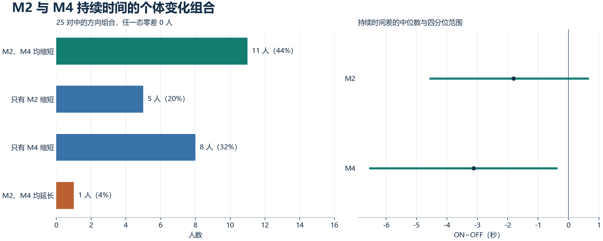
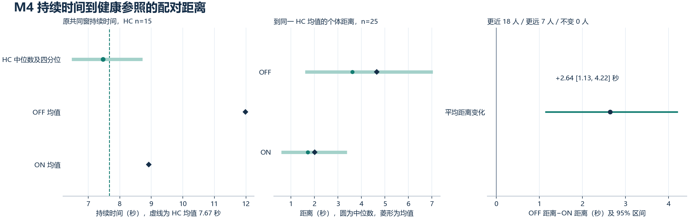

# STN DBS ON/OFF 第二轮报告

沿用原冻结 A3 共同窗及 25 名患者配对。这一轮描述改善的构成和个体变化，并估计 M4 持续时间与同一冻结队列 15 名 HC 均值的距离变化。原临床 BH5、持续时间 BH4 和 20 项关联均保留原校正范围。本轮只对平均 M4 配对距离变化给出嵌套 Bootstrap 区间，未追加 P 值。

## 一、临床改善的构成与一致性

**总分 25/25 人下降。** OFF 和 ON 平均分别为 53.32 和 32.64 分，平均改善 20.68 分。逐人改善率的平均值为 37.4%。下降为分值方向，临床重要改善阈值未设定。总分沿用 33 项人工评分重算口径，正式量表版本待核实。

下表分值列依次为均值、中位数和四分位范围。改善率列使用百分比，分母为该项 OFF 分数大于零的人数。

| 指标 | OFF（分） | ON（分） | 改善量 OFF−ON（分） | 改善 / 不变 / 变差 | 有效改善率 n | 改善率（%） | 原 BH5 q |
|---|---:|---:|---:|---|---:|---:|---:|
| 运动总分 | 53.32 / 49.00 [41.00, 65.00] | 32.64 / 30.00 [27.00, 38.00] | 20.68 / 21.00 [9.00, 27.00] | 25（100%） / 0（0%） / 0（0%） | 25 | 37.36 / 38.64 [23.81, 54.35] | 1.034e-07 |
| 强直 | 10.48 / 11.00 [7.00, 13.00] | 5.92 / 6.00 [4.00, 8.00] | 4.56 / 5.00 [3.00, 6.00] | 23（92%） / 1（4%） / 1（4%） | 25 | 47.62 / 42.86 [29.41, 64.29] | 2.105e-07 |
| 运动徐缓 | 24.00 / 24.00 [18.00, 30.00] | 16.00 / 14.00 [11.00, 20.00] | 8.00 / 6.00 [2.00, 12.00] | 22（88%） / 2（8%） / 1（4%） | 25 | 31.69 / 31.58 [11.11, 51.28] | 8.432e-06 |
| 震颤 | 6.84 / 4.00 [1.00, 12.00] | 1.04 / 0.00 [0.00, 1.00] | 5.80 / 3.00 [0.00, 11.00] | 18（72%） / 7（28%） / 0（0%） | 19 | 78.84 / 100.00 [63.33, 100.00] | 0.0002362 |
| 步态与平衡 | 5.28 / 5.00 [4.00, 7.00] | 4.32 / 4.00 [3.00, 6.00] | 0.96 / 1.00 [0.00, 1.00] | 16（64%） / 7（28%） / 2（8%） | 25 | 23.52 / 16.67 [0.00, 30.00] | 0.001067 |

震颤在全部 25 人中为 18 人改善、7 人不变、0 人变差。OFF 震颤大于零的 19 人中有 18 人改善（94.7%）。另 6 人 OFF 震颤已经为零，该条目没有进一步下降的空间。这些人的原始分数与绝对变化均保留，改善率记为 NA。

[临床连续量、比例与分母](../results/Clinical_Response_Profile.csv) · [原临床 BH5](../../results/Clinical_Paired_Results.csv)

**总分改善点数以运动徐缓和震颤两部分较多。** 平均分别改善 8.00 和 5.80 分，合计占平均总分改善的 66.7%。根据字典重算了两个条件的 50 次评分。强直、运动徐缓、震颤、步态与平衡和其余四项逐人相加均等于总分。其余四项是言语、面部表情、起立和姿势。

| 总分部分 | 条目数 | OFF 均值（分） | ON 均值（分） | 平均改善（分） | 占平均总分改善 |
|---|---:|---:|---:|---:|---:|
| 强直 | 5 | 10.48 | 5.92 | 4.56 | 22.1% |
| 运动徐缓 | 11 | 24.00 | 16.00 | 8.00 | 38.7% |
| 震颤 | 10 | 6.84 | 1.04 | 5.80 | 28.0% |
| 步态与平衡 | 3 | 5.28 | 4.32 | 0.96 | 4.6% |
| 其余四项 | 4 | 6.72 | 5.36 | 1.36 | 6.6% |
| 运动总分 | 33 | 53.32 | 32.64 | 20.68 | 100.0% |

分值比例为每部分的平均改善除以平均总分改善。各域条目数不同，比例只描述这套量表的改善点数构成。

[总分分解](../results/Clinical_Improvement_Composition.csv) · [原人工条目字典](../../results/Score_Item_Dictionary.csv)

## 二、脑动态的个体组合与健康参照

**11/25 人的 M2 和 M4 都缩短，13/25 人只缩短其中一态。** 两态的组均值缩短由部分相同患者共同支持，患者内仍有多种方向组合。方向取自实际 ON−OFF，1e−12 秒容差内单列为零差。

| 持续时间方向组合 | 人数 / 总配对数 | 比例 |
|---|---:|---:|
| M2、M4 均缩短 | 11/25 | 44% |
| 只有 M2 缩短 | 5/25 | 20% |
| 只有 M4 缩短 | 8/25 | 32% |
| M2、M4 均延长 | 1/25 | 4% |
| 任一态为零差 | 0/25 | 0% |

| 状态 | 缩短 / 不变 / 延长 | 平均变化（秒） | 中位变化与四分位范围（秒） |
|---|---|---:|---:|
| M2 | 16 / 0 / 9 | −2.23 | −1.81 [−4.58, 0.67] |
| M4 | 19 / 0 / 6 | −3.07 | −3.12 [−6.56, −0.36] |

第一轮 M2 和 M4 的持续时间 BH4 q 分别为 0.04375 和 0.006415。第二轮方向计数是配对描述。

[方向组合](../results/M2_M4_Response_Patterns.csv) · [持续时间幅度](../results/M2_M4_Duration_Change_Summary.csv) · [原持续时间 BH4](../../results/Duration_Paired_Results.csv)

### M4 距离本队列 HC 均值

**18 人更接近，7 人更远离，0 人不变。** 个体到参照均值的平均距离从 4.65 秒降至 2.01 秒，平均配对距离改善为 2.64 秒（95% 百分位区间 1.13 至 4.22 秒）。区间全部在零以上，支持当前固定模型下 ON 时平均个体距离较小。

HC 参照是 15 人原共用有效窗 M4 持续时间的算术均值 7.67 秒。HC 中位数 7.47 秒，四分位范围 6.48 至 8.71 秒。此范围是样本描述。

| 距离统计 | 均值（秒） | 中位数（秒） | 四分位范围（秒） |
|---|---:|---:|---:|
| OFF 到参照的绝对距离 | 4.65 | 3.62 | 1.60 至 7.03 |
| ON 到参照的绝对距离 | 2.01 | 1.71 | 0.58 至 3.38 |
| 个体距离变化（OFF 距离减 ON 距离） | 2.64 | 2.48 | −0.10 至 4.43 |

组均值本身到参照的距离为 OFF 4.31 秒、ON 1.24 秒。主要效应使用上表的个体绝对距离配对差，先对每人计算绝对距离，再取平均。M4 缩短的 19 人中，17 人同时更接近 HC 均值。
9,999 次重抽每次同时抽取 15 名 HC 和 25 个完整患者对。每次重估一个 HC 均值，供该轮全部 ON 与 OFF 使用。

[健康参照距离汇总](../results/M4_HC_Reference_Summary.csv)

### 既有时间分解与空间注释

V7 原窗结果显示，M4 的平均持续时间由 OFF 11.98 秒降到 ON 8.92 秒，占用比例由 37.02% 降到 28.82%，出现率均值从 1.848 增到 1.886 段/有效分钟。每次扫描的平均持续时间等于 M4 总占用时间除以 M4 段数。这组点估计呈现总占用减少、连续驻留缩短、出现率均值变化较小。V7 占用分量原 Holm6 P=0.1150，保留为描述性分解。 [V7 时间分解](../../../BOLD_Microstate_Mechanistic_Decomposition/reports/V7_M4_Duration_Decomposition.md)

V7 折 0 的 AAL78–Yeo7 注释以落入 Yeo7 的平方模板权重为分母。M2 主要份额包括 Default 32.6%、Ventral Attention 14.7%，M4 包括 Default 31.3%、Somatomotor 18.1%。Yeo7 映射部分分别覆盖 M2 和 M4 整体平方模板权重的 39.9% 和 39.8%。这些占比描述已映射部分的空间分布，整个状态保留 M2/M4 编号。激活和抑制需要另外的测量证据。 [V7 空间注释](../../../BOLD_Microstate_Mechanistic_Decomposition/reports/V7_Functional_Network_Annotation.md)

V6 四态 Coverage 的 Aitchison 距离平均缩短 0.124，嵌套 95% CI −0.191 至 0.412，健康参照家族 Holm P=0.21938，原结论仍为未获得校正支持。该指标衡量四态占用组成，本轮衡量单态持续时间到 HC 均值的绝对距离。 [V6 四态占用距离](../../../V6_DBS_ON_OFF_Microstate_Dynamics/reports/V6_Normalization_Analysis.md) · [V6 配对异质性](../../../V6_DBS_ON_OFF_Microstate_Dynamics/reports/V6_Paired_Response_Heterogeneity.md)

结论适用于同一冻结模型与本队列参照。全脑动态恢复正常、与 HC 等效及因果疗效仍未建立。既有顺序审计中，24 对可核实患者均先 ON 后 OFF，另 1 对顺序未知。共享图使用汇总值，逐人配对轨迹在本地私有目录。

[第二轮方案](../ANALYSIS_PLAN.md) · [输入指纹与核验](../results/Round2_Run_Manifest.json)
