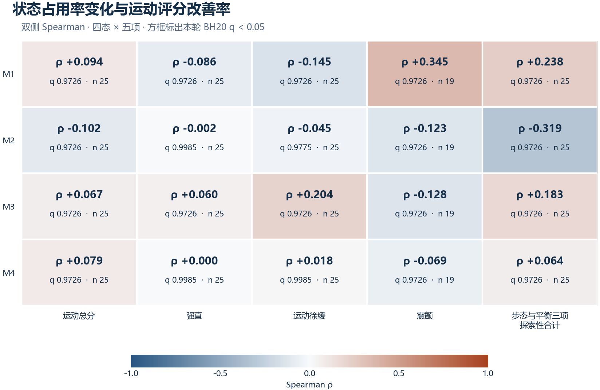

# DBS ON–OFF 状态占用率变化与运动改善率的关联

**主分析 0/20 项通过 BH-FDR。** 四态与五项改善率均未获得校正后的关联证据。

正 ρ 表示占用增加越多、改善率越高。负 ρ 表示占用减少越多、改善率越高。同样本绝对减分对照中，15 格同向、5 格反向、0 格涉及零相关、0 格不可比较。对照另行 BH20，通过 0/20 项。

主分析原始 P<.05 也为 0/20。最小原始 P=0.120027，最小 q=0.972611。

冻结队列共 25 名 STN 患者。震颤改善率纳入 19 人，6 人 OFF 评分为零。其绝对减分在 25 人中可计算，同样本对照仍限制在与改善率相同的 19 人。HC 不进入相关。

## 主分析完整结果

| 状态 | 运动终点 | n | ρ | 原始 P | BH20 q | 证据 | 同样本绝对减分 ρ | 方向比较 |
|---|---|---:|---:|---:|---:|---|---:|---|
| M1 | 运动总分 | 25 | 0.0938462 | 0.655456 | 0.972611 | 证据不足 | 0.141647 | 同向 |
| M1 | 强直 | 25 | -0.0858849 | 0.68313 | 0.972611 | 证据不足 | 0.310353 | 反向 |
| M1 | 运动徐缓 | 25 | -0.144643 | 0.4903 | 0.972611 | 证据不足 | -0.0701757 | 同向 |
| M1 | 震颤 | 19 | 0.345437 | 0.147466 | 0.972611 | 证据不足 | 0.1869 | 同向 |
| M1 | 三项步态与平衡 | 25 | 0.23843 | 0.251065 | 0.972611 | 证据不足 | 0.156608 | 同向 |
| M2 | 运动总分 | 25 | -0.101538 | 0.62913 | 0.972611 | 证据不足 | -0.13164 | 同向 |
| M2 | 强直 | 25 | -0.00154054 | 0.994169 | 0.998542 | 证据不足 | 0.159632 | 反向 |
| M2 | 运动徐缓 | 25 | -0.0450087 | 0.830836 | 0.977454 | 证据不足 | -0.0535957 | 同向 |
| M2 | 震颤 | 19 | -0.123371 | 0.614837 | 0.972611 | 证据不足 | -0.200187 | 同向 |
| M2 | 三项步态与平衡 | 25 | -0.319076 | 0.120027 | 0.972611 | 证据不足 | -0.365553 | 同向 |
| M3 | 运动总分 | 25 | 0.0669231 | 0.750606 | 0.972611 | 证据不足 | 0.0354119 | 同向 |
| M3 | 强直 | 25 | 0.0604661 | 0.774024 | 0.972611 | 证据不足 | -0.217751 | 反向 |
| M3 | 运动徐缓 | 25 | 0.203885 | 0.328294 | 0.972611 | 证据不足 | 0.146521 | 同向 |
| M3 | 震颤 | 19 | -0.128116 | 0.601188 | 0.972611 | 证据不足 | -0.239161 | 同向 |
| M3 | 三项步态与平衡 | 25 | 0.182719 | 0.382002 | 0.972611 | 证据不足 | 0.330125 | 同向 |
| M4 | 运动总分 | 25 | 0.0792308 | 0.706571 | 0.972611 | 证据不足 | 0.0804465 | 同向 |
| M4 | 强直 | 25 | 0.000385134 | 0.998542 | 0.998542 | 证据不足 | -0.049982 | 反向 |
| M4 | 运动徐缓 | 25 | 0.0180804 | 0.931641 | 0.998542 | 证据不足 | 0.0146521 | 同向 |
| M4 | 震颤 | 19 | -0.0692773 | 0.778089 | 0.972611 | 证据不足 | 0.101865 | 反向 |
| M4 | 三项步态与平衡 | 25 | 0.0638931 | 0.76157 | 0.972611 | 证据不足 | 0.0128829 | 同向 |

[主分析 CSV](../results/Coverage_Clinical_Rate_Associations.csv) · [绝对减分对照 CSV](../results/Coverage_Clinical_Absolute_Associations.csv) · [临床改善率可用人数](../results/Clinical_Rate_Eligibility.csv)

## Coverage 描述与方法

| 状态 | OFF 均值（%） | ON 均值（%） | ON−OFF 均值（百分点） | 增加 / 不变 / 减少人数 |
|---|---:|---:|---:|---:|
| M1 | 17.96 | 23.90 | +5.93 | 17 / 0 / 8 |
| M2 | 30.19 | 25.98 | -4.21 | 11 / 0 / 14 |
| M3 | 14.83 | 21.30 | +6.47 | 16 / 0 / 9 |
| M4 | 37.02 | 28.82 | -8.19 | 8 / 0 / 17 |

Coverage 取同一有效窗内四态各自的有效时间比例。四态合计为 1，每对患者四态差值和为 0，因此状态变化反映相对时间分配，网络激活或抑制需要另外的测量证据。M1–M4 保留 A3 原编号。

沿用 AAL78、K=4、TR=2.1 秒、0.01–0.08 Hz、N0/G1/S1、λ=0.04、原共同窗及固定五折。每名患者以患者键和两侧扫描键匹配。占用差为 ON−OFF，绝对减分为 OFF−ON，改善率为绝对减分除以 OFF。分母为零的该项改善率保留 NA，其他终点以及零改善和恶化个体照常保留。

沿用 WEiDA 的双侧 Spearman＋BH-FDR 关联框架。本轮预设四态 × 五项构成主 BH20，绝对减分对照用同样本并各自校正 20 项。采用标准并列秩。样本不足 3 或变量恒定时保留 NA，校正运算中该槽按 P=1 计入。总分沿用 33 项人工条目重算，正式量表版本待核实。步态、步态冻结及姿势平稳度三项组成步态与平衡探索性合计。既有临床比较和持续时间关联沿用其原校正范围。

这是同一队列下的探索性延伸。组均值占用变化和临床改善各自描述条件差异，相关必须由患者内两项变化共同判定。既有审计中 24 对可核实患者均先 ON 后 OFF，另 1 对顺序未知。

[四态 Coverage 描述](../results/Coverage_Change_Summary.csv) · [第三轮方案](../ANALYSIS_PLAN.md) · [固定检验清单](../configs/test_registry.csv) · [运行清单](../results/Round3_Run_Manifest.json) · [原临床与持续时间报告](../../reports/Behavior_ON_OFF_Report.md) · [第二轮报告](../../round2/reports/ON_OFF_Round2_Report.md) · [WEiDA 既有统计规程](../../../V4_WEiDA_Statistical_Framework_Microstate/reports/WEIDA_STATISTICAL_PROTOCOL.md)
