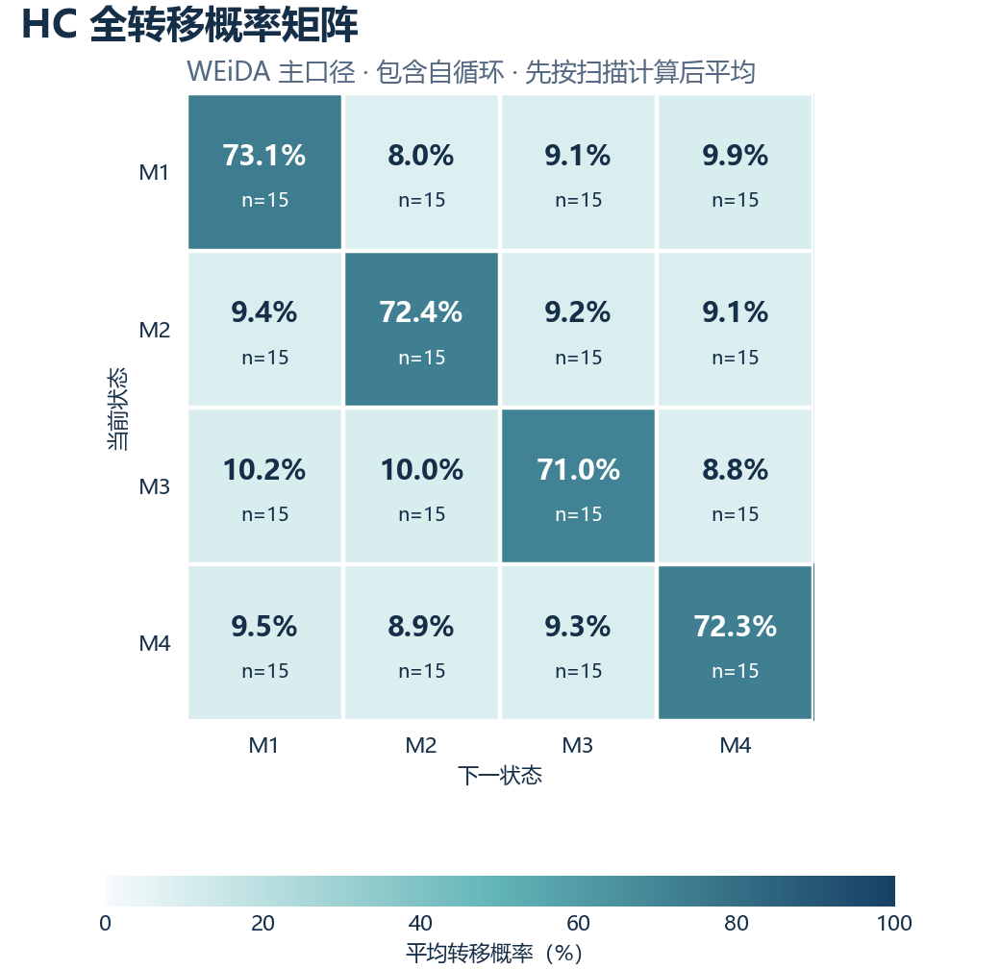
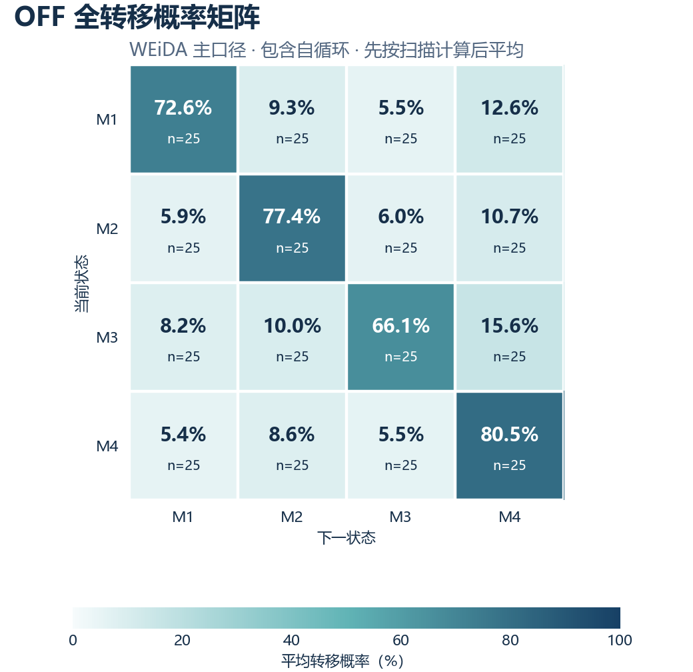
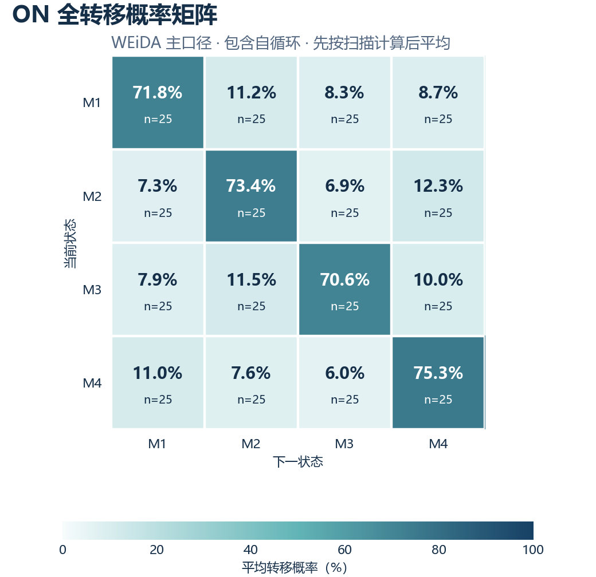
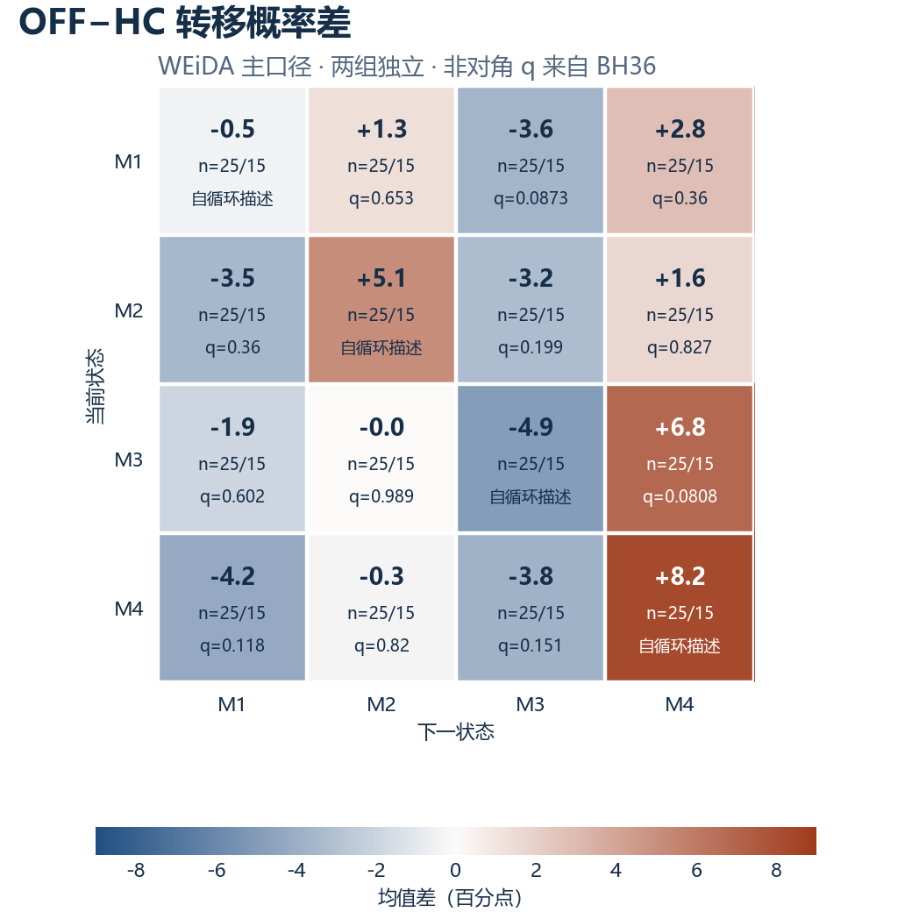
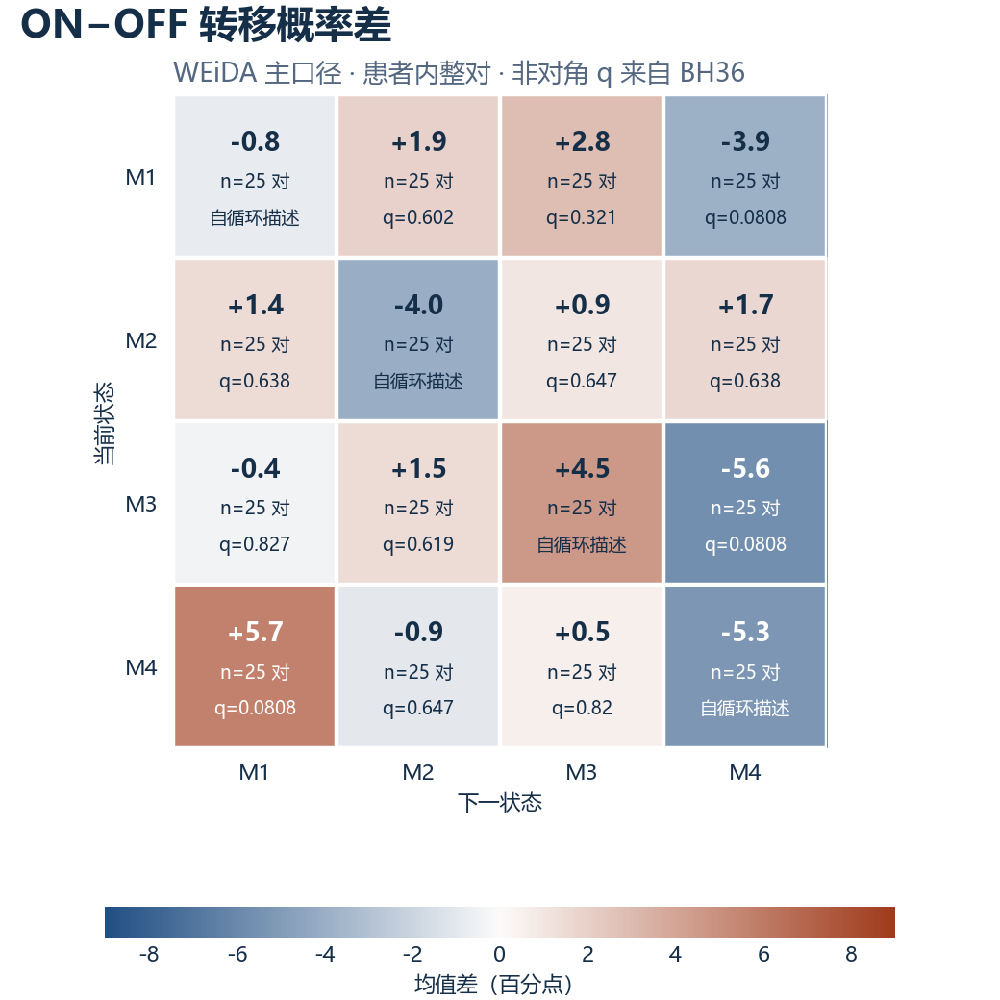
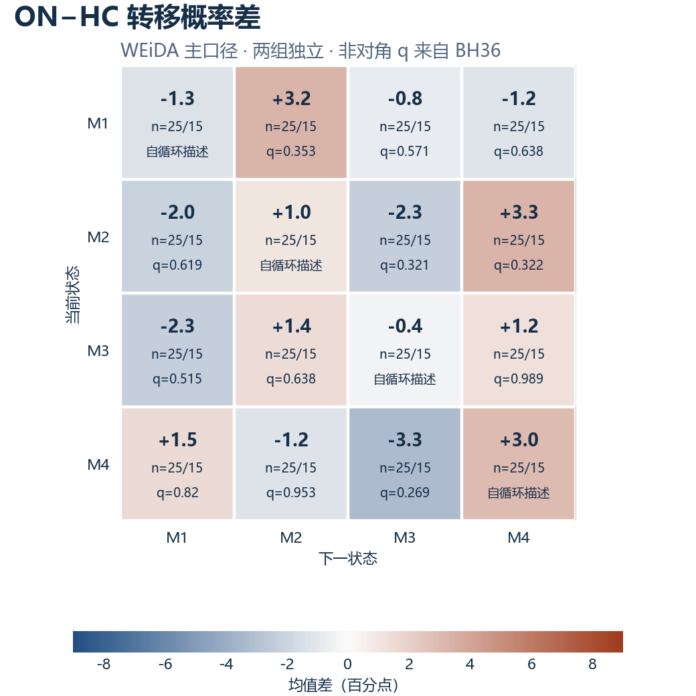
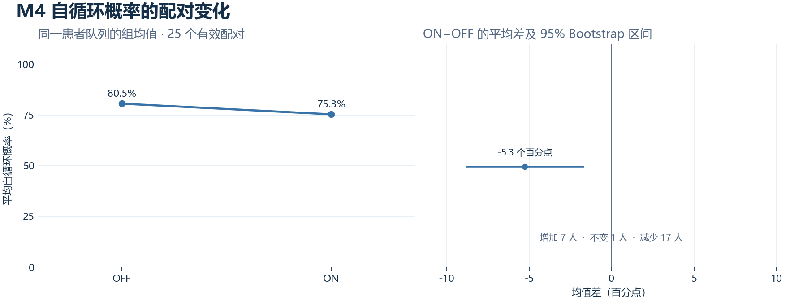
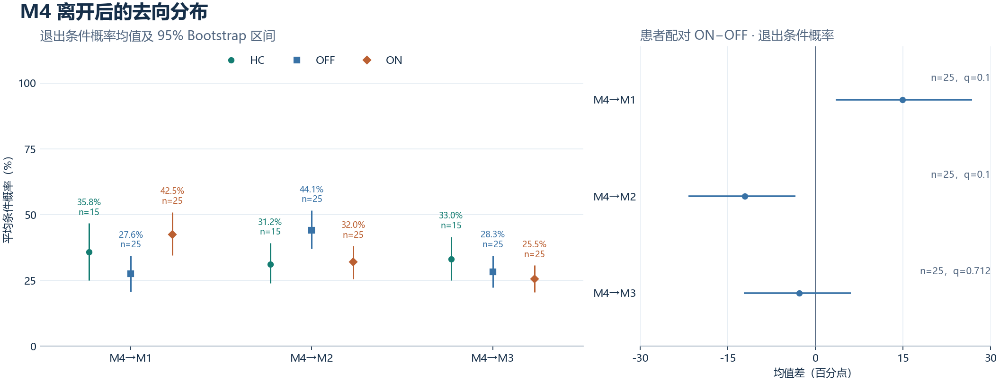
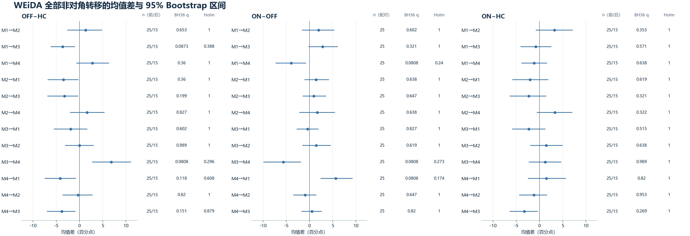

# A3 BOLD 微状态完整四态转移概率

源数据核验通过 **65/65 次扫描**（HC 15、OFF 25、ON 25），以及 25 个精确 ON/OFF 配对。WEiDA 主家族 36 项中，BH 通过 **0 项**，Holm 通过 **0 项**。退出条件概率单列为补充家族。

| 对比 | 可估计 | BH36 通过 | 方向与均值差 | Holm36 通过 | 方向与均值差 |
|---|---:|---:|---|---:|---|
| OFF−HC | 12/12 | 0 | 无 | 0 | 无 |
| ON−OFF | 12/12 | 0 | 无 | 0 | 无 |
| ON−HC | 12/12 | 0 | 无 | 0 | 无 |

主矩阵组均值为逐扫描概率等权平均，包含对角自循环。差矩阵使用第一组减第二组，ON−OFF 使用完整配对。图中的 n 对应各单元有定义的样本。

| HC | OFF | ON |
|:---:|:---:|:---:|
|  |  |  |

| OFF−HC | ON−OFF | ON−HC |
|:---:|:---:|:---:|
|  |  |  |

## M4 的进入、驻留和退出

M4→M4 的平均概率为 HC **72.31%**、OFF **80.55%**、ON **75.29%**。ON−OFF 的均值差和逐项自助区间为 **-5.25 [-8.78, -1.68] 个百分点**（25 对）。自循环属于描述性比较。同一有效窗内，ON 的 M4 持续时间及占用率也低于 OFF，出现率的差值较小。

离开 M4 后，HC 最多转向 M1（35.79%），OFF 最多转向 M2（44.13%），ON 最多转向 M1（42.50%）。使用退出条件分母的三条 ON−OFF 去向差为 M4→M1 +14.93 个百分点（BH q=0.1004，Holm P=0.6605）、M4→M2 -12.14 个百分点（BH q=0.1004，Holm P=0.6681）、M4→M3 -2.78 个百分点（BH q=0.7125，Holm P=1）。

按全部合格来源邻对计算，三条进入 M4 的 ON−OFF 差异为 M1→M4 -3.93 个百分点（BH q=0.08084，Holm P=0.2397）、M2→M4 +1.66 个百分点（BH q=0.6382，Holm P=1）、M3→M4 -5.60 个百分点（BH q=0.08084，Holm P=0.2734）。每个入口保留各自来源状态的分母。将非 M4 来源邻对合并所得的补充进入概率汇总如下。

| 指标 | HC | OFF | ON | ON−OFF［95% CI］ |
|---|---:|---:|---:|---:|
| 从非 M4 来源进入 M4（%） | 8.94 | 11.74 | 9.94 | -1.80 [-4.35, +0.61] |
| 从 M4 来源离开（%） | 27.69 | 19.45 | 24.71 | +5.25 [+1.68, +8.78] |
| 持续时间（秒） | 7.67 | 11.98 | 8.92 | -3.07 [-4.73, -1.45] |
| 占用率（%） | 24.72 | 37.02 | 28.82 | -8.19 [-14.44, -2.12] |
| 出现率（段/有效分钟） | 1.93 | 1.85 | 1.89 | +0.04 [-0.27, +0.33] |
| 块内进入次数 | 12.73 | 12.36 | 12.48 | +0.12 [-2.00, +2.08] |
| 块内退出次数 | 12.53 | 12.40 | 12.40 | +0.00 [-2.24, +2.04] |

概率和占用率行的差值用百分点。Occurrence 以连续段数除以有效分钟，块内进入次数排除块首即处于 M4 的段。每次扫描的 M4 自循环次数等于 M4 帧数减段数，其分母等于 M4 帧数减以 M4 结束的块数。持续时间等于 M4 总秒数除以段数。自循环与持续时间的方向一致性属于这一数据结构的描述，神经活动强度和临床恢复需其他证据。

| 分母口径 | 路径 | HC | OFF | ON |
|---|---|---:|---:|---:|
| WEiDA | M1→M4 | 9.88% | 12.64% | 8.71% |
| WEiDA | M2→M4 | 9.06% | 10.69% | 12.35% |
| WEiDA | M3→M4 | 8.80% | 15.64% | 10.03% |
| WEiDA | M4→M1 | 9.52% | 5.37% | 11.03% |
| WEiDA | M4→M2 | 8.85% | 8.55% | 7.63% |
| WEiDA | M4→M3 | 9.32% | 5.53% | 6.04% |
| WEiDA | M4→M4 | 72.31% | 80.55% | 75.29% |
| ExitConditional | M1→M4 | 37.88% | 43.52% | 31.48% |
| ExitConditional | M2→M4 | 31.49% | 44.31% | 45.71% |
| ExitConditional | M3→M4 | 30.91% | 43.23% | 30.76% |
| ExitConditional | M4→M1 | 35.79% | 27.57% | 42.50% |
| ExitConditional | M4→M2 | 31.17% | 44.13% | 31.98% |
| ExitConditional | M4→M3 | 33.03% | 28.30% | 25.52% |

## 健康参照和既往结果

使用相同 HC 样本和各边完整患者对，WEiDA 的 12 条非对角路径中，ON 组均值到 HC 的绝对距离在 7 条缩小、5 条扩大。M4 自循环距离从 8.23 降至 2.98 个百分点。ON−HC 中原始 P 最小的 M4→M3，均值差及区间为 -3.28 [-6.43, -0.39] 个百分点（P=0.06723）。距离变化属于样本描述，等效性需要预先界定差异容许范围。

同一原窗的持续时间和占用结果见上表。此前，M4 持续时间的 ON−OFF 配对变化通过 BH4，第三轮的 20 项 Coverage 与相对运动改善关联无 BH 通过项。V6 的 12 维整体变化和路径证据使用不同的置换和校正家族，本轮重数与 V6 已发布的 ON/OFF 矩阵完成 16/16 元素数值对账。V4 E04 的转移结果对应另一套方法。 [持续时间报告](../../../reports/Behavior_ON_OFF_Report.md) · [Coverage 报告](../../../round3/reports/ON_OFF_Coverage_Clinical_Rate_Report.md) · [V6 转移报告](../../../../V6_DBS_ON_OFF_Microstate_Dynamics/reports/V6_Transition_Dynamics.md) · [V4 E04 结果](../../../../V4_WEiDA_Statistical_Framework_Microstate/reports/V4_STATISTICAL_RESULTS.md)

## 转移变化与历史运动评分

80 个预设关联槽位中 80 项可估计，BH80 通过 0 项，最小 q 为 0.4143。所检验的转移概率变化与五项运动改善量缺少校正后的关联证据。

检验使用同一患者的转移变化 ON−OFF 和绝对改善 OFF−ON。总分由 33 项人工条目重算，正式量表版本待核实。三项步态与平衡为探索性合计。HC 采用任务给定的零分设置，影像参照只使用 HC 转移概率。原始访视审计在 25 人中确认完整同期配对 0 人，故患者关联属于历史评分探索。原时间戳可核实的 24 对均先 ON 后 OFF，余下 1 对顺序未知。 [完整临床 BH80](../results/Transition_Clinical_Associations.csv) · [同期访视审计](../../audit/Clinical_Timing_Audit_Report.md)

## 所有主要概率检验

下列 36 项共同参与 BH 和 Holm。括号内 95% 区间是均值差区间。秩检验的统计量和效应量、Hedges g／配对 g_z 及各自区间保存在完整比较表。

### OFF−HC

| 转移 | n | 第一组均值 | 第二组均值 | 均值差［95% CI］（百分点） | 原始 P | BH q | Holm P |
|---|---:|---:|---:|---:|---:|---:|---:|
| M1→M2 | 25/15 | 9.28% | 7.97% | +1.32 [-2.60, +4.84] | 0.5082 | 0.6534 | 1 |
| M1→M3 | 25/15 | 5.47% | 9.08% | -3.62 [-6.21, -0.99] | 0.01213 | 0.0873 | 0.388 |
| M1→M4 | 25/15 | 12.64% | 9.88% | +2.77 [-0.66, +6.36] | 0.1446 | 0.3604 | 1 |
| M2→M1 | 25/15 | 5.89% | 9.36% | -3.47 [-6.86, -0.21] | 0.1502 | 0.3604 | 1 |
| M2→M3 | 25/15 | 6.00% | 9.22% | -3.22 [-6.90, -0.29] | 0.04423 | 0.199 | 1 |
| M2→M4 | 25/15 | 10.69% | 9.06% | +1.63 [-2.05, +5.37] | 0.748 | 0.8269 | 1 |
| M3→M1 | 25/15 | 8.23% | 10.15% | -1.92 [-5.53, +1.66] | 0.3179 | 0.6023 | 1 |
| M3→M2 | 25/15 | 10.02% | 10.05% | -0.02 [-3.08, +3.06] | 0.9889 | 0.9889 | 1 |
| M3→M4 | 25/15 | 15.64% | 8.80% | +6.84 [+2.74, +11.09] | 0.008982 | 0.08084 | 0.2964 |
| M4→M1 | 25/15 | 5.37% | 9.52% | -4.15 [-7.45, -0.77] | 0.0196 | 0.1176 | 0.6075 |
| M4→M2 | 25/15 | 8.55% | 8.85% | -0.30 [-3.63, +2.84] | 0.6957 | 0.8198 | 1 |
| M4→M3 | 25/15 | 5.53% | 9.32% | -3.79 [-7.00, -0.91] | 0.0293 | 0.1507 | 0.879 |

### ON−OFF

| 转移 | n | 第一组均值 | 第二组均值 | 均值差［95% CI］（百分点） | 原始 P | BH q | Holm P |
|---|---:|---:|---:|---:|---:|---:|---:|
| M1→M2 | 25 对 | 11.21% | 9.28% | +1.92 [-1.61, +5.35] | 0.3103 | 0.6023 | 1 |
| M1→M3 | 25 对 | 8.30% | 5.47% | +2.83 [-0.19, +6.10] | 0.09816 | 0.3212 | 1 |
| M1→M4 | 25 对 | 8.71% | 12.64% | -3.93 [-7.31, -0.74] | 0.006848 | 0.08084 | 0.2397 |
| M2→M1 | 25 对 | 7.31% | 5.89% | +1.43 [-1.05, +4.21] | 0.4432 | 0.6382 | 1 |
| M2→M3 | 25 对 | 6.93% | 6.00% | +0.93 [-1.46, +3.57] | 0.4828 | 0.6469 | 1 |
| M2→M4 | 25 对 | 12.35% | 10.69% | +1.66 [-2.17, +5.45] | 0.419 | 0.6382 | 1 |
| M3→M1 | 25 对 | 7.85% | 8.23% | -0.38 [-2.75, +1.93] | 0.758 | 0.8269 | 1 |
| M3→M2 | 25 对 | 11.49% | 10.02% | +1.47 [-1.50, +4.58] | 0.3614 | 0.6195 | 1 |
| M3→M4 | 25 对 | 10.03% | 15.64% | -5.60 [-9.89, -1.85] | 0.008041 | 0.08084 | 0.2734 |
| M4→M1 | 25 对 | 11.03% | 5.37% | +5.66 [+2.36, +9.26] | 0.004846 | 0.08084 | 0.1745 |
| M4→M2 | 25 对 | 7.63% | 8.55% | -0.92 [-3.52, +1.47] | 0.4852 | 0.6469 | 1 |
| M4→M3 | 25 对 | 6.04% | 5.53% | +0.51 [-1.73, +2.62] | 0.661 | 0.8198 | 1 |

### ON−HC

| 转移 | n | 第一组均值 | 第二组均值 | 均值差［95% CI］（百分点） | 原始 P | BH q | Holm P |
|---|---:|---:|---:|---:|---:|---:|---:|
| M1→M2 | 25/15 | 11.21% | 7.97% | +3.24 [-0.79, +7.14] | 0.1275 | 0.3529 | 1 |
| M1→M3 | 25/15 | 8.30% | 9.08% | -0.78 [-4.05, +2.55] | 0.2698 | 0.5712 | 1 |
| M1→M4 | 25/15 | 8.71% | 9.88% | -1.17 [-3.88, +1.63] | 0.4264 | 0.6382 | 1 |
| M2→M1 | 25/15 | 7.31% | 9.36% | -2.04 [-5.83, +1.89] | 0.3493 | 0.6195 | 1 |
| M2→M3 | 25/15 | 6.93% | 9.22% | -2.29 [-6.41, +1.46] | 0.09637 | 0.3212 | 1 |
| M2→M4 | 25/15 | 12.35% | 9.06% | +3.29 [-0.57, +7.09] | 0.1073 | 0.3218 | 1 |
| M3→M1 | 25/15 | 7.85% | 10.15% | -2.30 [-5.87, +1.27] | 0.2287 | 0.5146 | 1 |
| M3→M2 | 25/15 | 11.49% | 10.05% | +1.45 [-1.98, +4.99] | 0.4295 | 0.6382 | 1 |
| M3→M4 | 25/15 | 10.03% | 8.80% | +1.24 [-2.28, +4.67] | 0.9777 | 0.9889 | 1 |
| M4→M1 | 25/15 | 11.03% | 9.52% | +1.51 [-2.50, +5.66] | 0.706 | 0.8198 | 1 |
| M4→M2 | 25/15 | 7.63% | 8.85% | -1.22 [-4.38, +1.63] | 0.8999 | 0.9529 | 1 |
| M4→M3 | 25/15 | 6.04% | 9.32% | -3.28 [-6.43, -0.39] | 0.06723 | 0.2689 | 1 |

退出条件概率的 36 项补充检验中，BH 通过 0 项，Holm 通过 0 项。退出条件分母的非对角行独立归一化。 [完整组比较](../results/Transition_Group_Comparisons.csv) · [BH 与 Holm 校正](../results/Transition_Statistical_Corrections.csv) · [退出条件概率](../results/Transition_Probability_ExitConditional.csv)

## 复现和质量核验

严格按冻结 A3 留出回填标签、V6 原共同有效块与已发布状态编号计算。各扫描有效 TR、块数和邻对之和分别为 **12,574、65、12,509**。校验了逐扫描 4×4 计数、状态频数、连续段边界、进入与退出、概率行和及与原 Coverage、Duration、Occurrence 的对应。V6 已发表计数与分母完全吻合，概率均值最大核验误差 5.55e-17。

三组使用 V4 Shapiro 门槛下的双侧 Welch、Mann–Whitney U、配对 t 或 Wilcoxon。区间为 9,999 次参与者级百分位 Bootstrap，配对整对重抽。结论条件于固定模板、标签和本队列。

[冻结方案](../ANALYSIS_PLAN.md) · [完整检验清单](../configs/test_registry.csv) · [运行清单与命令](../results/Transition_Run_Manifest.json) · [扫描核验汇总](../results/Transition_QC_Summary.csv) · [WEiDA 组概率](../results/Transition_Probability_WEiDA.csv) · [M4 汇总](../results/M4_Transition_Summary.csv) · [HC 参照](../results/Transition_HC_Reference.csv)

逐扫描计数和概率、逐人 M4 配对图及源文件指纹保存在工作树 Git 忽略的 `private/round4/transition/`。
