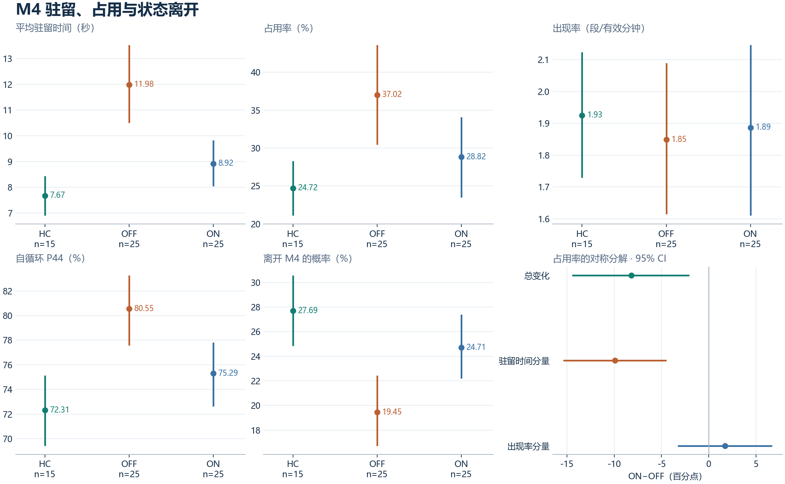
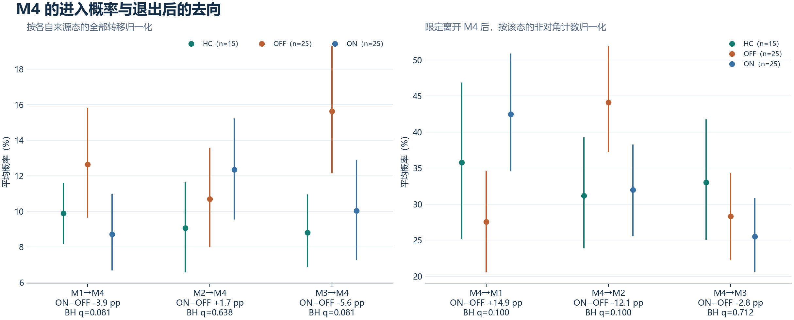

# Round 5 M4 维持、进入与退出

同一有效窗内，M4 自循环平均由 80.55% 降至 75.29%。ON−OFF 为 -5.254 [-8.762, -1.645] 个百分点，25 对中 17 对的自循环与驻留时间同时降低。自循环和总离开概率是同一个二分构成，差值及配对区间互为反数。

M4 的内部段计数满足占用率 = 持续时间 × 每秒出现率。逐人对称分解的平均结果显示，驻留缩短对应 -9.91 个占用百分点，出现率变化对应 +1.72 个百分点，两项之和与平均占用率差一致。M4 仍有相近的块内进入和退出次数。驻留缩短是占用减少的主要算术分量。离开 M4 后最高的组均去向，HC 为 M1（35.79%），OFF 为 M2（44.13%），ON 为 M1（42.50%）。进入和退出方向的构成变化保留为机制线索。

| 指标 | HC | OFF | ON | ON−OFF [95% CI] | 配对 g_z | 原 BH q | 原 Holm P |
|---|---|---|---|---|---|---|---|
| 持续时间（秒） | 7.6724 | 11.985 | 8.9157 | -3.069 [-4.753, -1.405] | -0.6887 | NA | NA |
| 占用率（%） | 24.723 | 37.016 | 28.824 | -8.192 [-14.443, -2.075] | -0.4898 | NA | NA |
| 出现率（段/有效分钟） | 1.9251 | 1.8483 | 1.8862 | +0.038 [-0.268, +0.326] | 0.046473 | NA | NA |
| M4→M4 | 72.313 | 80.547 | 75.293 | -5.254 [-8.762, -1.645] | -0.54994 | NA | NA |
| M4 总离开概率 | 27.687 | 19.453 | 24.707 | +5.254 [+1.645, +8.762] | 0.54994 | NA | NA |
| M4→M1 | 9.5212 | 5.3708 | 11.035 | +5.664 [+2.260, +9.285] | 0.60107 | 0.080837 | 0.17447 |
| M4→M2 | 8.85 | 8.5539 | 7.6337 | -0.920 [-3.494, +1.504] | -0.13731 | 0.6469 | 1 |
| M4→M3 | 9.3155 | 5.5284 | 6.039 | +0.511 [-1.773, +2.683] | 0.085997 | 0.81983 | 1 |
| 退出后去 M1 | 35.794 | 27.57 | 42.498 | +14.928 [+3.356, +26.650] | 0.47713 | 0.10038 | 0.66054 |
| 退出后去 M2 | 31.171 | 44.128 | 31.985 | -12.144 [-21.749, -3.631] | -0.49744 | 0.10038 | 0.66813 |
| 退出后去 M3 | 33.035 | 28.302 | 25.517 | -2.785 [-12.207, +6.116] | -0.11132 | 0.71245 | 1 |
| M1→M4 | 9.8768 | 12.645 | 8.7113 | -3.933 [-7.256, -0.719] | -0.44556 | 0.080837 | 0.23968 |
| M2→M4 | 9.0566 | 10.687 | 12.349 | +1.661 [-2.222, +5.402] | 0.15925 | 0.63817 | 1 |
| M3→M4 | 8.7951 | 15.636 | 10.034 | -5.602 [-9.851, -1.734] | -0.5139 | 0.080837 | 0.2734 |
| 非 M4 来源汇总进入概率 | 8.9394 | 11.738 | 9.9426 | -1.795 [-4.336, +0.585] | -0.26926 | NA | NA |
| 块内进入次数 | 12.733 | 12.36 | 12.48 | +0.120 [-2.000, +2.120] | 0.021631 | NA | NA |
| 块内退出次数 | 12.533 | 12.4 | 12.4 | +0.000 [-2.160, +2.040] | 0 | NA | NA |
| 段数 | 13.067 | 12.56 | 12.76 | +0.200 [-2.080, +2.240] | 0.035021 | NA | NA |
| 驻留时间分量（百分点） | NA | NA | NA | -9.908 [-15.396, -4.465] | -0.67728 | NA | NA |
| 出现率分量（百分点） | NA | NA | NA | +1.717 [-3.291, +6.673] | 0.12778 | NA | NA |

概率组均值为百分比，概率配对差为百分点。步长为一个 TR。P41 使用全部 M4 来源邻对，P41_exit 只以离开 M4 的邻对为分母。P14/P24/P34 各使用本来源态的全部有效邻对。家族校正直接来自 Round 4，两个分母口径各有原 36 项槽位。自循环、出现率、计数及分解使用描述性区间。

[M4 组级分解](../results/M4_Dynamics_Decomposition.csv) · [M4 配对效应](../results/M4_Dynamics_Paired_Effects.csv) · [三对比的进入与退出](../results/M4_Entry_Exit_Analysis.csv)

逐人配对表和配对轨迹图留在 Round 5 的 Git 忽略目录。
