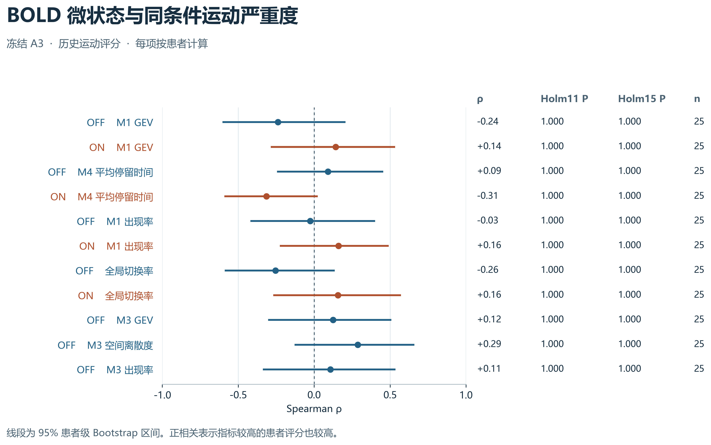

# 冻结 BOLD 微状态与同条件运动严重度

**25 名患者的 11 项同条件关联全部可估计，ON 的 4 项和 OFF 的 7 项均未通过校正。** M1 GEV 和 M4 平均停留时间在任一条件下都未得到充分关联证据。最强的点估计是 ON 的 M4 平均停留时间与 ON 评分的负相关，ρ=−0.314，95% CI [−0.591, +0.023]，置换 P=0.1270。阶段 Holm 和累计 Holm 均为 1.0000。

## 当前 A3 指标和同条件评分的结果

使用 25 人的原 V6 冻结逐扫描绝对值和 `WEiDA4-1_atlas1_group0` 历史运动总分。每项关联在一种刺激条件内比较患者之间的差异。评分较高代表档案记录的症状较重。条件内的指标、评分和平均 FD 来自对应的扫描及评分记录。所有终点均有 25 名有效患者。

| 条件 | 指标 | Spearman ρ [95% CI] | 原始 P | 置换 P | Holm11 P | BH11 q | Holm15 P | BH15 q |
|---|---|---|---:|---:|---:|---:|---:|---:|
| OFF | M1 GEV | −0.239 [−0.604, +0.206] | 0.2508 | 0.2413 | 1.0000 | 0.6635 | 1.0000 | 0.6032 |
| ON | M1 GEV | +0.141 [−0.285, +0.533] | 0.5005 | 0.4819 | 1.0000 | 0.7381 | 1.0000 | 0.6571 |
| OFF | M4 平均停留时间 | +0.091 [−0.245, +0.454] | 0.6660 | 0.6710 | 1.0000 | 0.7381 | 1.0000 | 0.7190 |
| ON | M4 平均停留时间 | −0.314 [−0.591, +0.023] | 0.1262 | 0.1270 | 1.0000 | 0.6635 | 1.0000 | 0.6032 |
| OFF | M1 出现率 | −0.026 [−0.420, +0.400] | 0.9026 | 0.9017 | 1.0000 | 0.9017 | 1.0000 | 0.9017 |
| ON | M1 出现率 | +0.160 [−0.226, +0.490] | 0.4449 | 0.4455 | 1.0000 | 0.7381 | 1.0000 | 0.6571 |
| OFF | 全局切换率 | −0.255 [−0.589, +0.135] | 0.2183 | 0.2114 | 1.0000 | 0.6635 | 1.0000 | 0.6032 |
| ON | 全局切换率 | +0.156 [−0.270, +0.571] | 0.4561 | 0.4550 | 1.0000 | 0.7381 | 1.0000 | 0.6571 |
| OFF | M3 GEV | +0.124 [−0.303, +0.508] | 0.5552 | 0.5560 | 1.0000 | 0.7381 | 1.0000 | 0.6951 |
| OFF | M3 空间离散度 | +0.287 [−0.130, +0.659] | 0.1636 | 0.1610 | 1.0000 | 0.6635 | 1.0000 | 0.6032 |
| OFF | M3 出现率 | +0.107 [−0.338, +0.536] | 0.6120 | 0.6135 | 1.0000 | 0.7381 | 1.0000 | 0.7079 |

原始 P 为双侧 Spearman 近似。每项均完成 10,000 次有效患者间评分置换和 2,000 次有效患者 Bootstrap。11 个区间均跨 0，最小阶段 BH q 为 0.6635。上一轮四项变化量关联的置换 P 从原表直接引用，累计 15 项 Holm 和 BH 均为 0 项通过。累计家族覆盖这两轮列出的检验。[完整 11 项统计](../results/Motor_Severity_Associations.csv) · [累计 15 项统计](../results/Cumulative_15_Associations.csv) · [上一轮结果](../../BOLD_Microstate_Behavior_Association/reports/BOLD_Microstate_Behavior_Association_Report.md)

## 同次扫描头动及逐人留一

| 条件 | 指标 | FD 调整 ρ | FD 置换 P | FD Holm11 P | FD BH11 q | 未调整逐人留一 ρ 范围 | 留一方向改变 |
|---|---|---:|---:|---:|---:|---|---|
| OFF | M1 GEV | −0.236 | 0.3368 | 1.0000 | 0.6880 | −0.350 至 −0.161 | 否 |
| ON | M1 GEV | +0.182 | 0.3753 | 1.0000 | 0.6880 | +0.083 至 +0.275 | 否 |
| OFF | M4 平均停留时间 | +0.087 | 0.6326 | 1.0000 | 0.7386 | +0.038 至 +0.206 | 否 |
| ON | M4 平均停留时间 | −0.308 | 0.0522 | 0.5741 | 0.5741 | −0.410 至 −0.257 | 否 |
| OFF | M1 出现率 | −0.018 | 0.9437 | 1.0000 | 0.9437 | −0.107 至 +0.060 | 是 |
| ON | M1 出现率 | +0.168 | 0.3496 | 1.0000 | 0.6880 | +0.121 至 +0.267 | 否 |
| OFF | 全局切换率 | −0.253 | 0.1934 | 1.0000 | 0.6880 | −0.356 至 −0.183 | 否 |
| ON | 全局切换率 | +0.128 | 0.5835 | 1.0000 | 0.7386 | +0.092 至 +0.307 | 否 |
| OFF | M3 GEV | +0.119 | 0.6065 | 1.0000 | 0.7386 | +0.010 至 +0.192 | 否 |
| OFF | M3 空间离散度 | +0.288 | 0.1497 | 1.0000 | 0.6880 | +0.221 至 +0.393 | 否 |
| OFF | M3 出现率 | +0.102 | 0.6714 | 1.0000 | 0.7386 | −0.002 至 +0.195 | 是 |

FD 调整对 11 项均保留 25 人，Holm11 和 BH11 均为 0 项通过。ON M4 平均停留调整后 ρ=−0.308，95% CI [−0.607, +0.028]，置换 P=0.0522，Holm11 P=0.5741。全部终点的留一相关均可估计。只有 OFF M1 和 M3 出现率的留一范围跨过 0，二者的完整样本点估计分别为 −0.026 和 +0.107。最大单人留一偏移出现在 ON 全局切换率（0.151）。[FD 调整、样本数和重抽诊断](../results/Motor_Severity_FD_Sensitivity.csv) · [完整留一结果](../results/Motor_Severity_Associations.csv)

候选依据仍以归档的影像对比为准。V6 的 M1 GEV 和 M4 平均停留在 ON−OFF 分析中均通过原家族的 FD 与 DVARS 校正。M1 出现率和全局切换率的原 DVARS Holm P 均为 0.0575。V4 的三项 M3 候选来自 OFF−HC 影像比较，M3 出现率在该指标原家族 FD 校正下有支持，V4 全标量联合家族的 FD Holm P 为 0.0940。三项 V4 候选缺少归档 DVARS 检验。[逐项影像证据](../results/Endpoint_Registry.csv) · [V6 影像结果](../../V6_DBS_ON_OFF_Microstate_Dynamics/results/ON_OFF_Feature_Summary.csv) · [V4 影像结果](../../V4_Microstate_Statistical_Significance/results/All_Scalar_Results.csv)

## 严重度、改善量和来源限制

本轮效应量描述 ON 内或 OFF 内患者之间的严重度关联。上一轮效应量描述同一患者影像 ON−OFF 差值与评分 OFF−ON 差值之间的关联。阶段和累计校正沿用各自病例和原置换 P，每项的推断单位为患者。

可按编号、扫描键与刺激条件对应 25 人，通过影像与评分同期访视核实的患者为 0 人。本轮结果适用于这一版可追溯的历史评分。既有核查发现备用版改变了 7 人的评分差，其他版本下的同条件相关尚未复算。区间包含患者抽样变异，条件于固定模板。既有模板重训中，M3 和 M4 状态的可匹配比例分别为 35.6% 和 72.5%，解读依赖冻结状态的定义。[扫描及评分核查](../../BOLD_Microstate_Behavior_Association/reports/Behavior_Data_Audit.md) · [模板稳定性](../../V4_Microstate_Statistical_Significance/reports/Microstate_Stability_Report.md)

## 既有结果复算

用既有工作簿中的旧 0.04–0.07 Hz 模板逐人指标和同版 ON 评分复算。**在旧模板的 ON 条件下，旧 M4 出现率较高的患者历史运动评分较低**（25 人，Pearson r=−0.6412，Fisher 95% CI [−0.8268, −0.3296]，原始 P=0.0005523，BH42 q=0.02320）。校正在原 42 个假设中只替换这一个复算 P，其余 41 个来自原归档。结果在 q<0.05 口径下保留，在早期 EEG 对照方案的 q<0.01 阈值下未通过。旧 M4 使用当时的条件模板，这条归入既有结果复算。[复算表](../results/Legacy_ON_M4_Recheck.csv) · [原窄频报告](../../reports/bold_microstates_v1/eeg_replacement_105/README.md)

| 历史流程 | 来源登记 |
|---|---|
| 105 旧 AAL78 四态回填及头动敏感性 | 原分析比较 ON−OFF 影像参数。[105 旧四态报告](../../reports/bold_microstates_v1/legacy_105/README.md) |
| V3 预处理和模板选项 | 原方法比较保留各分支的状态及方法差异。[V3 方法比较](../../V3_BOLD_Microstate_Method_Optimization/reports/Method_Bias_Report.md) |
| 主频段及 slow-5 幅度与相位状态 | 原分析比较微状态与 WEiDA 局部亚稳态的对应。[同频对照](../../reports/bold_microstates_v1/same_band/README.md) |

## 组会用语

> 我们把 25 名患者在同一 DBS 条件下的冻结 A3 微状态绝对值与历史运动评分关联。11 项中，开机和关机均没有通过校正的关联，调整同次扫描头动后结论一致。旧窄频模型的开机 M4 出现率与评分负相关按原口径复算一致，属于既有发现。

六项针对性检查覆盖配对错位、方向、单位、FD 缺失和家族校正。重复运行逐字节复现输出并核对冻结输入哈希。公开图给出 11 项汇总，逐人散点图留在授权工作区的私有目录。[矢量效应图](../figures/Motor_Severity_Forest.pdf) · [锁定方案](../ANALYSIS_PLAN.md) · [运行验证元数据](../results/Run_Metadata.json)
