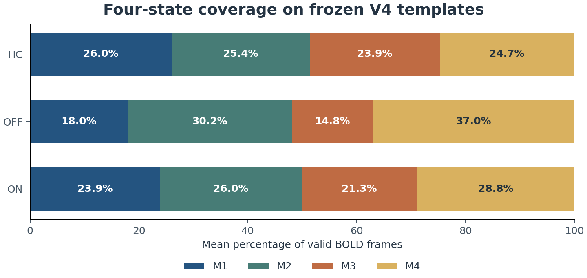

# V5 四态 Coverage

在原 A3 五折固定模板下，OFF 的四态占用分布与 HC 有差异。Energy 参与者级置换纳入六项主检验后，Holm P=0.00240，调整平均 FD 后 P=0.00480。ON–HC 对比相应为 0.31587 和 0.35816。两项与冻结 V4 的覆盖组成结论方向一致，来自同一队列和相同标签。[主检验](../results/coverage/Coverage_Energy.csv) · [V4 冻结清单](../V4_FROZEN_SIGNIFICANCE_REGISTRY.csv)

| 对比 | Energy 效应 | 95% Bootstrap 区间 | 置换 P | FD 置换 P | 六项置换 Holm P | 六项 FD Holm P |
|---|---:|---:|---:|---:|---:|---:|
| OFF–HC | 0.49545 | [0.33641, 0.95230] | 0.00040 | 0.00080 | 0.00240 | 0.00480 |
| ON–HC | 0.21066 | [0.16966, 0.57563] | 0.10529 | 0.11939 | 0.31587 | 0.35816 |

Energy 用 Aitchison 距离比较占用向量的整体分布。四个比例同时解释，其总和固定为 1。非负距离统计量的百分位区间描述效应尺度，检验依据置换参照分布。组中心 Wald 在 OFF–HC 的辅助家族 Holm P=0.00060，FD Holm P=0.00160。两项组内离散程度检验的 Holm P 均为 0.08139，调整 FD 后分别为 0.07179 和 0.09509。OFF–HC 比较检出了中心偏移，离散程度的贡献仍有不确定性。[中心与离散](../results/coverage/Coverage_Center_and_Dispersion.csv)

OFF–HC 整体通过后，M3 的占用率低 **9.06 个百分点**（95% CI −14.00 至 −4.34），M4 高 **12.29 个百分点**（4.78 至 19.99）。两项置换家族 Holm P 分别为 0.00880 和 0.03500。FD 调整后 M3 继续通过家族 Holm（0.04000），M4 只通过家族 BH（Holm P=0.08539）。ON–HC 的整体定位门槛未开启。逐态表保留全部八行和门槛标记。[逐态结果](../results/coverage/Coverage_Localization.csv)

[V4 与 V5 对照图](../figures/V4_V5_Comparison.png)
