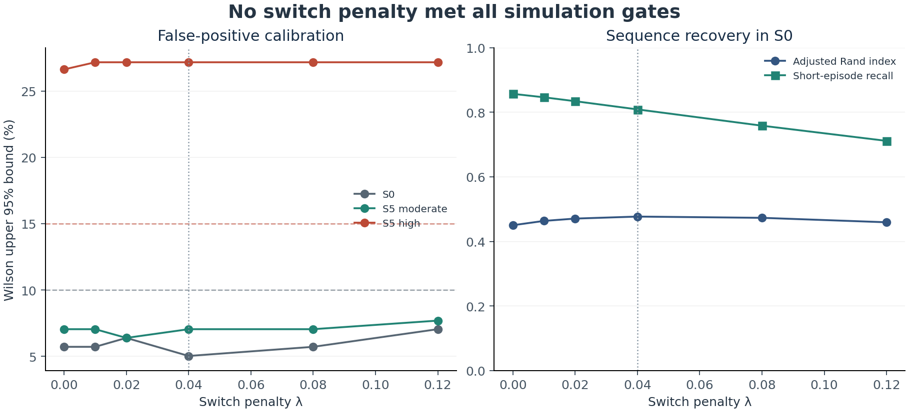

# V5 A3 时间分段噪声校准

六个 λ 候选各完成 1,200 个合成队列。**全部未通过高噪声 S5 的 Wilson 上界 ≤15% 门槛，因此没有采用备用参数。** 真实数据继续读取冻结 A3（λ=0.04）的原始标签。V5 的 λ=0.04 在高噪声情景中有 42/200 个队列至少一项核心检验误报（21.0%，Wilson 上界 27.16%）。V4 的原模拟为 21/200、上界 15.52%。V5 使用五折冻结模板回填和本轮观测模型，两次模拟的误报率不能直接作算法改进对照。[参数选择](../results/simulation/Penalty_Selection_Table.csv) · [冻结 V4](../V4_FROZEN_REFERENCE.json)

| λ | S0 误报 | S5 中噪声误报 | S5 高噪声误报 | 高噪声 Wilson 上界 |
|---:|---:|---:|---:|---:|
| 0 | 5/200 | 7/200 | 41/200 | 26.63% |
| 0.01 | 5/200 | 7/200 | 42/200 | 27.16% |
| 0.02 | 6/200 | 6/200 | 42/200 | 27.16% |
| 0.04 | 4/200 | 7/200 | 42/200 | 27.16% |
| 0.08 | 5/200 | 7/200 | 42/200 | 27.16% |
| 0.12 | 7/200 | 8/200 | 42/200 | 27.16% |

S0 无组别差异，S1 改变目标占用，S2 改变停留分布，S3 只在真值生成时扭转一张空间图。S5 的真值分布相同，改变观测噪声和 FD。代码逐点验证同种子 S0 与 S5 的真实标签和无噪声信号相同。每情景 200 个不同种子的 40 人、65 扫描队列，六个 λ 在共同合成输入上比较。目标函数将帧内 GFP² 按扫描均值缩放，再对每次状态切换减去 λ。λ 与缩放后的拟合分数处在同一尺度。[模拟代码](../scripts/noise_calibration.py) · [逐合成队列输出](../results/simulation/Formal_Synthetic_Cohorts.csv)

模拟使用 210 帧时钟、实际标签窗口的抽样、AAL78 空间协方差、经验 FD 分位和带通噪声。校准达到指定四主轴残余方差目标，基线空间协方差非对角相关为 0.944。经验 GFP 的四分位数为 0.787/0.947/1.102，基线模拟为 0.866/0.963/1.076。经验滞后 1 相关中位数为 0.783，模拟为 0.852。该差异限制模拟外推。正式模拟以 V4 同口径的六项核心 Holm 规则检查误报，组合检验用原规则的 399 次 wild 重抽。真实 V5 检验独立使用 10,000 次参与者置换。S5 误报数字描述合成数据的核心校准结果。[观测参数匹配](../results/simulation/Simulation_Matching.json) · [情景指标](../results/simulation/Calibration_by_Scenario.csv)

λ=0.04 在 S1 的 M1 占用效应恢复中，真值 9.64 个百分点、回填 7.30 个百分点，84.5% 队列方向正确且靶指标原始 P<0.05。在 S2，M1 停留真值 +6.40 秒，回填 +3.95 秒，同向检出率 85.5%。由 S2 引起的 M2→M1 概率变化真值 −2.36 个百分点，回填 −1.67 个百分点，同向检出率仅 26.5%。提高 λ 对停留和局部转换的影响不同，λ=0.08 和 0.12 的 S0 短段召回降幅还超过了 5 个百分点。全序列 ARI、GEV、估计偏差和 RMSE 均在表内。[种植效应恢复](../results/simulation/Planted_Effect_Recovery.csv) · [全部质量门槛](../results/simulation/Penalty_Selection_Table.csv)

