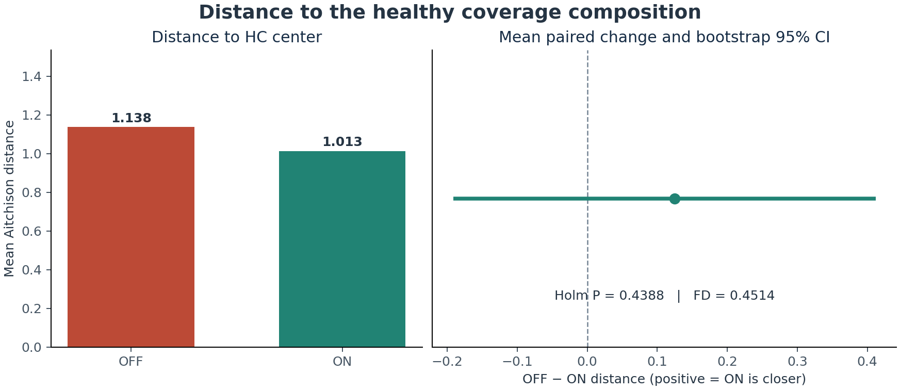

# V5 到健康 Coverage 参考中心的距离

25 对患者的 ON 平均距离为 1.013，OFF 为 1.138。距离平均缩短 **0.124** Aitchison 单位，嵌套 95% CI 为 **−0.191 至 0.412**。方向符合事先定义的靠近假设，样本估计仍允许距离增加。中位数缩短 0.407，95% CI −0.222 至 0.588。[完整结果](../results/restoration/Restoration_Results.csv)

| 推断 | P | 六项 Holm P |
|---|---:|---:|
| 单侧配对 t | 0.21603 | 0.43206 |
| 单侧配对符号翻转 | 0.21938 | 0.43876 |
| 单侧 FD 敏感性 | 0.22568 | 0.45135 |

四态占用转为 ILR 后，以 15 名 HC 的均值作为参考中心。所有患者共用该中心。符号翻转使用 OFF−ON 距离差。2,000 次嵌套自助同时重抽健康参与者和完整的患者配对，每次重新估计 HC 中心。双侧置换敏感性 P=0.43136。用冻结点估计得到配对 dz=0.160，用于功效敏感性分析。[Bootstrap](../results/bootstrap/Fixed_Template_Bootstrap_Audit.csv) · [功效](../results/power/Sample_Size_Planning.csv)

配对结果未检出可靠的健康趋近。公开结果也保留了独立的 ON–HC 整体检验。两类分析均未建立等效性。已核对的 24 对原始扫描全部先 ON 后 OFF，刺激状态与先后顺序在这部分资料中重合。[扫描顺序核查](../results/covariates/Scan_Order_and_Intervals.json)

