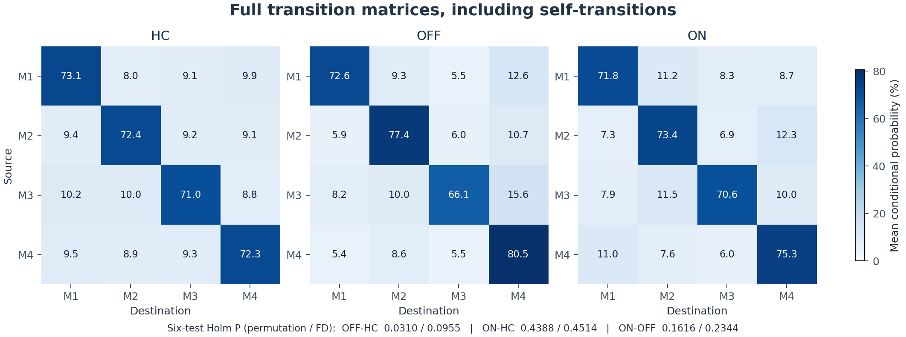
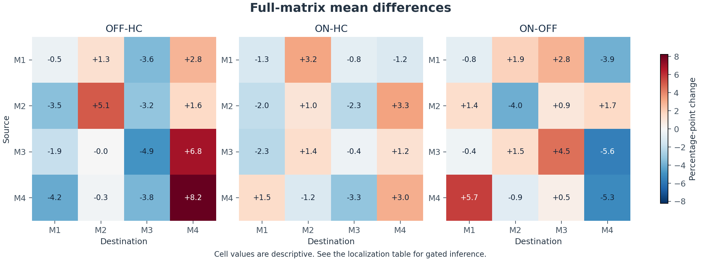

# V5 完整微状态转换矩阵

OFF–HC 的 12 维完整转移结构在未调头动的六项主家族中通过 Holm（P=0.03100），调整 FD 后 P=0.09549。只看三项转移整体家族，相应为 0.01860 和 0.05729。ON–HC 和 ON–OFF 在两个家族和两类模型中均未通过 Holm。[整体统计](../results/transition/Transition_Omnibus.csv)

| 对比 | ILR 效应长度 [95% CI] | 置换 P | 三项置换 Holm | 三项 FD Holm | 六项置换 Holm | 六项 FD Holm |
|---|---|---:|---:|---:|---:|---:|
| OFF–HC | 1.0863 [0.8626, 1.6282] | 0.00620 | 0.01860 | 0.05729 | 0.03100 | 0.09549 |
| ON–HC | 0.8071 [0.6054, 1.4777] | 0.32417 | 0.32417 | 0.37546 | 0.43876 | 0.45135 |
| ON–OFF | 0.9176 [0.7377, 1.4028] | 0.04040 | 0.08079 | 0.11719 | 0.16158 | 0.23438 |

按扫描计数 16 条相邻转换，包含四条自循环。无效帧两侧的标签没有连接。各扫描保存原始条数、源状态分母和经验条件概率。65 次扫描的四个源状态均可估计。每个目的状态加 0.5 后对各行做 Helmert ILR。整体统计固定为各向同性迹收缩 Wald（0.10）。独立组重排参与者，配对则对患者差向量翻号。FD 模型使用缩减模型残差置换。ILR 效应为两组质心距离或配对均值变化长度，区间是固定模板的描述性百分位区间。[完整矩阵和分母](../results/transition/Transition_Matrices.csv) · [ILR 各坐标区间](../results/bootstrap/ILR_Coordinate_Intervals.csv)

OFF–HC 未调整整体通过后，12 条候选路径中没有一条在 36 项路径家族中通过 Holm 或 BH。其他对比与 FD 调整的定位门槛均未开启。逐路径效应、区间和可复核的计算列仍在表中。[三组 36 条路径](../results/transition/Transition_Localization.csv)

