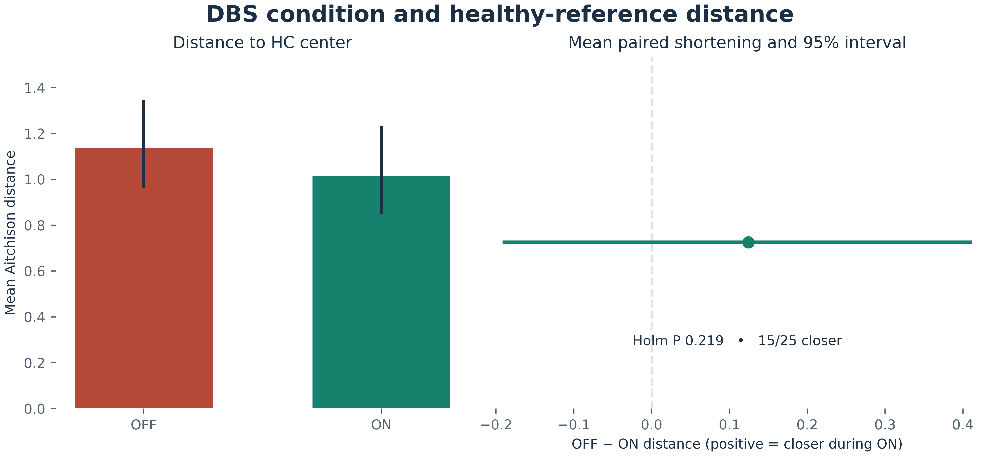

# V6 健康参考距离

冻结四态覆盖量转换到同一 Helmert ILR 空间后，以 15 名 HC 的均值定义参考中心。25 名患者的 OFF 平均 Aitchison 距离为 1.138，ON 为 1.013。均值缩短 **0.124**，嵌套 95% CI **−0.191 至 0.412**。中位缩短 0.407（−0.222 至 0.588），dz=0.160（−0.206 至 0.741）。15 人距离变小、10 人增大。[距离统计](../results/Restoration_Results.csv)

| 健康参考分析 | 置换 P | V6 健康参考两项 Holm P | V6 FD Holm P | V5 六项置换 Holm P |
|---|---:|---:|---:|---:|
| 配对距离缩短（单侧） | 0.21938 | 0.21938 | 0.23878 | 0.43876 |
| ON–HC Coverage Energy（V5 冻结） | 0.10529 | 0.21058 | 0.23878 | 0.31587 |

配对正向距离改善的单侧 t 检验 P=0.21603，双侧符号翻转敏感性 P=0.43136。每轮同时重抽 15 名 HC 和 25 对患者并重新估计中心，共 2,000/2,000 次有效。ON 和 OFF 两次测量属于同一抽样单位。[健康参考家族](../results/Health_Reference_Results.csv) · [重抽审计](../results/Paired_Bootstrap_Audit.csv)

健康中心趋近假设未得到统计支持。V5 的 ON–HC 比较也未检出整体占用分布差异。本队列缺乏有外部依据的最小等效界值，TOST 未执行。ON 与 HC 的等效性未建立。配对 Coverage 组成变化另有 3 维 ILR 整体检验，它评估 ON 和 OFF 是否发生变化。[配对组成差异](../results/ON_OFF_Omnibus_Results.csv) · [等效性检验](https://doi.org/10.1177/1948550617697177)

