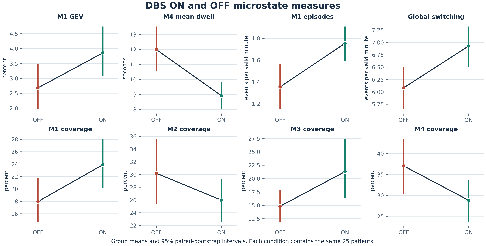

# V6 DBS ON–OFF 微状态结果

在 25 名患者的固定 A3 标签中，两项预定主要终点都显示配对变化。ON 的 **M1 GEV 增加 1.17 个百分点**，**M4 平均停留时间缩短 3.07 秒**。两者在调整平均 FD、调整标准化 DVARS、仅分析 24 对有扫描顺序记录的敏感性下，均通过两项主要终点的 Holm 校正。[完整配对统计](../results/ON_OFF_Feature_Summary.csv)

| 终点 | OFF 均值 | ON 均值 | 平均 ON−OFF [95% CI] | 中位差 | dz | 原始 P | 置换 P | 置换 Holm P | FD Holm P | DVARS Holm P |
|---|---:|---:|---|---:|---:|---:|---:|---:|---:|---:|
| M1 GEV | 2.681% | 3.855% | +1.17 pp [0.69, 1.66] | +1.00 pp | +0.934 | 0.00010 | 0.00030 | **0.00060** | **0.00080** | **0.00100** |
| M4 平均停留 | 11.98 s | 8.92 s | −3.07 s [−4.75, −1.43] | −3.12 s | −0.711 | 0.00160 | 0.00190 | **0.00190** | **0.00170** | **0.00230** |

M1 GEV 是 M1 对本扫描全局解释方差的贡献，受该态占用、幅度和模板拟合影响。21 人升高、4 人降低，dz 的 95% CI 为 0.513 至 1.605。M1 GEV 与 M1 空间离散改变量的 Spearman ρ=−0.328（95% CI −0.688 至 0.064，置换 P=0.1117，FD P=0.1554）。两个指标共享模板拟合信息，估计区间仍容许弱或无关联。M4 平均停留在 19 人中缩短，6 人延长，dz 的 95% CI 为 −1.216 至 −0.345。两项每次留一对时均保持原效应方向。[离群影响](../results/Leave_One_Out_Influence_Summary.csv) · [GEV 与离散](../results/M1_GEV_Dispersion_Association.csv)

| M4 停留定义 | 平均配对差 [95% CI]（秒） | 置换 BH | 置换 Holm | FD Holm |
|---|---|---:|---:|---:|
| 完整窗口逐人中位数 | −1.43 [−3.11, 0.08] | 0.14665 | 0.67583 | 0.34537 |
| 完整窗口逐人 P75 | −3.51 [−6.09, −1.30] | 0.03545 | 0.14249 | 0.16198 |
| 排除边界后的逐人中位数 | −1.60 [−3.19, −0.25] | 0.08138 | 0.38296 | 0.30517 |
| 排除边界后的逐人 P75 | −3.70 [−6.22, −1.43] | 0.03545 | 0.10719 | 0.13759 |
| 排除边界后的逐人均值 | **−3.28 [−4.85, −1.77]** | **0.01020** | **0.01020** | **0.01360** |

逐人的均值、中位数和 P75 分别反映各人状态段时间分布的不同性质。完整窗口的均值保留在主要家族。其他五个 M4 口径和全部其他时长口径采用预定的 17 项探索性家族。

| 次要终点 | 平均 ON−OFF [95% CI] | 置换 Holm P | FD Holm P | DVARS Holm P |
|---|---|---:|---:|---:|
| M1 出现率 | +0.40 次/分钟 [0.15, 0.64] | 0.02500 | 0.01800 | 0.05749 |
| 全局切换率 | +0.84 次/分钟 [0.26, 1.40] | 0.03040 | 0.00660 | 0.05749 |
| M1 占用率 | +5.93 pp [2.43, 9.30] | 0.01980 | 0.06239 | 0.03780 |
| M2 占用率 | −4.21 pp [−9.74, 1.00] | 0.14519 | 0.15238 | 0.16228 |
| M3 占用率 | +6.47 pp [1.51, 12.15] | 0.05499 | 0.15238 | 0.06239 |
| M4 占用率 | −8.19 pp [−14.31, −2.02] | 0.05369 | 0.15238 | 0.05749 |

M3 模板离散度下降在未调整置换中只有名义支持，FD 之后通过四态 Holm（0.03960），DVARS Holm 为 0.12919。整体 Coverage ILR 差向量通过探索性 Holm（置换 P=0.00180，FD P=0.00680）。单态和整体结果采用各自的预定家族。各列原始 P、BH、Holm 与 A–D 分类均已导出。[全部 41 个标量](../results/ON_OFF_Feature_Summary.csv) · [两项整体检验](../results/ON_OFF_Omnibus_Results.csv)

固定模板重抽中，41 个标量、两项整体及健康距离均为 2,000/2,000 次有效。主要两项的全部重抽均值与原方向一致。重抽区间条件于冻结空间模板和分类规则。V4 的原报告和联合校正记录保留在对应提交。[Bootstrap 汇总](../results/Paired_Bootstrap_Audit.csv) · [V4 配对历史](../results/V4_Frozen_ON_OFF_Results.csv) · [V5 配对历史](../results/V5_Frozen_Paired_Results.csv)

