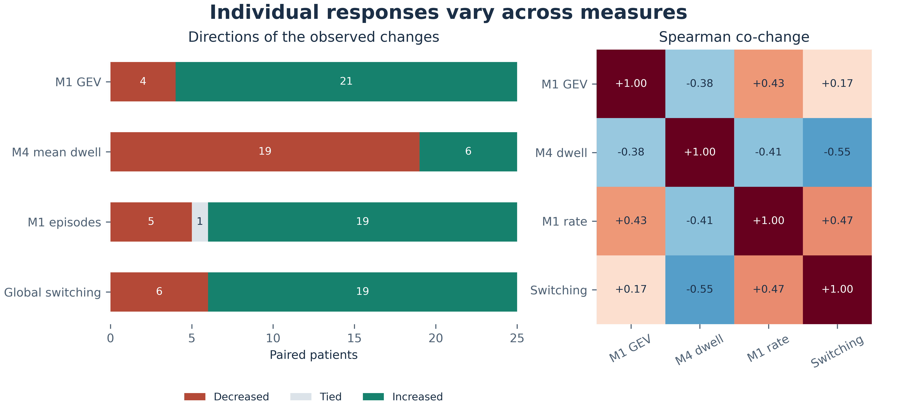

# V6 患者配对变化异质性

个体从 OFF 到 ON 的变化方向仍有差异。主要终点中，M1 GEV 在 21/25 人升高，M4 平均停留在 19/25 人缩短。下表以 ON−OFF 定义方向。所有 25 个真实配对用于分析。微状态特征没有独立验证的临床最小变化阈值，本报告呈现方向和变化幅度。[逐项方向、Wilson 比例区间和中位数区间](../results/Paired_Change_Directions.csv)

| 终点 | 上升 | 下降 | 不变 | 组中位差 |
|---|---:|---:|---:|---:|
| M1 GEV | 21 | 4 | 0 | +1.00 pp |
| M4 平均停留 | 6 | 19 | 0 | −3.12 秒 |
| M1 出现率 | 19 | 5 | 1 | +0.41 次/分钟 |
| 全局切换率 | 19 | 6 | 0 | +1.03 次/分钟 |
| M1 占用率 | 17 | 8 | 0 | +7.13 pp |
| M2 占用率 | 11 | 14 | 0 | −1.49 pp |
| M3 占用率 | 16 | 9 | 0 | +3.65 pp |
| M4 占用率 | 8 | 17 | 0 | −8.31 pp |

分别留出每位患者后，M1 GEV 的配对均值差为 +1.08 至 +1.29 个百分点，M4 平均停留为 −3.41 至 −2.78 秒。按预定 20% 修剪后相应为 +1.23 个百分点和 −2.89 秒。主结果的方向由多位患者支持。[留一和修剪均值](../results/Leave_One_Out_Influence_Summary.csv)

四个预定变化量按各自变化 SD 缩放。与其余患者平均变化向量比较，21/25 人向量内积为正，4/25 为负。夹角余弦中位数 0.724，四分位 0.311–0.905。固定两类 Ward 得到大小为 9 和 16 的两组，silhouette 为 0.357。500 次 20 人内部子抽样的 ARI 中位数为 1.00。相似方向和内部重抽表现仅描述这 25 人及所选距离，临床分型仍需有独立的临床依据和外部样本。[模式审计](../results/Paired_Response_Patterns.json)

