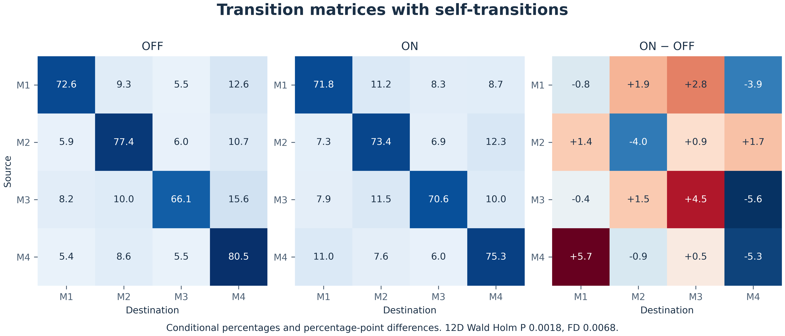

# V6 ON–OFF 整体转换动力学

V6 的 12 维非对角转移概率存在配对整体变化。患者级符号翻转 P=0.00180，探索性整体家族 Holm P=0.00180，FDR P=0.00180。调整平均 FD 后 Holm P=0.00680，调整标准化 DVARS 后为 0.00220。25 对均覆盖源状态四行。两组的完整 4×4 矩阵都含自循环。[整体结果](../results/ON_OFF_Omnibus_Results.csv) · [矩阵、分母和效应](../results/Transition_Matrices.csv)

整体 Wald 固定采用 0.10 各向同性迹收缩，按患者翻转 12 个概率差的符号。参与者矩阵以源状态所有相邻有效转换为分母，因此四条自循环保留在各行概率定义中。未跨越无效帧。整体均值向量的欧氏长度为 0.0999（固定模板自助 95% 区间 0.0772–0.1520）。其分量有方向，长度和区间描述联合变化幅度。整体判别以置换参照分布为准。[坐标效应](../results/Omnibus_Coordinate_Effects.csv)

整体门槛通过后，全部 12 条路径进入校正。M4→M1 的条件转移概率平均上升 5.66 个百分点（95% CI 2.35–9.28）。在置换分支通过 Holm 与 BH（均 0.04440）。常规检验的 Holm P=0.05816，FD 调整的置换 Holm P=0.05999，DVARS 调整为 0.06119。具体路径的定位结果有模型敏感性。其他 11 条路径未通过未调整置换 Holm。[12 条路径](../results/Transition_Path_Results.csv)

V5 将完整矩阵的每行做 Jeffreys 平滑和 ILR 后检验，ON–OFF 原始置换 P=0.04040，六项 Holm P=0.16158。V6 在原始概率尺度检验预先指定的配对变化，并在两项探索性整体家族校正。两个版本使用同一批患者，同一标签，统计空间与校正家族不同。[V5 历史配对结果](../results/V5_Frozen_Paired_Results.csv)

