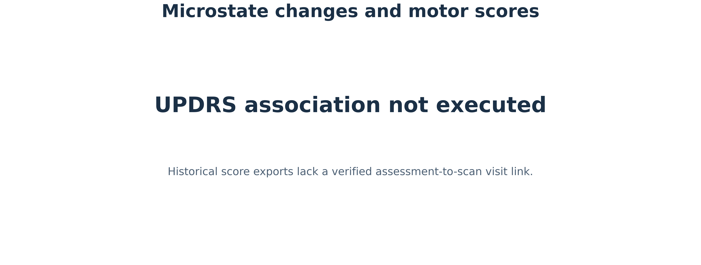

# V6 UPDRS 临床关联

**状态为 BLOCKED，未计算相关系数。** 当前可复核的历史研究导出有三个版本，每版有 50 条按患者和 DBS 开关分配的 UPDRS3 条目。导出表缺少评估日期、访视连接键和用药时钟，部分历史版本的分值亦不同。已有扫描工作簿能确认 24 对的扫描日期与时刻，评分日期仍空缺。无法核实每侧评分实际对应本次 BOLD 访视，所以本轮符合访视核查要求的是 0 对。[临床来源审计](../results/UPDRS_Input_Audit.json) · [扫描时钟](../results/Scan_Order_Audit.json)

待具备可复核的评分与扫描访视连接后，分析方向规定为 UPDRS-III OFF−ON，分别与 ON−OFF 的 M1 GEV、M4 平均停留、M1 出现率和全局切换率作 Spearman。预定报告 95% 成对 Bootstrap 区间、原始 P、BH、Holm、FD 敏感性及逐对留一影响。四个条目现在均保留 BLOCKED 记录。[关联表](../results/UPDRS_Association_Results.csv)

