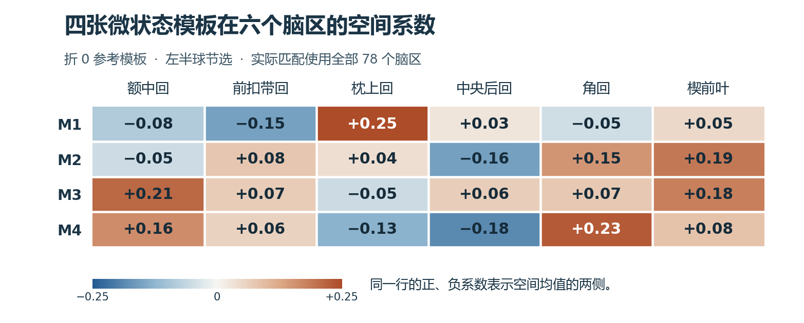

# BOLD 微状态研究进展与计算方法

**更新日期：2026 年 11 月 26 日。** 本报告汇总已归档的 15 名 HC 与 25 名 ON/OFF 配对患者的 BOLD 微状态分析，按研究问题与计算流程组织。方法和数值对应文末的固定提交；这不是一次新运行的实验。

**阅读说明：** 在 GitHub 文件页面的预览视图阅读。公式使用 GitHub 支持的数学块和行内数学格式，每个关键公式后附中文含义。

## 研究对象与数据

- **研究目标**
  - 使用静息态 BOLD-fMRI 时间序列构建四种微状态（M1–M4）。
  - 比较 PD 患者 DBS-OFF、DBS-ON 与健康对照（HC）的微状态时空特征。
  - 当前重点转向同一患者 DBS-ON 与 DBS-OFF 的配对变化，进一步评估这些变化是否与健康参考状态接近。

- **队列**
  - HC：15 名。
  - PD：25 名，每名患者有 ON、OFF 两次扫描。
  - 共 40 名独立参与者、65 次扫描。
  - 患者 ON/OFF 比较以 25 名患者配对为统计单位；不能把 50 次扫描当成 50 名独立参与者。

- **BOLD 数据**
  - 图谱：AAL78，提取 78 个 ROI 的 BOLD 时间序列。
  - TR：2.1 s。
  - 上游时间滤波：0.01–0.08 Hz。
  - 每次扫描的原始时钟约 210 TR；实际进入共同有效分析窗的帧数因扫描而略有不同。
  - 冻结分析的共同有效窗总计 12,574 帧。
  - 当前主要分析沿用冻结的 ROI 时序、五折模板及原始标签。
  - 这里的“微状态”指 BOLD 空间模式的离散状态与秒级持续过程；TR 为 2.1 秒，不能由此推断 EEG 的毫秒级微状态。

依据：[冻结流程][workflow]、[锁定统计配置][protocol]。

## BOLD 微状态是怎样计算的

每隔 2.1 秒，扫描记录一次 78 个脑区的 BOLD 信号。把同一时刻的 78 个值排在一起，就能看到哪些脑区相对偏高、哪些相对偏低。本研究用四张模板概括反复出现的空间格局，记为 M1–M4。一张模板描述一种格局，一串连续的标签才告诉我们这种格局出现了几次、每次停留多久。

### 一帧 BOLD 怎样变成一张空间图？

一次扫描可以读成一张表。每列是一个脑区，每行是一个采样时刻，每个格子来自该脑区内体素的平均 BOLD 信号。冻结方案 F1 沿用上游 0.01–0.08 Hz 的 ROI 时序，对每个连续有效段去线性趋势、去均值。[输入与滤波核查](https://github.com/vanor-lavigine/WEiDA-DBS-Reproduction/blob/17d3d1261b223da37280238e615c3176adaef684/V3_BOLD_Microstate_Method_Optimization/reports/input_and_filter_audit.md)

1. **沿一列看，这个脑区此刻比它平时高多少？** 对每个脑区，用该次扫描的时间均值和标准差做标准化。例如，标准化后的 +1 表示比这个脑区在该次扫描中的平均水平高一个标准差。
2. **沿一行看，同一时刻哪些脑区相对高、哪些相对低？** 从这 78 个标准化值中减去该帧的空间均值，得到 78 个偏差。偏差的均方根叫**空间幅度**，表示脑区间的差距有多大。把这组偏差按同一比例缩放到单位长度，就得到用来和模板比较的**空间形状**。[标准化与空间幅度实现][prepare]

举一个只含三个脑区的示意。去空间均值后的 `[1, 0, −1]` 和 `[2, 0, −2]` 形状完全相同，后一帧的空间幅度是前一帧的两倍。若换成 `[−1, 0, 1]`，整张图的正负翻转，本研究仍把它看作同一种空间格局。这个约定叫**极性不敏感**。

### 四张模板从哪些人、哪些帧学出来？

40 名参与者按人分成五折。以其中一折为例，用 12 名健康对照和 20 名患者的扫描学模板，再用这些模板给另外 3 名健康对照和 5 名患者标注状态。轮换五次，每个人都由其他人学出的模板标注。同一患者的 ON 和 OFF 始终在同一折，两次扫描共用同一套模板。

训练时，先找空间幅度的局部峰值。某帧的幅度严格高于紧邻的前、后两帧，且三帧都有效，就取出这一帧的空间形状。这些峰标记脑区间对比在局部较鲜明的时刻。每名参与者在训练中的总权重相同。健康对照的一次扫描占 1，患者 ON 和 OFF 各占 0.5，每次扫描的权重再均分给自己的峰。

四张模板由训练折的峰图共同决定。先抽取四张峰图作为起点，把每张峰图归给形状最相似的模板，再用各类的峰图更新四张模板。反复进行这两步，就得到四种有代表性的空间格局。这种算法叫改进 K 均值聚类（G1），类别数预先固定为四。因为不同折可能给相似的图编上不同号码，最后按与第 0 折模板的空间相关绝对值做一对一匹配（Hungarian），统一 M1–M4 的编号。[模板学习与跨折匹配实现][models]



**如何读图。** 横读 M4 这一行，左角回为 +0.23，左中央后回为 −0.18。竖着看同一列，左枕上回在 M1 为 +0.25，在 M4 为 −0.13。识别状态靠的是全部 78 区的系数组合，整张模板同时变号仍代表同一状态。图中数值描述模板的形状，患者与健康对照的差异要从每人的扫描指标里估计。[完整 78 区参考模板](https://github.com/vanor-lavigine/WEiDA-DBS-Reproduction/blob/17d3d1261b223da37280238e615c3176adaef684/V4_Microstate_Statistical_Significance/results/Reference_Templates.csv)

### 一帧稍微更像 M4，就要切到 M4 吗？

给留出的扫描标状态时，先确定可分析的时间段。两种已有的峰值回填方法各自去掉边界不完整的片段，取都保留的时间段作为共同窗口。65 次扫描的 13,647 个输入有效帧中，12,574 帧进入这个窗口。**窗口内每一帧都参与，包括峰与峰之间的帧**。将每帧与四张模板分别算一次跨 78 区的 Pearson 相关，取绝对值，得到四个 0 到 1 的分数。1 表示两张图的形状完全一致或完全反向。遇到时间缺口就另起一段。[输入帧核查](https://github.com/vanor-lavigine/WEiDA-DBS-Reproduction/blob/17d3d1261b223da37280238e615c3176adaef684/V3_BOLD_Microstate_Method_Optimization/reports/input_and_filter_audit.md) · [共同窗口核查][hc-results]

算法在每个连续块中为**整段序列**选标签。把一帧分给相似度低的模板会增加拟合代价，空间幅度越大的帧权重越高。每切换一次状态，再加 0.04 的代价。动态规划选总代价最低的路径。这样，微弱的一帧波动可以留在原状态，证据足够强的一帧也可以单独成段。[共同窗口与分段入口][inputs] · [动态规划实现][models]

### 八帧怎样变成一次扫描的指标？

下面用真实的第 0 折模板构造**八帧教学示例**。帧是人为构造的，设为一个连续分析块，各帧的幅度权重都为 1。两行分别列出只看当前帧时最相似的模板，以及正式分段算法给出的标签。

| 采样时刻（每格 2.1 秒） | 1 | 2 | 3 | 4 | 5 | 6 | 7 | 8 |
|---|---|---|---|---|---|---|---|---|
| 逐帧最像的模板 | M1 | **M4** | M1 | M4 | M4 | M4 | M4 | M1 |
| 整段计算后的标签 | M1 | **M1** | M1 | M4 | M4 | M4 | M4 | M1 |

第 2 帧与 M4 的相似度是 0.860，与 M1 是 0.847。把它单独改标为 M4，拟合代价只减少约 0.022，却要为进入和离开 M4 共付出 0.080，所以最终保留 M1。第 4 至第 7 帧则连续标为 M4。

从最后一行可以直接读出三个结果。

- **一共占多久？** M1 和 M4 各占 4/8 帧，占用率都是 **50%**。
- **每次停多久？** M1 分两段出现，长度为 3 帧和 1 帧，平均停留 **4.2 秒**。M4 连续出现 4 帧，只有一段，平均停留 **8.4 秒**。
- **下一帧去哪？** 四个有后继的 M4 帧中，三个后面仍是 M4，一个后面是 M1，所以 M4→M1 的转移概率为 **1/4**。

还有一类问题需要用到每帧与模板的相似度。例如 M1 虽然占一半时间，第 2 帧与它只部分吻合。把各帧的拟合程度计入后，本例 M1 对整段的解释贡献（GEV）是 **46.47%**。下一节给出 GEV 及状态内空间离散度的完整计算。

**回到帕金森病。** 在真实队列里，先算每个人的 M4 平均段长，再比较参与者。25 名关闭 DBS 的患者（OFF）组均值为 **11.98 秒**，15 名健康对照（HC）为 **7.67 秒**，相差 **4.31 秒**。在本队列和这套模板下，患者关刺激时一旦进入 M4，这种空间格局平均一次维持得更久。[组均值与段长结果](https://github.com/vanor-lavigine/WEiDA-DBS-Reproduction/blob/17d3d1261b223da37280238e615c3176adaef684/V4_Microstate_Statistical_Significance/results/Duration_Results.csv) · [OFF–HC 统计检验][hc-results]

<details>
<summary>复核计算所需的公式、窗口规则与示例构造</summary>

**标准化。** 令 $`x_{ti}`$ 为 F1 处理后的第 $`t`$ 帧、第 $`i`$ 个脑区的值。N0 用 78 区均为有限值的帧估计每列的时间均值 $`\mu_i`$ 和样本标准差 $`s_i`$（分母为有效帧数减一）。先标准化，再对每帧作空间去均值。

```math
z_{ti}=(x_{ti}-\mu_i)/s_i,\qquad
u_{ti}=z_{ti}-\frac{1}{78}\sum_{j=1}^{78}z_{tj}.
```

用 $`A_t`$ 记空间幅度（BOLD 的 GFP 类比量），用 $`\mathbf q_t`$ 记用于匹配的单位向量。空间范数为零的帧在这一步排除。

```math
A_t=\frac{\|\mathbf u_t\|_2}{\sqrt{78}},\qquad
\mathbf q_t=\frac{\mathbf u_t}{\|\mathbf u_t\|_2}.
```

**模板学习。** 对每个训练峰 $`p`$，以该扫描权重除以该扫描峰数得到 $`w_p`$。下式选取四条单位空间轴，使每个峰与其最佳模板的加权平方相关总和最大。

```math
\max_{\|\mathbf m_k\|_2=1}
\sum_p w_p \max_{k=1,\ldots,4}(\mathbf q_p^{\mathsf T}\mathbf m_k)^2.
```

每次更新取该类峰图加权二阶矩的第一特征向量。实现从 50 个固定随机初值出发，选取收敛候选中训练目标最高的一组。峰在模板学习中按上述权重计入，幅度平方权重用于后续分段与 GEV。

**标记整段时间。** 共同窗由 G0、G1 两种峰回填方法在同一扫描都有标签的帧构成。两种方法分别在连续有效块内去掉两端不完整的峰回填片段，再取交集。G1 提供分段用的四个相似度 $`s_{tk}=|\mathbf q_t^{\mathsf T}\mathbf m_k|`$。用该扫描全部有效、空间范数非零帧的幅度平方均值 $`\overline{A^2}`$ 做归一化，得到单帧拟合代价。

```math
c_t(k)=\frac{A_t^2}{\overline{A^2}}\left(1-s_{tk}^2\right).
```

对共同窗的每个连续块，令 $`D_t(k)`$ 表示到该块第 $`t`$ 帧为止、末帧标为 $`k`$ 的最低总代价。首帧取 $`D_1(k)=c_1(k)`$，以后各帧比较两种代价。一种来自上一帧就处于同一状态的路径，另一种来自其他状态的路径，加上一次切换的 0.04。

```math
D_t(k)=c_t(k)+\min\left\{D_{t-1}(k),\ \min_{j\ne k}[D_{t-1}(j)+0.04]\right\}.
```

从代价最低的末帧标签回溯即得到该块标签。冻结方案 A3 组合 G1 模板与这一分段规则（S1）。0.04 来自既定的校准回退规则，候选参数均未通过高噪声模拟门槛。[参数与模拟结果][optimization]

**复算八帧示例。** 使用公开参考模板表中的原始方向。第 1、3、8 帧取 M1 单位向量，第 4–7 帧取 M4，第 2 帧取 $`0.49\mathbf m_1-0.51\mathbf m_4`$ 后缩放至单位长度，四个绝对相关依次为 0.8471、0.2726、0.2314、0.8598。该帧改标的拟合收益为 $`0.8598^2-0.8471^2\approx0.022`$。示例直接从空间形状和幅度权重演示分段。[分段与指标实现][inputs]

</details>

---

## 微状态指标如何从 BOLD 标签计算

设一份扫描在共同分析窗口 $`\mathcal W`$ 中共有 $`N=|\mathcal W|`$ 个有效且已分类的 TR，TR 长度为 $`\Delta t=2.1`$ 秒。设第 $`k`$ 个状态的连续片段数为 $`N_k`$，所有连续片段集合记为 $`\mathcal R_k`$。

### 1. Coverage / Fractional Occupancy

第 $`k`$ 个微状态占据的有效帧数除以总有效帧数：

```math
C_k=
\frac{\sum_{t\in\mathcal W}\mathbb I(\ell_t=k)}
{N}.
```

四个状态的 Coverage 满足：

```math
\sum_{k=1}^{4}C_k=1.
```

解释：某一微状态在整段扫描中占据的时间比例。Coverage 是组成数据，四个状态并非相互独立。

### 2. Mean Duration / Dwell Time

先把连续相同标签定义为一个状态片段。若第 $`j`$ 个片段长度为 $`L_{kj}`$ 帧，则持续时间为：

```math
d_{kj}=L_{kj}\times\Delta t.
```

第 $`k`$ 个状态的平均持续时间：

```math
D_k=
\frac{1}{N_k}\sum_{j=1}^{N_k}d_{kj}.
```

解释：一次进入该状态后，平均连续维持多长时间。若某状态未出现，Duration 和 Dispersion 记为缺失，不能补成 0。当前主指标保留共同有效观察窗首尾处实际可见片段；边界删失版本作为敏感性分析单独报告。

### 3. Occurrence Rate

第 $`k`$ 个状态的连续片段数量除以总有效扫描时间：

```math
O_k=
\frac{N_k}{N\Delta t}.
```

单位为 episodes/s；换算为次/分钟时乘以 60。

解释：单位时间内该状态出现多少次。Coverage 衡量总占用时间，Occurrence 衡量状态段出现的频率。在使用同一窗口和边界规则时，三者满足：

```math
C_k=D_k O_k.
```

其中 $`O_k`$ 使用次/秒；若使用次/分钟，则 $`C_k=D_k O_{k,\mathrm{min}}/60`$。因此这三类指标存在代数关联，不能把它们当成完全独立的证据。

### 4. Global Explained Variance（GEV）

对每个有效 TR，取其被分配状态模板的空间相似度 $`s_{\ell_t}(t)`$，并以 GFP 的平方加权：

```math
GEV_k=
\frac{
\sum_{t\in\mathcal W}
\mathbb I(\ell_t=k)A(t)^2s_k(t)^2
}{
\sum_{t\in\mathcal W}A(t)^2
}.
```

解释：第 $`k`$ 个微状态对整段扫描全局空间方差/幅度加权拟合的贡献。GEV 同时受状态占用、幅度和模板拟合程度影响，不能单独解释为某脑网络活动增强。必须使用最终动态规划标签对应的模板，不能把每帧最大相关直接代入。四态 GEV 的总和是总解释贡献，通常小于 1；它不像 Coverage 那样必须合计为 1。

### 5. Spatial Dispersion

先对每帧空间向量和对应模板进行去空间均值及 L2 单位化。对被分配到状态 $`k`$ 的每一帧，计算极性不敏感的单位向量距离：

```math
d_k(t)=\sqrt{2\left(1-|r_k(t)|\right)}.
```

第 $`k`$ 个状态的 Spatial Dispersion 为该状态所有有效帧距离的算术平均：

```math
SD_k=
\frac{
\sum_{t\in\mathcal W}
\mathbb I(\ell_t=k)d_k(t)
}{
\sum_{t\in\mathcal W}\mathbb I(\ell_t=k)
}.
```

解释：该状态内各帧空间模式与其模板之间的平均距离。数值越大，表示状态内空间模式相对模板越分散。该指标不进行 GFP 加权，不是 BOLD 时间序列方差，也不同于 WEiDA 的 Local Metastability/VAR。

### 6. Transition Probability

在两个相邻且都有效的 TR 之间，若前一帧为 $`i`$、后一帧为 $`j`$，则计为一次 $`i\to j`$ 转换。定义计数：

```math
N_{ij}
=
\sum_{t}
\mathbb I(\ell_t=i,\ell_{t+1}=j)
\mathbb I(t,t+1\text{ 均有效}).
```

以源状态 $`i`$ 所有具有有效后继的相邻帧数为分母：

```math
P_{ij}=
\frac{N_{ij}}{\sum_{j'=1}^{4}N_{ij'}}.
```

- 每一行表示从某个源状态出发，下一有效相邻 TR 落入各状态的条件概率。
- 完整 4×4 矩阵包含自循环 $`P_{ii}`$。
- 主要路径定位检验关注 12 条非对角有向转换；保留上述分母，不删除自转移后再次归一化。
- 有有效后继的源状态行合计为 1；分母为 0 的行不定义。
- 不会跨越无效 TR 缺口构造虚假的状态转换。

### 7. Global Switching Rate

统计相邻有效 TR 标签发生变化的次数：

```math
N_{switch}
=
\sum_t
\mathbb I(\ell_t\ne\ell_{t+1})
\mathbb I(t,t+1\text{ 均有效}).
```

全局切换率：

```math
SR=
\frac{N_{switch}}{N\Delta t}.
```

单位为次/秒；乘以 60 可转换为次/分钟。

### 8. Coverage 的 ILR 组成变换

因为四态 Coverage 总和为 1，不能将四个比例当作四个独立变量。当前整体比较对组成向量进行 ILR 变换。

对四态帧数 $`n_k`$ 加 0.5 的伪计数，构造：

```math
\mathbf z=
\mathbf H
\begin{bmatrix}
\log(n_1+0.5)\\
\log(n_2+0.5)\\
\log(n_3+0.5)\\
\log(n_4+0.5)
\end{bmatrix},
```

其中 $`\mathbf H`$ 为三维 Helmert 正交基：

```math
\mathbf H=
\begin{bmatrix}
1/\sqrt2&-1/\sqrt2&0&0\\
1/\sqrt6&1/\sqrt6&-2/\sqrt6&0\\
1/\sqrt{12}&1/\sqrt{12}&1/\sqrt{12}&-3/\sqrt{12}
\end{bmatrix}.
```

该变换得到三维 ILR 坐标，用于整体组成差异和健康参考距离分析。因为 $`\mathbf H\mathbf 1=0`$，先把加伪计数的帧数归一化成比例再取对数，会得到同样的坐标。

依据：[当前指标与 ILR 的直接计算实现][inputs]。

---

## 微状态统计分析与目前结果

### 1. 统计比较设计

- OFF–HC：患者 OFF 与健康对照的独立组比较。
- ON–HC：患者 ON 与健康对照的独立组比较。
- ON–OFF：同一患者内的配对比较。
- 当前汇总优先报告参与者级置换与相应 Holm 校正。归档的常规参数/非参数检验结果单独保留，不与置换 P 值混用。
- ON–OFF 的置换在患者内进行符号翻转，不把两次扫描拆成独立样本。
- 平均 FD、标准化 DVARS 是分别调整的两个敏感性模型；表中的两列不是同时调整 FD 和 DVARS 的联合模型。
- 多重比较使用 BH-FDR、Holm、置换 Holm；不同家族和更广泛联合校正分别报告。
- ON–OFF 的 95% CI 来自 2,000 次固定模板、患者配对 Bootstrap，条件于原五折模板和标签；区间未按全部检验进行多重调整，不能代替 Holm 判定。
- 校正家族：ON–OFF 主要终点 2 项、次要终点 6 项、探索性整体检验 2 项、转移路径 12 项。OFF–HC 使用对应归档家族；不同家族的显著结果不能计为相互独立的重复发现。

两项配对主要终点沿用同一队列此前已经观察到的结果。本轮聚焦、留一分析和质量敏感性增加了对该队列的描述，不能称为独立确认性验证。

依据：[统计方法][stats]、[配对结果][paired]、[证据解释][interpretation]。

### 2. ON–OFF：当前重点报告的两项主要终点

| 指标 | ON−OFF 效应 | 95% CI | 置换 Holm P | FD Holm P | DVARS Holm P |
|---|---:|---|---:|---:|---:|
| M1 GEV | **+1.17 个百分点** | [+0.69, +1.66] | **0.00060** | **0.00080** | **0.00100** |
| M4 Mean Duration | **−3.07 s** | [−4.75, −1.43] | **0.00190** | **0.00170** | **0.00230** |

- M1 GEV：21/25 名患者 ON 高于 OFF。
- M4 Mean Duration：19/25 名患者 ON 低于 OFF。
- 两项主要终点在逐一留一患者分析中均保持效应方向。
- 这支持 DBS 条件与 BOLD 微状态动力学变化相关，但由于扫描顺序混杂，不能直接表述为完全识别的因果效应。

### 3. ON–OFF：次要及整体结果

| 指标 | ON−OFF 效应 | 置换 Holm P | FD Holm P | DVARS Holm P |
|---|---:|---:|---:|---:|
| M1 Occurrence | +0.40 次/分钟 | **0.02500** | **0.01800** | 0.05749 |
| Global Switching Rate | +0.84 次/分钟 | **0.03040** | **0.00660** | 0.05749 |
| M1 Coverage | +5.93 个百分点 | **0.01980** | 0.06239 | **0.03780** |

| 整体检验 | 原始置换 P | 两项家族 Holm P | FD Holm P | DVARS Holm P |
|---|---:|---:|---:|---:|
| 四态 Coverage ILR（3 维） | 0.00090 | **0.00180** | **0.00680** | **0.00220** |
| 非对角 Transition（12 维） | 0.00180 | **0.00180** | **0.00680** | **0.00220** |

- M4→M1 的条件转移概率增加 **5.66 个百分点**，95% CI [2.35, 9.28]。12 条路径的无协变量模型的置换 Holm P=**0.04440**；FD Holm P=0.05999，DVARS Holm P=0.06119，常规检验 Holm P=0.05816。其他 11 条路径未通过无协变量模型的置换 Holm。
- M3、M4 Coverage 的无协变量模型的置换 Holm P 分别为 0.05499、0.05369，没有通过 0.05；更宽松的 BH 结果属于补充证据。
- M3 Dispersion 只在 FD 分支达到四态 Holm P=0.03960，DVARS Holm P=0.12919，依赖调整设定。
- M4 排除边界段后的平均持续时间差为 −3.28 s，95% CI [−4.85, −1.77]；17 项时长探索家族置换 Holm P=0.01020，FD Holm P=0.01360。它是同一平均停留发现的敏感性支持。

依据：[配对结果与全部标量][paired]、[整体与路径检验][transition]。

### 4. OFF–HC：疾病相关组间结果

| 指标 / 分析 | OFF−HC 效应 | 归档家族置换 Holm P | FD Holm P |
|---|---:|---:|---:|
| 四态 Coverage ILR 整体组成 | 整体组成不同 | **0.00080** | **0.00080** |
| Coverage Aitchison Energy Distance | 整体分布不同 | **0.00240** | **0.00480** |
| M4 Mean Duration | +4.312 s | **0.00080** | **0.00080** |
| M3 GEV | −2.76 个百分点 | **0.00330** | **0.00550** |
| M3 Spatial Dispersion | +0.0673 | **0.00120** | **0.00120** |
| M3 Occurrence | −0.640 次/分钟 | **0.00400** | **0.00800** |
| M4 P75 Dwell Time | +5.31 s，95% CI [2.88, 7.91] | **0.00240** | **0.00720** |

- 两种整体组成检验从不同角度支持 OFF 与 HC 存在差异，不应计作两个独立复现。
- M3 出现率的计数模型得到 IRR=0.673，95% CI [0.555, 0.809]；计数模型家族 Holm P=0.00300，FD Holm P=0.00722。该结果与出现率降低方向一致。
- 这些 P 值保留各自归档的家族定义。扩展到跨指标、跨模型的联合校正后，部分结论会改变；完整联合校正可在原结果表中追溯。

依据：[HC 对比及联合校正][hc-results]、[计数与时长补充分析][optimization]。

### 5. ON–HC 与健康参考

- 整体 Coverage ILR：置换 P=0.6842，FD Holm P=0.6574。
- Coverage Energy：六项 Holm P=0.31587，FD Holm P=0.35816。
- ON 到 HC 健康参考中心的平均距离比 OFF 缩短约 0.124，但 嵌套 95% CI 为 [-0.191, 0.412]，Holm P=0.21938。
- ON–HC 不显著不等于统计等效；目前没有预先定义且有外部依据的等效界值，TOST 未执行。
- 因此目前尚不能声称 DBS-ON 已使微状态组成恢复正常。

### 6. 方法学与设计限制

- 完整模板重训时，M3 状态匹配率为 35.6%，M4 为 72.5%；这表示重训后状态身份可识别比例，不是原始扫描中状态出现比例。
- 高噪声模拟中所有候选时间正则化参数均未达到预设噪声校准门槛；A3 的 S5 高噪声误报为 42/200，Wilson 上界 27.16%。
- 可核实的 24 对患者均为 ON 先扫描、OFF 后扫描，间隔中位数约 109.98 分钟；刺激状态与扫描顺序重合，无法单独估计两者影响。
- 用药时间未完整核实。
- UPDRS-III 评分无法可靠匹配到对应影像访视，临床相关性分析目前 BLOCKED。
- 配对分析的 2,000 次 Bootstrap 条件于冻结模板，不包含重新学习空间模板的不确定性。
- 只保留 24 对扫描顺序已核实的患者，仍不能分离 DBS 条件与扫描顺序的影响。

依据：[稳定性复核][stability]、[优化与噪声报告][optimization]、[最终解释及质量审计入口][interpretation]。

## 当前结论与下一步

- **目前较明确的 ON–OFF 发现：**
  - M1 GEV 增加。
  - M4 Mean Duration 缩短。
  - 两项主要终点通过主要家族 Holm、FD 和 DVARS 敏感性调整。
- **次要发现：**
  - M1 Occurrence 和 Global Switching Rate 增加，但 DVARS 调整后未通过 0.05。
  - 整体 Transition Matrix 和 Coverage ILR 存在配对变化；具体单条转移路径需谨慎解释。
- **OFF–HC：**
  - 整体 Coverage 组成差异及部分 M3/M4 特征有统计支持。
- **尚未建立：**
  - ON 与 HC 等效。
  - DBS 已使微状态正常化。
  - 微状态变化与 UPDRS 改善相关。
  - 这些结果已在独立队列重复验证。

### 下一步工作

- [ ] 补齐逐人 UPDRS-III 与扫描访视的准确匹配，开展微状态变化与临床改善的关联分析。
- [ ] 后续采集平衡或随机化 ON/OFF 扫描顺序的数据，并记录用药及扫描时间。
- [ ] 在独立队列中预先锁定 M1 GEV、M4 Duration 两项终点与检验家族；预处理敏感性另行报告。
- [ ] 继续评估 A3 高噪声误报及 M1–M4 模板身份可重复性。
- [ ] 对 Transition Omnibus 及路径级结果进行预注册式重复验证。
- [ ] ON–HC 作为健康参考/等效性问题处理，不把“不显著”解释为“已恢复正常”。

## 附录：从单次 BOLD 扫描到统计结论

1. 提取 AAL78 的 ROI 时间序列，保留原始 TR 时钟与有效帧信息。
2. 沿时间标准化各 ROI，逐帧空间去均值，得到幅度及单位空间图。
3. 在训练折内汇集参与者加权的 GFP 峰图，学习四态模板。
4. 匹配五折状态编号，在留出扫描的共同窗口内做 Potts 动态规划。
5. 由最终标签计算 Coverage、Duration、Occurrence、GEV、Dispersion、Transition 与切换率。
6. 以参与者为统计单位，进行 HC 组间比较及 ON–OFF 配对检验；分别做 FD、DVARS 敏感性。
7. 按完整家族校正，结合效应、区间、模板稳定性和采集设计给出解释。

## 主要报告与代码来源

本报告仅综合既有分析，没有重跑原始影像或改变已归档数值。以下链接均固定到归档提交，方法编号只用于追溯来源。

- [冻结分析流程][workflow]；[锁定统计配置][protocol]。
- [ROI 标准化、幅度与峰值准备][prepare]；[模板学习与动态规划实现][models]。
- [共同窗口、指标与 ILR 的直接实现][inputs]。
- [统计设计与多重比较方法][stats]；[HC 对比结果及联合校正][hc-results]。
- [模板重训与稳定性][stability]；[计数、时长和噪声补充分析][optimization]。
- [ON–OFF 配对结果][paired]；[整体转移与具体路径][transition]；[健康参考分析][normalization]。
- [科学解释与研究限制][interpretation]。
- [GitHub 数学公式语法说明](https://docs.github.com/en/get-started/writing-on-github/working-with-advanced-formatting/writing-mathematical-expressions)。

[workflow]: https://github.com/vanor-lavigine/WEiDA-DBS-Reproduction/blob/17d3d1261b223da37280238e615c3176adaef684/V4_Microstate_Statistical_Significance/workflow/FROZEN_WORKFLOW.md
[protocol]: https://github.com/vanor-lavigine/WEiDA-DBS-Reproduction/blob/17d3d1261b223da37280238e615c3176adaef684/V4_Microstate_Statistical_Significance/configs/protocol.json
[prepare]: https://github.com/vanor-lavigine/WEiDA-DBS-Reproduction/blob/17d3d1261b223da37280238e615c3176adaef684/V4_Microstate_Statistical_Significance/workflow/source/V3_BOLD_Microstate_Method_Optimization/scripts/models_v3.py
[models]: https://github.com/vanor-lavigine/WEiDA-DBS-Reproduction/blob/17d3d1261b223da37280238e615c3176adaef684/V4_Microstate_Statistical_Significance/workflow/source/V4_BOLD_Microstate_Reliability/scripts/v4_models.py
[inputs]: https://github.com/vanor-lavigine/WEiDA-DBS-Reproduction/blob/17d3d1261b223da37280238e615c3176adaef684/V4_Microstate_Statistical_Significance/scripts/micro_inputs.py
[stats]: https://github.com/vanor-lavigine/WEiDA-DBS-Reproduction/blob/17d3d1261b223da37280238e615c3176adaef684/V4_Microstate_Statistical_Significance/reports/Statistical_Methods.md
[hc-results]: https://github.com/vanor-lavigine/WEiDA-DBS-Reproduction/blob/17d3d1261b223da37280238e615c3176adaef684/V4_Microstate_Statistical_Significance/reports/V4_Microstate_Statistical_Results.md
[stability]: https://github.com/vanor-lavigine/WEiDA-DBS-Reproduction/blob/17d3d1261b223da37280238e615c3176adaef684/V4_Microstate_Statistical_Significance/reports/Microstate_Stability_Report.md
[optimization]: https://github.com/vanor-lavigine/WEiDA-DBS-Reproduction/blob/17d3d1261b223da37280238e615c3176adaef684/V5_Microstate_Nonsignificant_Endpoint_Optimization/reports/V5_Microstate_Optimization_Report.md
[paired]: https://github.com/vanor-lavigine/WEiDA-DBS-Reproduction/blob/17d3d1261b223da37280238e615c3176adaef684/V6_DBS_ON_OFF_Microstate_Dynamics/reports/V6_ON_OFF_Microstate_Results.md
[transition]: https://github.com/vanor-lavigine/WEiDA-DBS-Reproduction/blob/17d3d1261b223da37280238e615c3176adaef684/V6_DBS_ON_OFF_Microstate_Dynamics/reports/V6_Transition_Dynamics.md
[normalization]: https://github.com/vanor-lavigine/WEiDA-DBS-Reproduction/blob/17d3d1261b223da37280238e615c3176adaef684/V6_DBS_ON_OFF_Microstate_Dynamics/reports/V6_Normalization_Analysis.md
[interpretation]: https://github.com/vanor-lavigine/WEiDA-DBS-Reproduction/blob/17d3d1261b223da37280238e615c3176adaef684/V6_DBS_ON_OFF_Microstate_Dynamics/reports/V6_Final_Scientific_Interpretation.md
