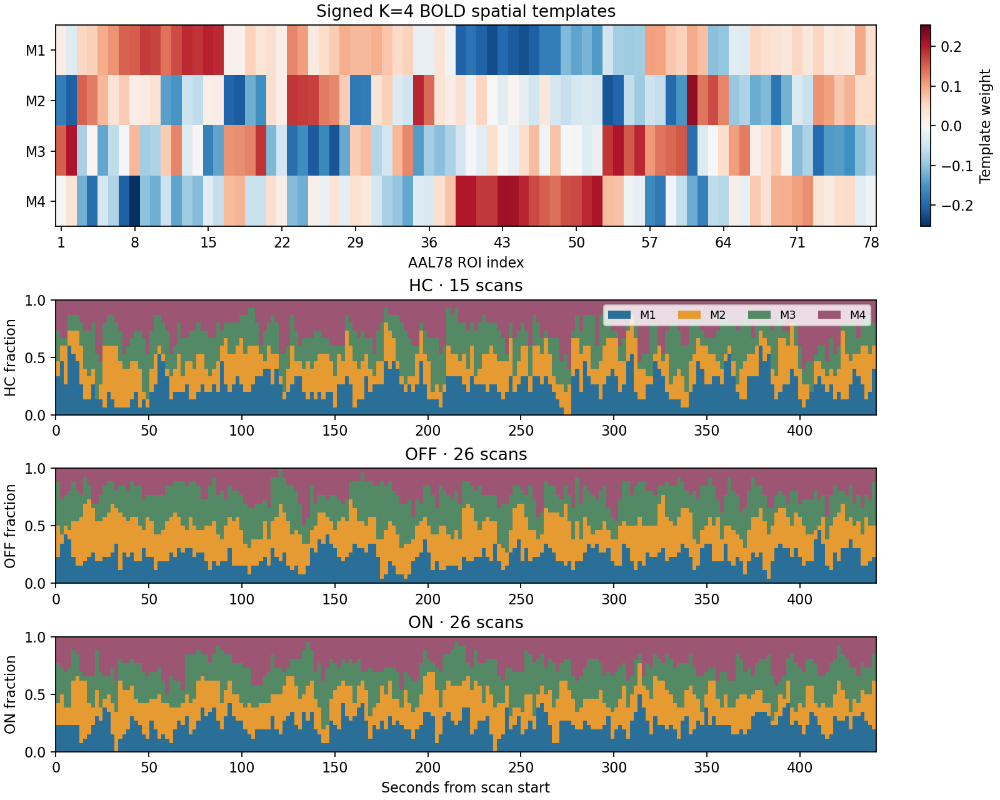
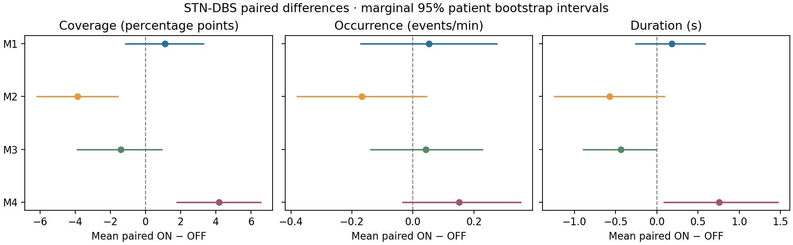

# V100 SyN9 真实队列的 BOLD 空间状态分析

2026 年 11 月 21 日

在真实 BOLD 数据上完成有符号 K=4 共同模板提取、全帧回填和 26 对 STN-DBS 的预设 ON−OFF 检验。12 项检验中有两项通过家族内 Holm 校正（α=0.05）。**M2 覆盖率下降 3.86 个百分点，M4 覆盖率上升 4.18 个百分点。** 四个状态的持续时间和出现率均未通过校正。**同期临床评分可核实覆盖为 0/26 对**，因此 OFF 持续时间与症状严重程度的关系仍未检验。

## 队列和时序来源

| 阶段 | OFF | ON | HC | 扫描 |
|---|---:|---:|---:|---:|
| SyN9 原始清单 | 27 | 27 | 15 | 69 |
| 预处理和 AAL78 技术验收 | 26 | 27 | 15 | 68 |
| 本轮共同模板 | 26 | 26 | 15 | 67 |

沿用原 MATLAB 分析的 67 扫描清单。一次 OFF 的 fMRIPrep 超时，其 ON 虽通过技术验收，因缺少配对 OFF 一并排除。V100 运行计划与既有身份表按运行审计编号及条件精确连接，并核对 BIDS 标签。67 份 TSV 的 SHA-256 全部等于原 MATLAB 打包清单记录，每份均为 210×78、TR 2.1 秒，列名和顺序与已存 AAL78 轴逐一相等，数值有限且各区非恒定。纳入样本的最低 ROI 覆盖率为 32.57%。 [SyN9 专项报告](../2026-11-21-v100-syn9-stn-hc.md) · [输入校验汇总](input_summary.json)

输入为 XCP-D 36P、GSR、despike、0.01–0.08 Hz 去噪后的 AAL78 ROI 幅度时序。原 WEiDA 分析在共享上游之后另用 0.04–0.07 Hz 带通和 Hilbert 相位。本轮与该结果的差异涉及分析频带和信号表征。V100 上的原始数据和既有导数只读挂载，镜像仅提供 Python 运行环境。

## 真实状态和时间指标

各 ROI 沿时间 z-score（样本标准差），每帧单位化。采用有符号球面 k-means，K=4、100 次初始化、每次上限 300 轮、seed 20261121。正式拟合按 41 名受试者等权，DBS 的两种条件各分得患者权重的一半。全部 14,070 帧均有效，按最大有符号余弦回填。M1–M4 是本次 BOLD 空间状态，EEG 类别对应性未经测量。

下图的上半部分为共同模板权重。最正／最负权重分别位于 M1 左额下回眶部／右楔叶、M2 左角回／左中央后回、M3 右中央前回／左直回、M4 左舌回／右额中回。下方时间线为各组在每个扫描相对时点落入四状态的比例，聚合了该组全部扫描。

持续时间为观察到的片段平均秒数，出现率为次/分钟，覆盖率为有效帧比例。起止片段按观察长度计入。覆盖率 = 持续时间 × 出现率 ÷ 60，因此三个指标共享信息。逐帧转移包含自转移，按片段计的转移仅统计相邻有效帧之间的状态变化。转移与 HC 结果仅作描述。 [模板权重](templates.tsv) · [分组指标分布](condition_metrics.csv) · [分组转移矩阵](transitions.csv)

## 预设家族 A · 配对 ON−OFF

每项为 26 个患者差值的均值。区间为 2,000 次患者层 bootstrap 的边际 95% 百分位区间，以当前共同模板固定为条件。双侧符号翻转 10,000 次，12 项统一做 Holm 校正。覆盖率差值换算成百分点，CSV 保留比例。 [完整 28 项统计表](stats.csv)

| 状态 | 指标 | ON−OFF [95% CI] | 原始 p | Holm p |
|---|---|---:|---:|---:|
| M1 | 覆盖率（百分点） | +1.10 [−1.17, 3.33] | 0.3776 | 1.0000 |
| M1 | 出现率（次/分钟） | +0.052 [−0.173, 0.277] | 0.6811 | 1.0000 |
| M1 | 持续时间（秒） | +0.180 [−0.266, 0.591] | 0.4190 | 1.0000 |
| M2 | 覆盖率（百分点） | **−3.86 [−6.21, −1.54]** | 0.00280 | **0.0308** |
| M2 | 出现率（次/分钟） | −0.167 [−0.382, 0.047] | 0.1607 | 1.0000 |
| M2 | 持续时间（秒） | −0.574 [−1.251, 0.099] | 0.1219 | 0.9751 |
| M3 | 覆盖率（百分点） | −1.41 [−3.92, 0.95] | 0.2898 | 1.0000 |
| M3 | 出现率（次/分钟） | +0.042 [−0.141, 0.230] | 0.7039 | 1.0000 |
| M3 | 持续时间（秒） | −0.437 [−0.899, 0.004] | 0.0748 | 0.6731 |
| M4 | 覆盖率（百分点） | **+4.18 [1.76, 6.59]** | 0.00200 | **0.0240** |
| M4 | 出现率（次/分钟） | +0.152 [−0.037, 0.356] | 0.1803 | 1.0000 |
| M4 | 持续时间（秒） | +0.757 [0.077, 1.478] | 0.0521 | 0.5209 |

M4 持续时间的边际 bootstrap 区间高于零，预设的符号翻转和 Holm 结果分别为 0.0521 和 0.5209。两种算法依据不同的重采样分布，家族结论以预设 Holm 检验为准。

在随后按患者 ΔFD 调整的事后敏感性分析中，12 项检验里 M4 覆盖率仍通过 Holm 校正，M2 覆盖率的校正 p 为 0.0594，M4 持续时间为 0.0770。 [头动调整前后完整对照](fd_sensitivity/README.md)

## 临床数据核查 · 家族 B 和 C

| 家族 | 临床问题 | 预设项数 | 可估计 |
|---|---|---:|---:|
| B | 各状态三个指标的 ON−OFF 与量表改善 OFF−ON 的 Spearman 关联 | 12 | 0 |
| C | 四个状态 OFF 持续时间与 OFF 同期严重程度的 Spearman 关联 | 4 | 0 |

对 V100 项目相关的六个归档树做关键词检索，并检查本地项目 814 份 CSV、7,355 份 TSV 和 9 份 XLSX 的表头，未发现可链接的同期 DBS 量表。既有 105 `PD_DBS_zcc` 原目录审计记录了 DBS 分组和扫描配对，能识别的临床工作簿归属 `PD_TI_zcc` 的 tTIS。两个审计表的逐扫描用药字段均为 `UNCONFIRMED`。本轮 105 的 SSH 服务可达，现有非交互认证被拒绝，原机材料核查限于已有审计留存。未能核实的字段包括量表实际版本、两条件总分、评分与扫描的访视和时间对应、逐人用药条件。

原 WEiDA 论文 Table 1 是另一纳入队列的组层数据，补充表 S4 报告相关系数，作者固定版本仓库提供计算代码。可用材料没有提供与本轮 26 对扫描逐人连接的量表。统计程序保留 B/C 全部 16 行，效应、区间和 p 值记 NA。 [WEiDA 数据可用性](https://pmc.ncbi.nlm.nih.gov/articles/PMC13280393/#data-availability) · [补充材料](https://pmc.ncbi.nlm.nih.gov/articles/instance/13280393/bin/41531_2026_1354_MOESM1_ESM.pdf) · [作者代码](https://github.com/chenfei-ye/WEIDA-DBS/tree/2e20b0bc956e6eb0eb8e06e2aaf00a93b014e72c)

Li 等在 DBS-OFF 的 EEG 中报告部分状态的持续时间与 UPDRS-III 呈正相关，未观察到其研究内的治疗改善率关联。Guo 等的公开摘要报告 EEG D 持续时间与 UPDRS 正相关。本轮家族 C 对应前一类横断面问题，家族 B 单独考察个体治疗变化。家族 A 的覆盖率结果只回答 BOLD 指标在 ON 与 OFF 的配对差异。 [Li 等，2021](https://www.frontiersin.org/journals/neuroscience/articles/10.3389/fnins.2021.697909/full) · [Guo 等，2024](https://pubmed.ncbi.nlm.nih.gov/38531478/)

## 初始化稳定性和描述性敏感性

正式 K=4 的最佳有符号损失为 0.666844，对应患者加权平均余弦 0.333156。两次额外初始化批次（每批 10 个起点）与主模板的一对一匹配余弦为 0.99986–0.99998。等扫描权重 pilot 和正式等受试者权重模板的匹配余弦为 0.9933–0.9985。上述匹配只量化在本轮数据上改变初始化或训练权重时的空间相似性。

| 拟合 | 与正式 K=4 一对一匹配的余弦，按主模板 M1、M2、M3、M4 顺序 |
|---|---|
| 有符号 K=5 | 0.9622，0.9310，0.8348，0.9750 |
| 有符号 K=6 | 0.9539，0.9776，0.8348，0.9167 |
| 有符号 K=7 | 0.9493，0.9812，0.8487，0.9072 |
| unsigned K=4（绝对余弦） | 0.4908，0.8760，0.6175，0.9348 |

有符号 K=5–7 中，M3 对应模板的相似性相对较低。极性对照下，M1 和 M3 的空间匹配下降更明显。表中数值描述模板几何，仍以预设有符号 K=4 的 12 项配对检验为推断范围。 [拟合汇总](fit_summary.csv) · [初始化稳定性](initialization_stability.csv) · [模板匹配](template_matches.csv) · [各拟合全部状态描述](condition_metrics.csv)

## 解释范围

这是同一成像队列内的探索性跨模态迁移。TR 和血流动力学时间尺度限制对短片段的解释，影像人工 QC 为 67/67 待复核。fMRIPrep 每次扫描平均 FD 的组中位数为 HC 0.167、OFF 0.111、ON 0.153 mm，标准化 DVARS 对应为 1.101、1.094、1.097。原流程保留全部帧，本轮头动指标为描述用途。配对检验依赖患者差值的符号交换性，扫描顺序和头动都可能影响估计。 [头动汇总](motion.csv)

独立于拟合入口重算了 14,070 个帧标签、268 条状态指标和 2,144 项转移计数，并复核全部家族的 Holm 校正。状态指标重算的最大绝对差为 1.78×10⁻¹⁵。服务器环境中另外通过 26 项手算和合成测试，验证对象是代码。本文的模板、图表和统计表均来自 V100 的真实数据。 [实际命令和软件版本](RUN.md) · [数值核验](numerical_checks.json)
