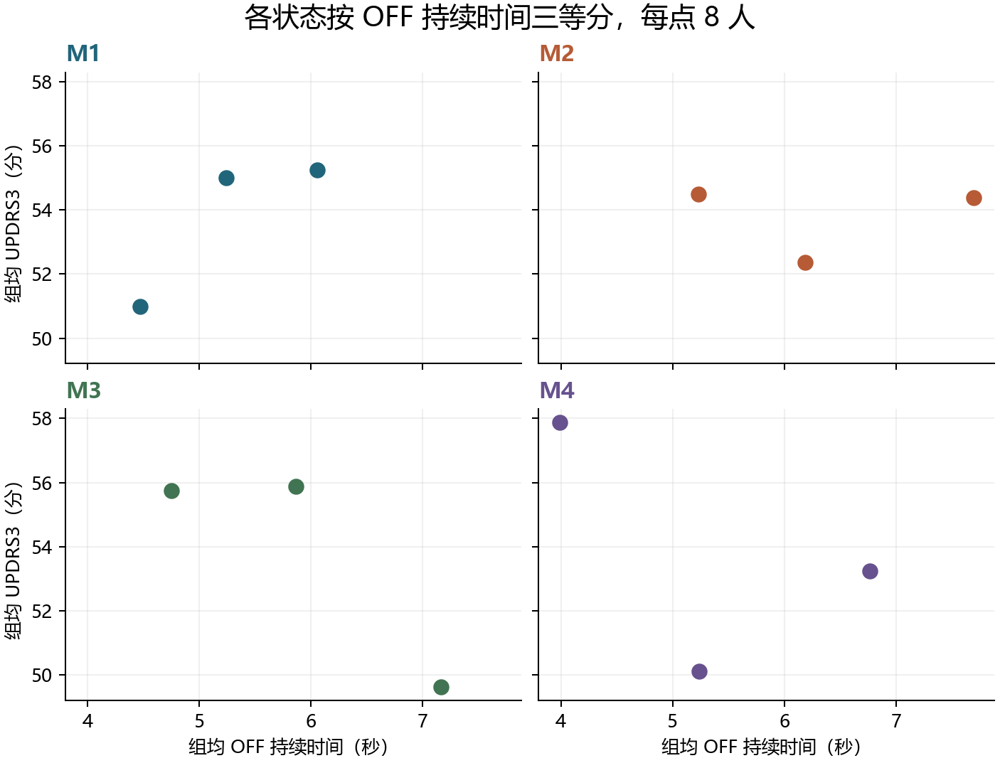
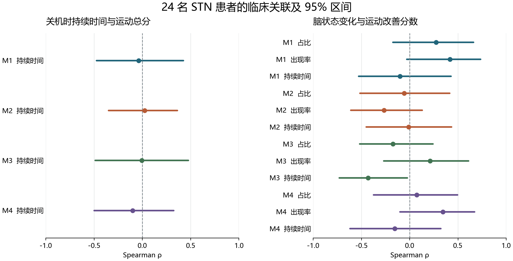

# STN-DBS 的 BOLD 微状态与运动评分

2026 年 11 月 23 日，复用 V100 的四状态模板和 67 次真实扫描。26 对 STN 患者中，24 对可以匹配到历史分析采用的 OFF 和 ON 运动总分。**关机时，四个状态持续时间与运动严重程度的相关系数都接近零。开机后，脑状态变化与运动改善的 12 项关联均未通过 Holm 校正。** 刺激本身的状态占比效应在全体 26 对中重复出现。[计算约定](PLAN.md) · [全部效应、95% 区间及 p 值](stats.csv)

| 预设问题 | 患者 | Holm 校正后达到 0.05 | 主要结果 |
|---|---:|---:|---|
| A · DBS 开机后脑状态是否改变 | 26 对 | 2/12 | M2 占比下降 3.86 个百分点，95% CI −6.21 至 −1.54，校正 p=0.0308。M4 占比上升 4.18 个百分点，95% CI 1.76 至 6.59，校正 p=0.0240。持续时间和出现率均未通过校正。 |
| B · 脑状态变化是否与运动改善相关 | 24 对 | 0/12 | M3 持续时间变化的相关系数为 −0.430，M1 出现率变化为 +0.417，校正 p 分别为 0.473 和 0.486。 |
| C · 关机时状态持续越久，症状是否越重 | 24 人 | 0/4 | 四项 Spearman ρ 在 −0.101 至 +0.023 之间，四项校正 p 均为 1.000。 |

## 关机时的持续时间与运动严重程度

每名患者贡献一条 OFF 记录。持续时间以秒计，评分越高表示运动症状越重。下表的区间为按患者重采样的 95% 边际区间。

| BOLD 幅度状态 | Spearman ρ | 95% CI | 双侧置换 p | Holm p |
|---|---:|---:|---:|---:|
| M1 | −0.039 | −0.476 至 +0.424 | 0.8565 | 1.000 |
| M2 | +0.023 | −0.350 至 +0.363 | 0.9187 | 1.000 |
| M3 | −0.006 | −0.488 至 +0.477 | 0.9790 | 1.000 |
| M4 | −0.101 | −0.499 至 +0.323 | 0.6329 | 1.000 |

这批患者没有呈现一致的“持续越久、症状越重”关系。样本为 24 人，区间仍容许一定幅度的正向或负向关联。下图按各状态的 OFF 持续时间分为三组，每个点是 8 人的均值。表中统计使用 24 名患者各自的观测。[图中分组均值](severity_bins.csv)

## 开关刺激后的变化与运动改善

影像变化按 ON−OFF 计算，临床改善按 OFF 总分减 ON 总分计算，单位为分。主评分方案中两项未经校正的 p 小于 0.05。改善较多的人，M3 持续时间更倾向于缩短（ρ=−0.430，95% CI −0.729 至 −0.025，原始 p=0.0394），M1 出现率更倾向于增加（ρ=+0.417，95% CI −0.031 至 +0.736，原始 p=0.0442）。同一问题涉及 12 项比较，两项均未达到预设显著性标准。图中的区间逐项计算，显著性按家族内 Holm 检验判断。

## 评分版本是否影响结论

主表使用 66 次扫描的四状态存档 `WEiDA4-1_atlas1_group0`。归档的 25 对 STN 共 50 条总分，可与三状态存档逐条对齐，并均能由 12 个共同分项求和得到。另一份四状态存档中，7 名共有患者的 OFF 和 ON 总分与主表有出入，分项逐项相同。三种方案均使用冻结模板。

| 评分方案 | n | M3 持续时间变化与改善 ρ | 原始 p | 12 项 Holm p | B 显著数 | C 显著数 |
|---|---:|---:|---:|---:|---:|---:|
| 两份存档一致、可由分项复算的主评分 | 24 | −0.430 | 0.0394 | 0.4728 | 0/12 | 0/4 |
| 采用另一份四状态存档的总分 | 24 | −0.436 | 0.0358 | 0.4296 | 0/12 | 0/4 |
| 仅保留三份存档总分完全一致的患者 | 17 | −0.633 | 0.0073 | 0.0876 | 0/12 | 0/4 |

共有 24 人平均头动 FD 为 OFF 0.151 mm、ON 0.193 mm。主评分与 OFF 头动的 ρ=−0.007，改善分数与头动变化的 ρ=−0.163。头动、固定的 ON 后 OFF 扫描顺序，以及各临床关联的区间宽度均影响解释。[头动描述及评分版本对照](motion.csv)

## 微状态与 WEiDA 亚稳态

另行复算了既有的同频段双流程影像实验。微状态切换率变化与 WEiDA S2 局部亚稳态变化的头动调整后相关为 V100 ρ=+0.287、105 ρ=+0.326，两项 Holm p 均为 0.2527。该实验回答两个连续指标是否随刺激一起变化，计算不使用评分。[切换率与 S2 局部亚稳态](../matched24_primary/switch_rate/README.md)

同帧共现回答两个状态标签是否倾向于同时出现。S2 与幅度微状态 M1 的共现率高于循环移位期望，V100 多 2.13 个百分点（16 项 Holm p=0.00016），105 多 1.42 个百分点（p=0.00742）。两套处理均通过校正的组合还有 S1–M3、S3–M4 和 S4–M3。复算所得 32 个组合检验值与原结果逐项一致。[全部 32 个共现结果](../matched24_primary/cooccurrence_cells/README.md)

## 评分来源与证据范围

临床文件标为 `UPDRS3`。本次用历史 WEiDA 每条记录附带的状态占比与停留时间共同定位扫描，再由已核验的原始 BOLD、T1w 和患者名册对应到 V100 的真实记录。论文方法写明，DBS 队列在隔夜停药后的扫描日先进行 ON 运动评分及扫描，关机等待一小时或症状重现后再评估，紧接着进行 OFF 扫描。这给出了研究层面的访视和用药依据。现有评分导出表缺少逐人的实际日期和用药记录，本报告把 B、C 标为基于归档评分的探索性结果。[原论文临床评估方法](https://www.nature.com/articles/s41531-026-01354-3) · [运行与独立核验](RUN.md)
