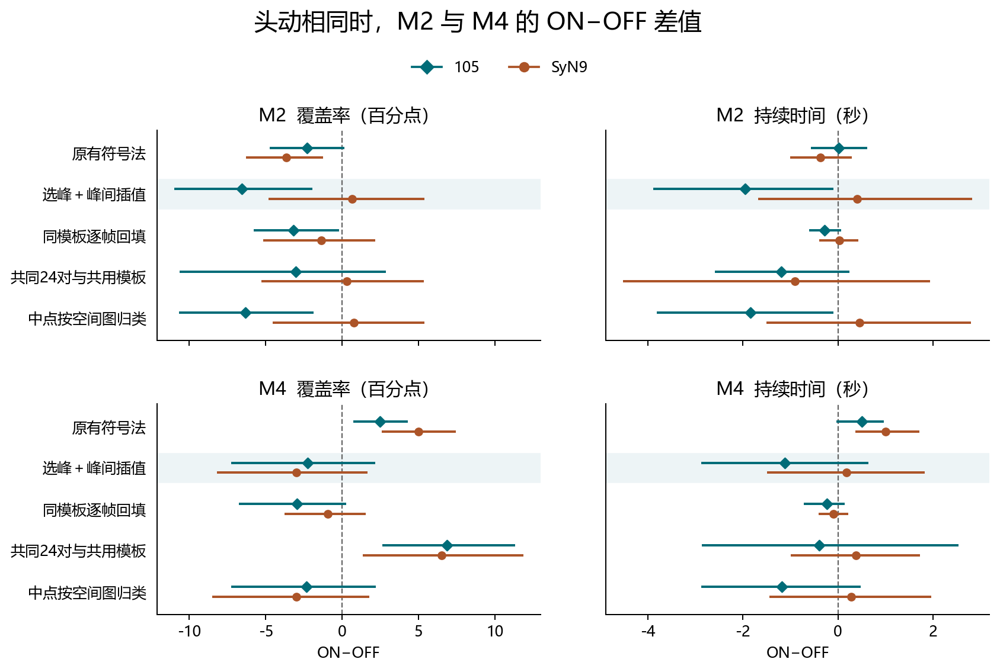
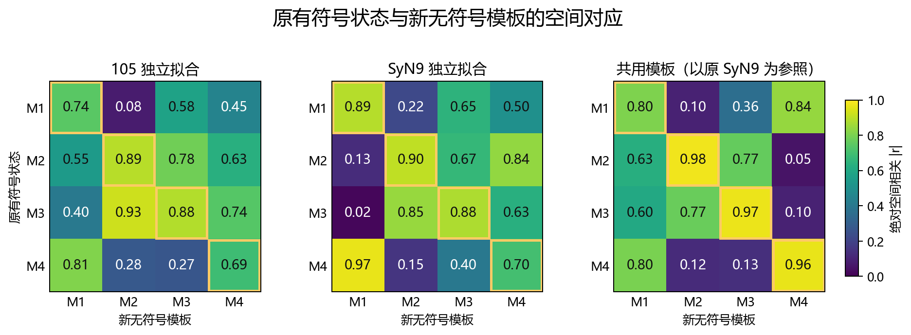

# 在 105 和 SyN9 的原有 BOLD 频段上使用 EEG 选峰法

2026 年 11 月 22 日。105 旧版使用 25 对 STN 患者和 15 名 HC，SyN9 使用 26 对和 15 名 HC。两套真实时序分别训练四个无符号状态。经 ΔFD 调整和 12 项 Holm 校正，两套的 M2、M4 覆盖率与持续时间均未达到 0.05。主分析中，105 只有 M1 覆盖率通过校正（+7.37 个百分点，p=0.0420），SyN9 的 12 项均未通过。 [预先固定的方案](PLAN.md) · [完整效应、区间与 p 值](results/paired_stats.csv)

两种处理在 WEiDA 频段和更慢频段的实际可选峰数，见[同频比较的可行性检查](INFRASLOW_FEASIBILITY.md)。

## 从 OFF 到 ON 的三个指标

下表来自两套真实 BOLD 数据的选峰、忽略极性、峰间插值主分析。每格为患者的 OFF 均值 → ON 均值（观察到的配对差）。每位患者等权，每项均使用两次访视都有该指标的患者。105 每项 25 对，SyN9 每项 26 对，其中 24 名患者重合。覆盖率以有效分析时间为分母，两次覆盖率之差用百分点表示。所有差值均在舍入前计算。[组均值、配对差、头动调整后效应和 Holm p 的完整表](results/condition_summary.csv)

| 来源 | 状态 | 平均持续时间（秒） | 出现率（次/分钟） | 时间覆盖率（%） |
|---|---|---:|---:|---:|
| 105 | M1 | 14.56 → 16.40（+1.84） | 0.909 → 1.040（+0.131） | 21.89 → 28.79（+6.90） |
| 105 | M2 | 15.86 → 14.21（−1.65） | 1.113 → 0.977（−0.137） | 29.94 → 23.75（−6.19） |
| 105 | M3 | 13.54 → 14.63（+1.09） | 1.063 → 1.030（−0.033） | 24.37 → 24.76（+0.39） |
| 105 | M4 | 13.48 → 13.25（−0.23） | 1.030 → 1.034（+0.004） | 23.80 → 22.71（−1.10） |
| SyN9 | M1 | 15.50 → 15.27（−0.23） | 0.912 → 1.197（+0.285） | 23.10 → 30.94（+7.84） |
| SyN9 | M2 | 13.84 → 14.29（+0.44） | 1.073 → 1.102（+0.029） | 25.45 → 26.11（+0.66） |
| SyN9 | M3 | 15.49 → 13.15（−2.34） | 1.124 → 1.101（−0.023） | 28.56 → 24.18（−4.38） |
| SyN9 | M4 | 12.29 → 12.16（−0.13） | 1.083 → 0.923（−0.160） | 22.89 → 18.77（−4.12） |

两套处理的 M1 空间图绝对相关为 0.981。M1 在 ON 时都出现得更频繁，占用的时间比例也更高。以 ΔFD=0 估计，105 的 M1 覆盖率增加 7.37 个百分点（逐项 95% 区间 3.02 至 11.84，Holm p=0.0420），SyN9 增加 8.84 个百分点（逐项 95% 区间 3.36 至 15.63，Holm p=0.0935）。两套数据中 M4 的覆盖率也同向下降，调整后分别为 −2.27 和 −3.00 个百分点，Holm p 均为 1。SyN9 的 M4 持续时间观察差为 −0.13 秒，调整后为 +0.18 秒，Holm p=1。[全部 24 项调整后检验](#新法主分析的全部-12-项) · [BOLD 模板空间相关](results/spatial_matches.csv)

Li 等（2021）的 EEG 原文按 A–D 报告同样三个指标。下表取原文表 1–3 公布的患者均值，计算 ON−OFF。粗体表示原文配对检验 p<0.001。B、D 持续时间的两个访视均值在原表显示精度下相等。[Li 等原文表 1–3](https://www.frontiersin.org/journals/neuroscience/articles/10.3389/fnins.2021.697909/full#T1)

| EEG 状态 | 持续时间变化（毫秒） | 出现率变化（次/秒） | 覆盖率变化（百分点） |
|---|---:|---:|---:|
| A | **−8** | **−0.624** | **−6.8** |
| B | 0 | +0.051 | +0.6 |
| C | +6 | **+0.671** | **+6.6** |
| D | 0 | −0.222 | −0.5 |

两套 BOLD 的 M1 与 EEG C 在出现率和覆盖率上都呈上升方向。三项指标都下降的组合出现在 EEG A、105 的 M2 和 SyN9 的 M3。后两者各自的三项均未通过 Holm 校正。BOLD 编号来自 AAL78 空间模板，EEG 类别来自头皮电位地形，两者缺少经验证的一一对应关系。这些结果支持比较方向，单凭方向相似无法确认同一生理状态。[BOLD 模板匹配约定](PLAN.md) · [EEG 原文](https://www.frontiersin.org/journals/neuroscience/articles/10.3389/fnins.2021.697909/full)

## M2、M4 与原方法的逐项对照

数值均为 ΔFD=0 时估计的 ON−OFF 差。原法在所有有效帧上训练和回填有符号模板。新法在空间振幅峰上训练无符号模板，按峰标签插值并排除首尾不完整段。“方法差”对同一患者的新法与原法 ON−OFF 差值再作配对检验，12 项单独 Holm 校正。两个方法的校正 p 一高一低，本身不足以证明方法差显著。

| 来源 | 指标 | 原法差值 | 原 Holm p | 新法差值 | 新 Holm p | 方法差（新−原） | 方法差 Holm p |
|---|---|---:|---:|---:|---:|---:|---:|
| 105 | M2 覆盖率（百分点） | −2.31 | 0.5129 | −6.55 | 0.1144 | −4.24 | 1.0000 |
| 105 | M2 持续时间（秒） | +0.014 | 1.0000 | −1.952 | 0.4140 | −1.966 | 0.5735 |
| 105 | M4 覆盖率（百分点） | +2.46 | 0.1180 | −2.27 | 1.0000 | −4.73 | 0.7249 |
| 105 | M4 持续时间（秒） | +0.508 | 0.4277 | −1.114 | 1.0000 | −1.622 | 0.7271 |
| SyN9 | M2 覆盖率（百分点） | −3.66 | 0.0594 | +0.66 | 1.0000 | +4.32 | 0.4920 |
| SyN9 | M2 持续时间（秒） | −0.375 | 1.0000 | +0.403 | 1.0000 | +0.778 | 1.0000 |
| SyN9 | M4 覆盖率（百分点） | +5.01 | 0.0048 | −3.00 | 1.0000 | −8.01 | 0.0869 |
| SyN9 | M4 持续时间（秒） | +1.000 | 0.0770 | +0.176 | 1.0000 | −0.824 | 1.0000 |

在全部 12 个方法差中，105 均未过校正，SyN9 只有 M1 覆盖率的方法差通过（+7.85 个百分点，Holm p=0.0384）。各模板的生理解释取决于空间对应。下图线段为逐项 95% 患者 bootstrap 区间，浅色行是本次主分析。

## 两套处理的状态对应和峰位置

原 SyN9 的 M1 与 M4 空间相关为 −0.782，105 为 −0.707。忽略极性会把正向和反向的近似模式视为相似。两套数据独立训练时，各自的原 M4 都和新 M1 最像（绝对空间相关分别为 105 的 0.811、SyN9 的 0.967）。四个状态必须一对一编号时，原 M4 与分配给它的新 M4 的相关只有 0.690、0.699。105 的原 M2、M3 也都最接近新 M2。各自拟合出的两个新 M1 之间 |r|=0.981，两个新 M4 之间 |r|=0.567。因此，独立拟合下 M4 覆盖率的估计变号，同时包含状态定义与逐帧分配的改变。 [全部空间相关与自由最佳匹配](results/spatial_matches.csv)

在两种方法都有标签的帧中，原 M4 帧在 105 有 40.2% 分到新 M1、28.8% 分到新 M4。SyN9 对应为 44.9% 和 22.8%。下图框内为总绝对相关最大的一对一匹配，行上最大值对应该旧状态自由选择的最相似新模板。 [逐帧交叉分布](results/frame_crosswalk.csv) · [三组模板权重](results/templates.tsv)

| 扫描层诊断，表中为各扫描的中位数 | 105（65 次） | SyN9（67 次） |
|---|---:|---:|
| 每次扫描空间振幅峰数 | 44 | 45 |
| 峰间距（秒，先在扫描内取中位数） | 8.4 | 8.4 |
| 计入峰间分析的帧比例 | 94.8% | 93.8% |
| 峰处模板解释的空间方差比例（GEV） | 22.8% | 21.3% |
| 在保留帧上，峰间插值与逐帧直接回填所得标签的一致率 | 58.2% | 57.1% |

在相同原始帧上比较共同的 63 次扫描（24 对患者及 15 HC），两套 GFP 类比量时间序列的相关中位数为 0.641。峰位置精确重合的交并比为 0.206，即同帧峰数除以至少一边为峰的帧数。允许相差一个 TR 时，105 的峰在 SyN9 中能找到邻近峰的比例中位数为 78.7%，反向为 75.0%。使用同一无符号模板、只比较双方都保留的帧时，两套的标签一致率中位数为 37.8%。 [按来源和条件的完整诊断](results/diagnostics.csv)

## 根据数据差异作的调整

1. **相同患者、时间帧和模板。** 取两流程共同的 24 对和 15 HC，三次短扫描按相同的原始帧范围对齐。在两套处理上共同训练一组模板，按人和处理流程等权，用各自的 ΔFD 调整。共同 M4 与原 SyN9 M4 的 |r|=0.965。M4 覆盖率在 105 为 **+6.85 个百分点**（Holm p=0.1254），SyN9 为 **+6.49 个百分点**（p=0.4812）。M4 持续时间分别为 −0.389 和 +0.375 秒，M2 覆盖率为 −3.04 和 +0.29 个百分点，M2 持续时间为 −1.195 和 −0.904 秒，这六项 Holm p 均为 1.0000。105 的共同 M2 持续时间有 23 对可估计，一对至少一侧未观察到合格的该状态片段。其余各项均为 24 对。两套各自的 12 项均未通过校正。此处同时固定了样本、帧和模板，无法单独分解三者的贡献。
2. **保留峰训练，改用逐帧直接回填。** 在各自完整队列，用独立拟合的同一组新模板给每个有效 BOLD 帧按绝对空间相关分配状态。M2、M4 的持续时间及覆盖率仍均未通过。M1 覆盖率两套均上升，105 为 +6.63 个百分点（Holm p=0.0012），SyN9 为 +6.40 个百分点（p=0.0096）。105 另有 M1 持续时间 +0.566 秒（p=0.0066）。此项为预先列明的敏感性比较。 [各分支全部 12 项](results/paired_stats.csv)
3. **按 BOLD 空间图解决恰好位于中点的帧。** 首次质控显示，每次扫描与相邻异类峰恰好等距的帧中位数均为 14。看到这一现象后，另行固定补充规则，只在这些帧上从左右峰的两个候选状态中选绝对空间相关较高者。105 有中位 8 帧、SyN9 有中位 7 帧改变了原有的编号决胜选择。计入首尾段重新划分后，每次扫描最终标签改变的比例中位数为 3.81% 和 3.33%。M2、M4 四项仍未通过。105 仍仅 M1 覆盖率通过（+7.24 个百分点，Holm p=0.0348），SyN9 的 12 项均未通过。 [补充规则](MIDPOINT_CHECK.md) · [补充检验全表](midpoint/paired_stats.csv) · [中点诊断](midpoint/diagnostics.csv)

## 新法主分析的全部 12 项

每套处理单独校正 12 项。覆盖率为百分点，出现率为次/分钟，持续时间为秒。原始 p 和 Holm p 均来自 ΔFD 调整后的检验。方括号给出以本轮模板固定为条件的逐项 95% bootstrap 区间。105 每项 25 对，SyN9 每项 26 对。本轮各分支的校正均覆盖各自的比较家族。跨分支结果用于敏感性判断。

| 状态 | 指标 | 105 调整后差值［区间］ | 原始 p | Holm p | SyN9 调整后差值［区间］ | 原始 p | Holm p |
|---|---|---:|---:|---:|---:|---:|---:|
| M1 | 覆盖率 | **+7.37［3.02，11.84］** | 0.00350 | **0.0420** | +8.84［3.36，15.63］ | 0.00850 | 0.0935 |
| M1 | 出现率 | +0.167［0.023，0.303］ | 0.03090 | 0.3090 | +0.306［0.121，0.515］ | 0.00480 | 0.0576 |
| M1 | 持续时间 | +1.407［−0.333，3.444］ | 0.16348 | 1.0000 | −0.129［−2.436，1.763］ | 0.90801 | 1.0000 |
| M2 | 覆盖率 | −6.55［−10.98，−1.93］ | 0.01040 | 0.1144 | +0.66［−4.81，5.37］ | 0.81412 | 1.0000 |
| M2 | 出现率 | −0.127［−0.277，0.020］ | 0.10789 | 0.8631 | +0.030［−0.151，0.210］ | 0.74533 | 1.0000 |
| M2 | 持续时间 | −1.952［−3.882，−0.092］ | 0.04600 | 0.4140 | +0.403［−1.674，2.818］ | 0.75992 | 1.0000 |
| M3 | 覆盖率 | +1.44［−3.98，6.73］ | 0.58574 | 1.0000 | −6.50［−11.82，−1.07］ | 0.02180 | 0.2180 |
| M3 | 出现率 | −0.003［−0.149，0.156］ | 0.95990 | 1.0000 | −0.081［−0.209，0.067］ | 0.27037 | 1.0000 |
| M3 | 持续时间 | +1.344［−0.893，3.509］ | 0.31917 | 1.0000 | −2.632［−5.579，−0.393］ | 0.03600 | 0.3240 |
| M4 | 覆盖率 | −2.27［−7.26，2.16］ | 0.36436 | 1.0000 | −3.00［−8.21，1.64］ | 0.25747 | 1.0000 |
| M4 | 出现率 | +0.023［−0.166，0.190］ | 0.80472 | 1.0000 | −0.123［−0.267，0.032］ | 0.11289 | 0.9031 |
| M4 | 持续时间 | −1.114［−2.875，0.646］ | 0.22278 | 1.0000 | +0.176［−1.493，1.826］ | 0.84902 | 1.0000 |

## 方法、实际命令与验证

在保存两套既有、经指纹核实的时序副本的 Windows 工作站上只读运行。SyN9 沿用原 0.01–0.08 Hz 输入，105 沿用历史 BIDS-fMRIpost basic36_sm6 的存档波形，早期缓存的完整生成命令仍缺记录。两者均直接复用进入 WEiDA 窄带/Hilbert 之前的时序。TR=2.1 秒。每个 ROI 作时间标准化，每帧减空间均值，空间总体标准差取严格局部极大值。扫描级 AAHC 忽略极性，组级一人等权、ON/OFF 共用模板。峰间插值和边缘处理的细节及来源见方案。所得空间轴与秒尺度时间指标用于 BOLD 解释。此数据没有已核实的同期临床评分，本次终点为 ON−OFF。 [分析约定](PLAN.md) · [状态提取与回填代码](../../../experiments/bold_microstates_v1/peak_states.py) · [配对分析代码](../../../experiments/bold_microstates_v1/eeg_peak_analysis.py)

主方案提交为 2313290204e1102adcb1b64e8ef0003707e14205，首次真实推断代码提交为 97bcd256db0272d05a1c51b6150bc17f50b24119。事后中点检查在求该分支结果之前记录于 5fa132882842c298a76945f9a1ffe862296ec102。环境为 Python 3.12.7、NumPy 1.26.4、SciPy 1.13.1、pandas 2.2.2、Matplotlib 3.9.2。双侧患者残差符号翻转 10,000 次，HC3 学生化截距，2,000 次患者 bootstrap，种子 20261121。每个端点报告实际成对人数，临床数据未参与拟合或匹配。 [运行汇总](results/summary.json) · [中点运行记录](midpoint/summary.json)

从仓库根目录使用以下 PowerShell 命令。分析及补充的输出参数须指向新目录，复算时复制同一目录结构即可运行后续验证和制图。

~~~powershell
$env:OPENBLAS_NUM_THREADS='1'
$env:MKL_NUM_THREADS='1'
$env:OMP_NUM_THREADS='1'
$env:BLIS_NUM_THREADS='1'
$env:PYTHONUTF8='1'
$env:MPLBACKEND='Agg'
$env:PYTHONDONTWRITEBYTECODE='1'
python -m unittest discover -s experiments/bold_microstates_v1/tests -q
python -u experiments/bold_microstates_v1/eeg_peak_analysis.py --data-root 'E:\NIT\神经调控数据' --out reports/bold_microstates_v1/eeg_peaks/results
python -u experiments/bold_microstates_v1/peak_midpoints.py --data-root 'E:\NIT\神经调控数据' --primary reports/bold_microstates_v1/eeg_peaks/results --out reports/bold_microstates_v1/eeg_peaks/midpoint
python -u experiments/bold_microstates_v1/verify_peak_analysis.py --data-root 'E:\NIT\神经调控数据' --report-dir reports/bold_microstates_v1/eeg_peaks
python experiments/bold_microstates_v1/plot_peak_analysis.py --report-dir reports/bold_microstates_v1/eeg_peaks
~~~

34 项手算和合成测试通过。真实数据上，两个原有符号分析各 12 项复现。另用独立的簇贡献重算、Gram 矩阵特征分解、逐帧空间相关、数值插值及连续段计数，复核三组组模板和全部 144 个端点行（含 24 个原法参照）。独立复算核对了效应、逐项区间、符号翻转极端计数、未调整和调整后两个 Holm 家族的数值。 [独立复核程序](../../../experiments/bold_microstates_v1/verify_peak_analysis.py) · [制图代码](../../../experiments/bold_microstates_v1/plot_peak_analysis.py)

本次补列 OFF、ON 均值时沿用上述环境和线程设置，在临时目录完整复算主分析。六个已有汇总文件在统一文本换行后逐字一致。用归档模板和独立的峰识别、标签插值、分段计数实现，另行核对了 48 个访视均值、24 个配对差和 24 个头动调整后截距。新增 CSV 中的覆盖率及其差值保留 0–1 的比例单位。[两访视汇总](results/condition_summary.csv)

~~~powershell
$outputPath=Join-Path ([IO.Path]::GetTempPath()) ('bold_peak_conditions_' + [guid]::NewGuid().ToString('N'))
python -B -u experiments/bold_microstates_v1/eeg_peak_analysis.py --data-root 'E:\NIT\神经调控数据' --out $outputPath
~~~
