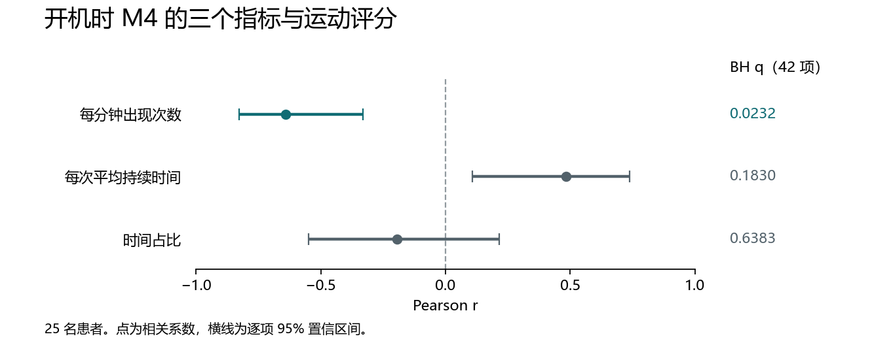
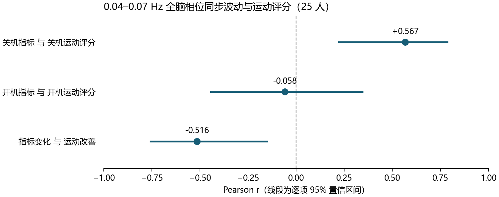

# STN-DBS 开关机时，BOLD 脑状态与运动评分有什么关系？

同一批 25 名患者已有与 15 名健康人的独立组间比较，涵盖总体切换速度和四种状态的段长、出现率及时间占比。[健康人与开关机患者的结果和图](../hc_stn_comparison/README.md)

**关机时，BOLD 未复现 EEG 论文中“运动症状越重，微状态持续越久、出现越少”的总体关系。开机时，本队列中运动评分较高的患者，每分钟进入 M4 的次数较少。** 这项 M4 关联通过了本报告采用的 BH 0.05 阈值，在 EEG 研究采用的 0.01 阈值下未达显著。相位同步分析还显示，关机时同步程度波动较大的患者评分较高。三项结果都来自已有数据，本次整理沿用原实验的统计量。[微状态临床统计](clinical.csv) · [相位临床统计](../legacy_scored25/weida_phase/results.json)

本报告使用 105 原始 fMRIpost 队列的 **25 名 STN-DBS 患者**。每人提供一次关机（OFF）和一次开机（ON）扫描及对应运动评分，共 50 次扫描。每项相关的样本量是 **25 人**。运动评分为 UPDRS III，分数越高表示症状越重。BOLD 分析均使用 AAL78 脑区时序和 **0.04–0.07 Hz** 频段。[微状态分析约定](PLAN.md) · [相位分析约定](../legacy_scored25/weida_phase/PLAN.md)

## 关机时的总体微状态指标能复现 EEG 的发现吗？

Li 等在独立的 20 名患者中观察到，关机时评分越高，EEG 微状态总体上持续越久、出现越少。在 BOLD 中，我们先算出每名患者四类状态各自的平均段长，再对四类等权平均。总出现率按所有状态段数除以有效扫描时长计算。下表比较患者之间的 Pearson 相关。[EEG 原文图 4](https://www.frontiersin.org/journals/neuroscience/articles/10.3389/fnins.2021.697909/full#F4)

| 与关机运动评分的相关 | EEG 的 r（20 人） | BOLD 的 r（25 人） | BOLD 逐项 95% 置信区间 | 原始 p | BH q |
|---|---:|---:|---:|---:|---:|
| 四类状态的平均持续时间 | +0.68 | −0.335 | −0.645 至 +0.069 | 0.1012 | 0.4066 |
| 总出现率 | −0.76 | +0.357 | −0.044 至 +0.659 | 0.0797 | 0.4066 |

**−0.335** 表示在这 25 人里，评分较高者的 BOLD 状态持续时间平均偏短。两项 BOLD 估计的区间均跨零，对“存在与 EEG 相反的规律”也缺乏统计证据。若按实际观察到的所有状态段计算平均时长，持续时间与评分的相关为 r = −0.287，原始 p = 0.164，结论一致。[时长计算方式的敏感性分析](pooled_duration_sensitivity.csv)


## 开机时，为什么要单独看 M4 出现率？

M4 是本次识别出的第四种 BOLD 空间幅度模式。对一名患者，连续多个时间点都属于 M4，只算出现一次。离开后再次进入，再计一次。**出现率**衡量每分钟有几段 M4，**持续时间**衡量每段平均多少秒，**时间占比**衡量扫描有效时长中有多少比例属于 M4。[M4 空间图](maps_weida_band.png) · [指标计算代码](../../../experiments/bold_microstates_v1/eeg_replacement_105.py)

| 开机时的 M4 指标与开机运动评分（25 人） | r | 逐项 95% 置信区间 | 原始 p | BH q（42 项） |
|---|---:|---:|---:|---:|
| 每分钟出现次数 | **−0.641** | **−0.827 至 −0.330** | **0.00055** | **0.0232** |
| 每次平均持续时间 | +0.483 | +0.109 至 +0.737 | 0.0144 | 0.1830 |
| 时间占比 | −0.195 | −0.548 至 +0.216 | 0.3493 | 0.6383 |

**−0.641 描述开机状态下患者之间的差异。** 同样开着 DBS，运动症状较重的人往往较少进入 M4。对同一人，时间占比（比例）等于每分钟出现次数乘以每段平均秒数，再除以 60。因此，进入次数较少的人，如果每次停留较久，总占比仍可能接近其他人。持续时间的逐项区间虽未跨零，在全部 42 项比较中仍未通过 BH 校正。只有出现率通过了 0.05，其因果方向和对个体症状改善的预测价值仍待验证。[全部 42 项临床相关](clinical.csv)



### 开机后，患者本人的 M4 出现率也改变了吗？

同一批患者的 M4 平均出现率为 OFF **0.637 次/分**、ON **0.611 次/分**，平均配对差约 **−0.025 次/分**，原始 p = 0.762，Holm 校正 p = 1.000。开机时的患者间相关可以与这样小的平均开关机差异同时存在。全部 **14 项配对检验均未通过 Holm 0.05**。四类等权平均持续时间从 25.16 秒变为 24.98 秒。M3 时间占比增加 4.53 个百分点，原始 p = 0.0201，Holm 校正 p = 0.281。[14 项配对差、区间和校正结果](paired.csv) · [各状态配对差图](paired_effects.png) · [相邻帧转移概率组均值](transitions.csv)

## 相位同步的变化量相关 −0.516 能说明疗效吗？

这一分析用同样的 78 个脑区，在每个时间点计算全脑相位同步程度（Kuramoto 序参量），再取其全扫描的标准差。数值越大，表示脑区同步程度随时间的起伏越大。该指标由连续相位计算，全程无需划分 M1–M4。[相位分析完整报告](../legacy_scored25/weida_phase/README.md)

| 相位同步波动与评分的比较（25 人） | Pearson r | 逐项 95% 置信区间 | 原始 p | Holm 校正 p（3 项） |
|---|---:|---:|---:|---:|
| 关机同步波动与关机评分 | +0.567 | +0.222 至 +0.786 | 0.00312 | 0.00935 |
| 开机同步波动与开机评分 | −0.058 | −0.443 至 +0.345 | 0.78193 | 0.78193 |
| 同步波动变化（ON−OFF）与运动改善（OFF−ON 评分） | **−0.516** | −0.757 至 −0.152 | 0.00830 | 0.01661 |

运动改善取**关机评分减开机评分**，正数越大表示改善越多。由于影像变化取**开机减关机**，−0.516 表示改善较多的人，其同步波动往往下降较多，或上升较少。两个变化量都用到了关机值。进一步控制每个人的关机同步波动和关机评分后，关联减弱至**偏 r = −0.132，p = 0.548**。这批数据支持关机同步波动与当时严重程度的关联，对于能否独立解释个人疗效，证据不足。关机横断面关联控制平均头动后仍为偏 r = +0.559，p = 0.00452。[相位原始统计与起点调整](../legacy_scored25/weida_phase/results.json)



## 如何复核这些结果

- **统计阈值。** 微状态临床相关对 42 项一起做 Benjamini–Hochberg（BH）校正。14 项开关机配对比较使用 Holm 校正。相位分析对自己的 3 项比较使用 Holm 校正。表内 95% 区间为逐项区间。按校正后的 0.05 判断，三组分别有 **1/42、0/14、2/3** 项通过。[临床相关](clinical.csv) · [配对比较](paired.csv) · [相位比较](../legacy_scored25/weida_phase/results.json)
- **状态识别。** 对每个脑区去线性趋势和均值，做二阶 Butterworth 双向带通，再按时间标准化幅度。在空间幅度峰使用忽略极性的 AAHC 聚类，OFF、ON 各拟合四张模板，按空间相关对齐。峰间回填并剔除边缘不完整段后计算时间指标，最后配对运动评分。BOLD M1–M4 与 EEG A–D 的逐类对应关系仍待验证。[四类 BOLD 空间图](maps_weida_band.png) · [78 区模板](templates.tsv)
- **实际数据与环境。** 47 次扫描有 210 帧，3 次有 209 帧，TR 2.1 秒。共 10,497 帧，保留 9,303 帧计算微状态时间指标。OFF 和 ON 分别检出 1,206 和 1,197 个幅度峰，峰上的平均加权空间解释率分别为 20.3% 和 21.7%。M1–M4 对应模板的 OFF–ON 空间相关依次为 0.852、0.526、0.508、0.821。105 使用 Python 3.10.20、NumPy 1.26.4、SciPy 1.14.1、pandas 2.3.3，单线程运行。[真实数据组级输出和环境](results.json) · [分析入口](../../../experiments/bold_microstates_v1/eeg_replacement_105.py)

原实验复算命令如下，环境变量指向使用者的本地路径。

```bash
python -B experiments/bold_microstates_v1/eeg_replacement_105.py --bids-root "$BIDS_ROOT" --clinical-root "$CLINICAL_ROOT" > "$REPORT/results.json"
python -B experiments/bold_microstates_v1/plot_eeg_replacement.py "$REPORT/results.json" "$AAL78_NII" "$AAL78_CSV" "$MNI_T1W" "$MNI_MASK"
```
