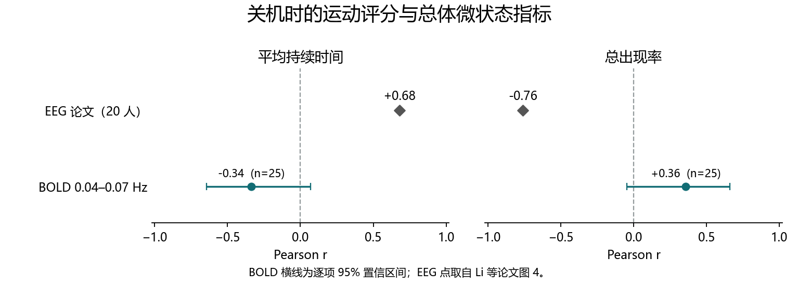
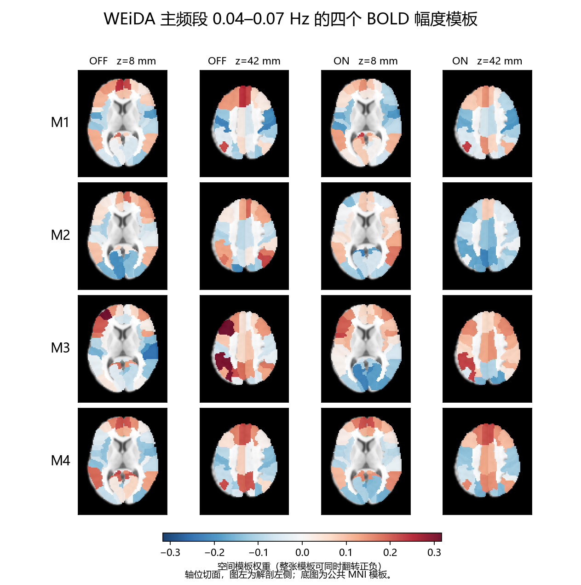

# 105 的 STN-DBS 微状态与运动评分 · 0.04–0.07 Hz

在师姐原始 BIDS-fMRIpost 数据上重新拟合 25 名 STN 患者的 50 次 OFF/ON 扫描。每次扫描均从 AAL78 导出时序直接提取 **0.04–0.07 Hz**。按用户指定的 0.05 校正阈值，42 项微状态临床相关中有 1 项显著。开机时，M4 出现率较低的患者运动评分较高（Pearson r=−0.641，95% 区间 −0.827 至 −0.330，原始 p=0.00055，BH q=0.0232）。这是一项探索性关联，按 EEG 对照实验最初的 q<0.01 标准未达显著。[42 项临床统计](clinical.csv) · [同一频段的相位同步结果](../legacy_scored25/weida_phase/README.md)

## 关机时与 EEG 论文的对照

运动评分越高表示运动障碍越重。Li 等的 EEG 对照来自独立的 20 名患者，本次 BOLD 的每个相关使用 25 名患者，每人贡献一次关机测量。总体持续时间为每人四类状态的平均段长等权平均，总出现率为所有状态段数除以有效扫描时长。[EEG 原文图 4](https://www.frontiersin.org/journals/neuroscience/articles/10.3389/fnins.2021.697909/full#F4)

| OFF 指标与 OFF 运动评分 | EEG 的 r | BOLD 的 r（逐项 95% 区间） | 原始 p | BH q |
|---|---:|---:|---:|---:|
| 四类状态平均持续时间 | +0.68 | −0.335（−0.645 至 +0.069） | 0.1012 | 0.4066 |
| 总出现率 | −0.76 | +0.357（−0.044 至 +0.659） | 0.0797 | 0.4066 |

这两项 BOLD 估计的区间均跨零，EEG 论文中“关机时症状越重，状态持续越久、出现越少”的关系未获复现。改用全部已观察段数汇总时，持续时间与关机评分的相关为 r=−0.287，p=0.164。[时长敏感性统计](pooled_duration_sensitivity.csv)



## 开机时 M4 出现率与运动评分

M4 为本次学习出的第四种 BOLD 幅度模式。连续属于 M4 的一段计一次，出现率为该状态段数除以有效时长。25 人的 M4 平均出现率为 OFF 0.637 次/分、ON 0.611 次/分。开机时出现率与评分的负相关描述同一条件内的患者差异；OFF 与 ON 的出现率配对比较为 Holm p=1.000。

## 各状态的 ON 与 OFF 配对差

主频段四类等权平均持续时间为 OFF 25.16 秒、ON 24.98 秒，配对差 −0.18 秒（95% 区间 −3.38 至 +3.03 秒）。M3 占比由 23.25% 升至 27.79%，配对差 +4.53 个百分点，原始 p=0.0201，Holm p=0.281。14 项配对检验均未通过 Holm 0.05。图中的横线为各项配对差的逐项 95% 区间。[14 项配对统计](paired.csv) · [32 项相邻帧转移概率组均值](transitions.csv)


## 状态识别和空间图

每个脑区独立线性去趋势及去均值，二阶 Butterworth 双向带通，各区幅度随时间标准化。对每帧的 78 区幅度求空间标准差，在其局部峰上运行忽略极性的个体 AAHC。每个条件按患者等权拟合四张组模板，并按绝对空间相关对齐 OFF 和 ON。峰间回填后计算完整段的持续时间、出现率和时间占比。模板拟合完成后才配对评分。BOLD 的 M1–M4 是本队列中的模式，与 EEG 论文 A–D 的逐类对应尚未建立。[执行约定](PLAN.md) · [单频段分析代码](../../../experiments/bold_microstates_v1/eeg_replacement_105.py)

输入为 47 份 210 帧及 3 份 209 帧，TR 2.1 秒，共 10,497 帧。OFF 检出 1,206 个幅度峰，ON 检出 1,197 个；峰间回填并剔除边缘不完整段后共保留 9,303 帧。四类模板在峰上的平均加权空间解释率为 OFF 20.3%、ON 21.7%；M1–M4 对应模板的 OFF–ON 空间相关分别为 0.852、0.526、0.508、0.821。图中展示公共 MNI 模板上两个轴位切面，整张状态图正负同时翻转代表相同模式。[全部 78 区模板权重](templates.tsv) · [原机组级输出和环境](results.json)



## 复算

105 使用 Python 3.10.20、NumPy 1.26.4、SciPy 1.14.1、pandas 2.3.3，以单线程在内存中调用分析入口。以下为等价命令和本机绘图入口。输入文件只读。结果来自真实患者；软件测试中的合成信号单独用于核验。

```bash
python -B experiments/bold_microstates_v1/eeg_replacement_105.py --bids-root "$BIDS_ROOT" --clinical-root "$CLINICAL_ROOT" > "$REPORT/results.json"
python -B experiments/bold_microstates_v1/plot_eeg_replacement.py "$REPORT/results.json" "$AAL78_NII" "$AAL78_CSV" "$MNI_T1W" "$MNI_MASK"
```
