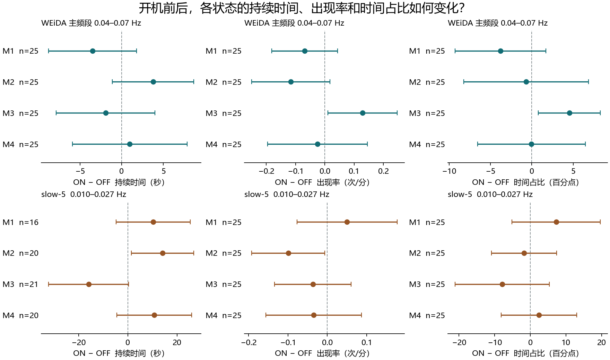
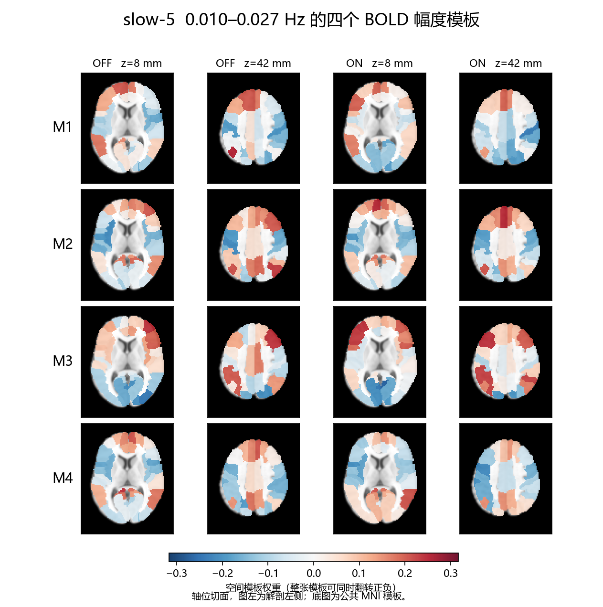

# 把 WEiDA 的状态识别替换成 EEG 微状态算法后，BOLD 能否重现运动评分关联？

在 105 上师姐原始 BIDS-fMRIpost 的 25 对 STN 扫描中，重新拟合得到了四个 BOLD 幅度状态。Li 等在 EEG 中观察到的“关机时症状越重，状态持续越久、出现越少”未在两种 BOLD 频段重现。主频段两项估计方向均与 EEG 相反，置信区间均跨零。主频段中，M4 出现率与开机运动评分有负相关（r=−0.641，原始 p=0.00055，每频段 42 项 BH 校正 q=0.0232）。它通过 0.05，但未达到本次沿用 EEG 论文的临床阈值 q<0.01。[原论文及图 4](https://www.frontiersin.org/journals/neuroscience/articles/10.3389/fnins.2021.697909/full#F4) · [全部 84 项临床相关](clinical.csv)

## 算法如何替换

| 环节 | 师姐的 WEiDA | 本次 105 实验 |
|---|---|---|
| 输入 | 各扫描的脑区 BOLD 时序 | 使用 25 对原始 fMRIpost AAL78 时序。47 次为 210 帧，3 次为 209 帧，TR 均为 2.1 秒 |
| 频段 | 逐区线性去趋势、去均值，二阶 Butterworth 双向滤波，0.04–0.07 Hz | 主分析保留同一频段，另外单独对 slow-5（0.010–0.027 Hz）复算 |
| 每帧的空间表示 | Hilbert 相位、脑区对相位差余弦矩阵、加权特征向量 | 各脑区 BOLD 幅度经过时间标准化；每帧减去 78 区均值，计算空间标准差，取其局部峰 |
| 学习四类状态 | 对相位特征向量聚类 | 对每次扫描的峰值空间图作忽略极性的 AAHC，再在 OFF、ON 内分别学习四张组模板，以绝对空间相关将两组状态一一匹配 |
| 得到状态序列 | 为各帧分配相位状态 | 将每个峰分配给空间相关绝对值最高的模板，按相邻峰回填，在等距时比较该帧的空间拟合度，剔除首末不完整状态段 |
| 读出 | 相位状态占比、转换、局部亚稳态等 | 从幅度状态序列计算持续时间、出现率、占比，另输出含自转移的相邻帧转换概率 |

这是根据论文方法实现的 Python 版 BOLD 分析。EEG 原研究使用 MATLAB R2013b 的 EEGLAB 插件、2–20 Hz 头皮电位及独立健康对照；本次实施的数据标准化、频带、分辨率和插值细节见约定。当前 M1–M4 在 BOLD 数据中学习，尚无证据与 EEG 的 A–D 或师姐 WEiDA 的 S1–S4 一一对应。分析全程使用 105 的 STN 患者；模板拟合完成之后才合并运动评分。[分析约定](PLAN.md) · [Li 等的方法](https://www.frontiersin.org/journals/neuroscience/articles/10.3389/fnins.2021.697909/full) · [WEiDA 作者代码](https://github.com/chenfei-ye/WEIDA-DBS/blob/main/StateSpace_modelling.m) · [个体 AAHC 的实现依据](https://pycrostates.readthedocs.io/en/main/_modules/pycrostates/cluster/aahc.html)

## 关机时，运动越差，状态是否持续越久、出现越少？

运动评分越高表示运动障碍越重。“总体持续时间”让每个患者的四类状态各占四分之一权重，“总出现率”为每秒内各类状态段数之和。各行使用有相应指标的患者。EEG 的两个总体相关取自 Li 等图 4；该图中 EEG 类别的汇总细节并未逐步给出，跨模态均值和绝对时长也受采样率影响。

| OFF 指标与 OFF 评分 | EEG 的 r（20 人） | BOLD 主频段 r [95% CI] | 原始 p / BH q | BOLD slow-5 r [95% CI] | 原始 p / BH q |
|---|---:|---:|---:|---:|---:|
| 平均持续时间 | +0.68 | −0.335 [−0.645, +0.069]，25 人 | 0.101 / 0.407 | −0.428 [−0.746, +0.048]，18 人 | 0.076 / 0.974 |
| 总出现率 | −0.76 | +0.357 [−0.044, +0.659]，25 人 | 0.080 / 0.407 | +0.101 [−0.307, +0.477]，25 人 | 0.632 / 0.974 |


slow-5 全组只检测到 890 个幅度峰，主频段为 2,403 个。slow-5 关机时 18 人、开机时 14 人在保留的序列中观察到全部四类，两个条件都观察到四类的有 11 人。改用“所有已观察状态段的平均持续时间”，每个频段的 OFF 分析均可用足 25 人。它与关机评分的相关为主频段 r=−0.287（p=0.164），slow-5 r=−0.00024（p=0.999）。样本中观察到哪些状态及如何给它们加权，对 slow-5 的总体时长估计影响较大。[总体时长敏感性结果](pooled_duration_sensitivity.csv)

## DBS ON 与 OFF 有什么差异？

主频段 25 对患者的四类等权平均持续时间为 OFF 25.16 秒、ON 24.98 秒，配对差为 −0.18 秒（95% 区间 −3.38 至 +3.03 秒）。M3 的平均时间占比从 23.25% 增至 27.79%，差 +4.53 个百分点（原始 p=0.020，Holm p=0.281）。每个频段的 14 项配对比较均未通过 Holm 0.05 校正。slow-5 的各状态持续时间可用对数是 16–21，占比和出现率均可使用 25 对。图中横线是配对差的逐项 95% 置信区间。[全部 28 项配对差和两频段联合校正](paired.csv) · [64 个描述性转移概率](transitions.csv)



## 四个状态在脑区上长什么样？

组模板按 AAL78 名称匹配同一公共图谱。图左为解剖左侧，红和蓝表示同一幅空间图中权重相反的脑区；模板整体翻转正负不改变识别结果。主频段 OFF 与 ON 对应模板的空间相关依次为 0.852、0.526、0.508、0.821。M2 和 M3 的时间比较尤其依赖两种条件下的模板对应。slow-5 的 OFF 与 ON 对应相关依次为 0.733、0.840、0.745、0.754。跨频段 M3 的 OFF 匹配相关只有 0.417。编号相同的模板仍可能有空间差异。[全部 78 区的模板权重](templates.tsv)




在峰上，四张组模板的 GFP 加权空间解释率按扫描等权取均值，主频段 OFF/ON 分别为 20.3% / 21.7%，slow-5 为 24.4% / 25.3%。峰间回填和边缘剔除后，主频段保留 9,303 帧，slow-5 保留 7,548 帧，输入共 10,497 帧。这些数值描述四张模板对这批 BOLD 图的拟合。研究中的脑电头皮图和本次 BOLD 脑区图采用不同的信号与空间轴。[拟合和样本核验](results.json)

## 与上一轮的关联有什么区别？

上一轮 slow-5 中，OFF 运动评分与 78 个脑区相位同步程度的时间标准差呈正相关（r=+0.559，三项 Holm p=0.0110）。本轮的临床读出是某类**幅度空间图**出现多长、多少次。两类结果可以在同一队列中同时出现。使用原始 fMRIpost 导出并共用一套模板的早期分析还给出了总体持续时间关机相关 r=+0.359（p=0.0777）；本轮同时引入固定窄带和分条件模板，不能单凭两次结果断定是哪一步令方向改变。[上一轮相位结果](../legacy_scored25/slow5_phase/README.md) · [早期共用模板结果](../legacy_scored25/README.md)

## 复算与核验

105 上以 Python 3.10.20、NumPy 1.26.4、SciPy 1.14.1、pandas 2.3.3，单线程在内存中调用分析入口。实际读取原始 fMRIpost 导出并验证 25 对名册、ROI 顺序、TR、帧数和两份评分归档。命令行等价入口如下。绘图使用公共 AAL78 图谱、其标签表，以及 TemplateFlow 的 MNI152NLin2009cAsym 2 mm T1w 和脑掩膜。数据目录参数仅在有权限的机器上提供。

```bash
python -B experiments/bold_microstates_v1/eeg_replacement_105.py --bids-root "$BIDS_ROOT" --clinical-root "$CLINICAL_ROOT" > "$REPORT/results.json"
python -B experiments/bold_microstates_v1/plot_eeg_replacement.py "$REPORT/results.json" "$AAL78_NII" "$AAL78_CSV" "$MNI_T1W" "$MNI_MASK"
```

表、模板和图全部来自真实数据。软件测试使用的合成信号不进入上述统计。绘图时按样本量和相关系数重算双侧 p，复核配对差及转移概率的行和。输出仅保留组级结果。[分析代码](../../../experiments/bold_microstates_v1/eeg_replacement_105.py) · [制图代码](../../../experiments/bold_microstates_v1/plot_eeg_replacement.py)
