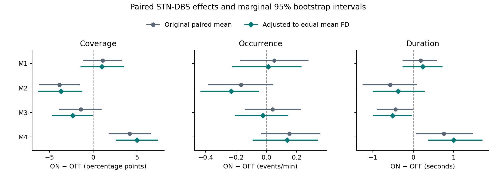

# 调整配对头动差后的 STN-DBS 状态指标

2026 年 11 月 21 日，V100 真实数据，26 对患者。沿用原分析的四个状态模板（保留 BOLD 极性）、逐扫描指标和患者配对，检验两次扫描平均头动相同时的 ON−OFF 差异。

**调整后 12 项中，M4 覆盖率通过 Holm 校正**，ON 高于 OFF 5.01 个百分点，Holm p=0.0048。M2 覆盖率的估计从 −3.86 变为 −3.66 个百分点，方向与幅度接近，Holm p 从 0.0308 升至 0.0594。M4 持续时间的估计从 +0.757 秒增至 +1.000 秒，原始 p=0.00770，Holm p=0.0770。M2 持续时间从 −0.574 秒变为 −0.375 秒，Holm p=1.0000。四个状态的持续时间和出现率均未达到家族阈值 0.05。 [全部数值](fd_adjusted_stats.csv) · [原始主分析](../README.md)

## 完整配对结果

每项均包含 26 对。调整前列为实际患者差值均数，调整后列为 ΔFD=0 mm 处的回归截距。覆盖率使用百分点，出现率使用次/分钟，持续时间使用秒。方括号给出调整后逐项 95% 患者 bootstrap 区间，家族判断使用最后一列。

| 状态 | 指标 | 原 ON−OFF | 原 Holm p | 调整后 ON−OFF [95% CI] | 调整后原始 p | 调整后 Holm p |
|---|---|---:|---:|---:|---:|---:|
| M1 | 覆盖率 | +1.10 | 1.0000 | +0.99 [−1.44, 3.57] | 0.48445 | 1.0000 |
| M1 | 出现率 | +0.052 | 1.0000 | +0.013 [−0.225, 0.232] | 0.91091 | 1.0000 |
| M1 | 持续时间 | +0.180 | 1.0000 | +0.235 [−0.264, 0.726] | 0.39666 | 1.0000 |
| M2 | 覆盖率 | −3.86 | 0.0308 | −3.66 [−6.29, −1.23] | 0.00540 | 0.0594 |
| M2 | 出现率 | −0.167 | 1.0000 | −0.231 [−0.434, −0.046] | 0.02910 | 0.2619 |
| M2 | 持续时间 | −0.574 | 0.9751 | −0.375 [−1.003, 0.292] | 0.26287 | 1.0000 |
| M3 | 覆盖率 | −1.41 | 1.0000 | −2.34 [−4.72, −0.05] | 0.06559 | 0.4592 |
| M3 | 出现率 | +0.042 | 1.0000 | −0.023 [−0.208, 0.144] | 0.80102 | 1.0000 |
| M3 | 持续时间 | −0.437 | 0.6731 | −0.512 [−0.991, −0.037] | 0.04700 | 0.3760 |
| M4 | 覆盖率 | +4.18 | 0.0240 | **+5.01 [2.58, 7.44]** | **0.00040** | **0.0048** |
| M4 | 出现率 | +0.152 | 1.0000 | +0.137 [−0.090, 0.341] | 0.23078 | 1.0000 |
| M4 | 持续时间 | +0.757 | 0.5209 | +1.000 [0.360, 1.715] | 0.00770 | 0.0770 |



## ΔFD 和统计方法

每次扫描的平均 FD 来自已留存的 fMRIPrep `framewise_displacement` 列。对 52 次患者扫描逐份重算并与既有元数据核对，每份 210 个时点中有 209 个可用 FD 值。患者的 ΔFD 取 ON 平均 FD 减 OFF 平均 FD。19 人为正，7 人为负，均值 +0.03923 mm，中位数 +0.02848 mm。零位于实际观测范围内。 [运行汇总](fd_adjusted_summary.json)

对每个状态、每个指标分别拟合 **Δ指标 = β₀ + β₁ × ΔFD + 误差**。每位患者贡献一行，ΔFD 以 mm 原值进入模型。β₀ 对应相同平均头动时的 ON−OFF 估计，等于原均数减去 β₁ × 0.03923。每增加 0.1 mm 的斜率另存于 CSV。

双侧检验以 β₀=0 为零假设。先拟合仅含 ΔFD 斜率的零模型，固定 ΔFD 和零模型拟合值，按患者独立翻转残差符号。每次加回拟合值、重拟合完整模型，以截距的 HC3 学生化 t 统计量构建参考分布。使用 10,000 次翻转和 (极端次数+1)/10,001 的 Monte Carlo p 值。该近似检验依赖患者之间独立、给定 ΔFD 后误差近似对称的假设。12 个调整后 p 一起做 Holm 校正。 [Winkler 等的残差符号翻转方法](https://pmc.ncbi.nlm.nih.gov/articles/PMC4010955/) · [MacKinnon 与 White 的稳健协方差估计](https://www.sciencedirect.com/science/article/pii/0304407685901587)

置信区间在患者层把 ΔFD 和 Δ指标成对重抽，每次重估斜率和截距。每项 2,000 次均可估计，取截距分布的 2.5% 和 97.5% 分位数。符号翻转和 bootstrap 沿用原家族按端点设置的随机数流，seed=20261121。区间固定本次共同模板。

这是看到原结果后增加的线性头动敏感性分析。M4 覆盖率在这一调整下仍有配对差异。最大回归杠杆值为 0.530，个别患者的 ΔFD 对斜率估计有较大影响潜力。刺激条件、患者运动表现和扫描头动可能共同变化，此分析只能给出条件关联。对症状严重度的推断仍缺少同期临床评分。

## 执行与复核

原始结果提交为 `e1892caf3145b42164c65defc16b49e7da98e3e5`，本次检验实现在读取调整后结果前固定于 `540c114deb03309f347e62d3cd0bb7912305b66e`。V100 于北京时间 17:23:27–17:23:46 完成测试和分析，退出码 0。原 K=4 运行目录与 SyN9 来源均以只读方式挂载，新结果写入独立的 `bold_microstates_fd_20261121_lHC6emno/summary/`。计算沿用主分析同一镜像 ID、Python 3.12.12、NumPy 2.2.6、SciPy 1.15.2 和 pandas 2.2.3。 [服务器实际执行脚本](run_fd.sh) · [分析代码](../../../experiments/bold_microstates_v1/fd_sensitivity.py) · [原运行环境](../RUN.md)

从仓库根目录生成固定提交的源码归档。

```bash
git -c core.autocrlf=false archive --format=tar --output=experiment.tar \
  540c114deb03309f347e62d3cd0bb7912305b66e -- experiments/bold_microstates_v1
```

在新的 V100 工作目录放入 `experiment.tar` 和随附的 `run_fd.sh`，执行 `bash run_fd.sh`。脚本验证归档提交并通过以下两个 Python 入口运行。

```bash
python -m unittest discover -s experiments/bold_microstates_v1/tests -v
python experiments/bold_microstates_v1/fd_sensitivity.py \
  --run-dir /data1/student/ruidong/bold_microstates_v1_20261121_Jp2fwhug \
  --out /data1/student/ruidong/bold_microstates_fd_20261121_lHC6emno/summary
```

29 项手算及合成测试通过，其中 3 项专门验证新协变量模型。真实数据上先逐项复现了原 12 项的配对均值、原始 p、Holm p 和区间。另用逐患者留一回归的系数变化独立重算 HC3 标准误，用直接重拟合的患者样本复核区间。12 项符号翻转极端计数与 Holm 结果全部一致，截距、t 和区间端点的最大绝对差小于 9×10⁻¹⁶。

对照图从去标识 CSV 生成，本地制图环境为 Python 3.12.7、pandas 2.2.2、Matplotlib 3.9.2。 [制图代码](../../../experiments/bold_microstates_v1/plot_fd_sensitivity.py)

```bash
python experiments/bold_microstates_v1/plot_fd_sensitivity.py \
  --stats reports/bold_microstates_v1/fd_sensitivity/fd_adjusted_stats.csv \
  --out reports/bold_microstates_v1/fd_sensitivity/fd_adjusted_effects.png
```
