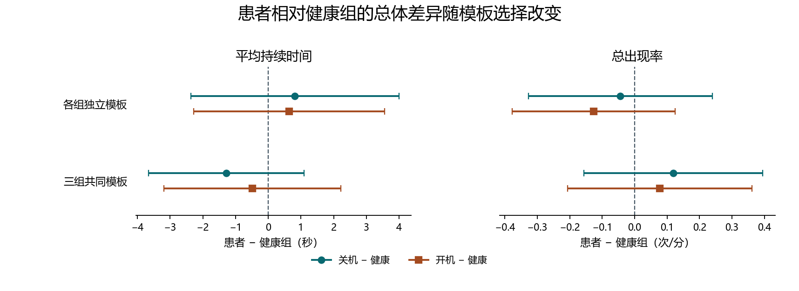
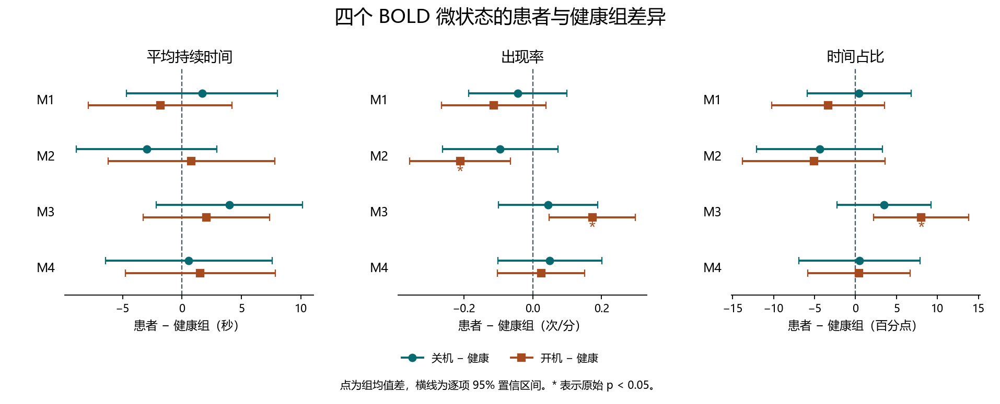

# 健康人与 STN-DBS 患者的 BOLD 微状态切换有差别吗？

**主分析中，患者的微状态平均持续稍久、每分钟出现稍少，方向与 EEG 论文一致。但四项总体差异均未达显著，改用共同模板后四个方向全部反转。因此，这批 BOLD 数据未能稳定复现患者总体切换较慢的现象。** 按 EEG 论文使用的原始 p < 0.05，局部有三项差异，均来自开机患者与健康人的比较。对全部 28 项作 Holm 校正后，显著项为 **0/28**。[主分析全部统计](group_templates.csv) · [共同模板全部统计](common_template.csv)

本次在 105 原始 BIDS-fMRIpost 归档上实际运行。**25 名 STN 患者**各有一份关机（OFF）和开机（ON）扫描，**15 名健康人**各有一份扫描，共 40 人、65 次扫描。两次组间比较均为同一组 15 名健康人分别对 25 名患者，每项检验都纳入了全部 40 人。频段为 0.04–0.07 Hz，图谱为 AAL78，TR 为 2.1 秒。[分析约定](PLAN.md)

## 总体切换速度

一段指连续分到同一个状态的一段时间。先对每人四个状态各自的平均段长作等权平均，得到总体持续时间。将所有状态的段数除以有效扫描时长，得到每分钟总出现率。EEG 论文报告患者相对健康人段长更长、出现率更低。跨 EEG 和 BOLD 比较的是组间差异的方向，两种信号的采样尺度不同。[EEG 论文表 1、表 2](https://www.frontiersin.org/journals/neuroscience/articles/10.3389/fnins.2021.697909/full#T1)

| 主分析 | 健康组均值 | 患者均值 | 患者减健康的均值差（逐项 95% 区间） | 原始 p | Holm p |
|---|---:|---:|---:|---:|---:|
| OFF 平均持续时间（秒） | 24.35 | 25.16 | +0.81（−2.37 至 +3.99） | 0.609 | 1.000 |
| ON 平均持续时间（秒） | 24.35 | 24.98 | +0.63（−2.28 至 +3.55） | 0.663 | 1.000 |
| OFF 总出现率（次/分） | 2.567 | 2.523 | −0.044（−0.328 至 +0.239） | 0.753 | 1.000 |
| ON 总出现率（次/分） | 2.567 | 2.441 | −0.127（−0.378 至 +0.125） | 0.315 | 1.000 |

主分析仿照 EEG 研究，为健康、关机、开机三组分别学习模板。敏感性分析用相同的 65 份时序，三组等权学习一套共同模板，再统一分配状态。此时 OFF 和 ON 的平均段长分别比健康人**短 1.28、0.48 秒**，总出现率分别**高 0.119、0.077 次/分**，四项原始 p 均大于 0.28。两种分析的区间均覆盖零，小幅差异的方向依赖状态如何定义。[共同模板统计](common_template.csv)



## 哪些状态有组间差异？

**关机患者与健康组的 14 项比较全部未达原始 p < 0.05。开机患者与健康组的 14 项比较中有以下三项达到该阈值。** 表中均值与差值独立四舍五入。三项的 Welch 检验也达到原始 0.05，均未通过主分析的 28 项 Holm 校正。[主分析含 Welch 检验](group_templates.csv)

| ON 与健康的比较 | 健康组 | 开机患者 | 患者减健康的差值（逐项 95% 区间） | 原始 p | Holm p |
|---|---:|---:|---:|---:|---:|
| M2 出现率（次/分） | 0.760 | 0.549 | −0.211（−0.358 至 −0.064） | 0.00603 | 0.169 |
| M3 出现率（次/分） | 0.541 | 0.714 | +0.173（+0.048 至 +0.298） | 0.00805 | 0.216 |
| M3 时间占比 | 19.78% | 27.79% | +8.01 个百分点（+2.22 至 +13.80） | 0.00801 | 0.216 |

**M3 的两项结果在共同模板下也朝同一方向。** 开机患者的 M3 出现率高 0.133 次/分（原始 p = 0.0313），占比高 8.98 个百分点（原始 p = 0.0152），仍未通过校正。M2 出现率的差值缩小到 −0.079 次/分（原始 p = 0.326）。共同模板分析中 28 项均未通过 Holm 0.05，最小校正 p 为 0.0547，对应 OFF 的 M2 时间占比。[共同模板完整结果](common_template.csv)



### 四个状态的组均值和全部原始 p

| 状态 | 指标 | 健康（15 人） | OFF（25 人） | ON（25 人） | OFF vs 健康 p | ON vs 健康 p |
|---|---|---:|---:|---:|---:|---:|
| M1 | 段长（秒） | 24.977 | 26.654 | 23.142 | 0.596 | 0.543 |
| M1 | 出现率（次/分） | 0.679 | 0.636 | 0.566 | 0.540 | 0.141 |
| M1 | 时间占比（%） | 26.366 | 26.809 | 23.019 | 0.889 | 0.332 |
| M2 | 段长（秒） | 26.210 | 23.234 | 27.001 | 0.315 | 0.820 |
| M2 | 出现率（次/分） | 0.760 | 0.665 | 0.549 | 0.259 | **0.006** |
| M2 | 时间占比（%） | 30.225 | 25.835 | 25.141 | 0.255 | 0.243 |
| M3 | 段长（秒） | 22.234 | 26.213 | 24.282 | 0.197 | 0.441 |
| M3 | 出现率（次/分） | 0.541 | 0.586 | 0.714 | 0.535 | **0.008** |
| M3 | 时间占比（%） | 19.777 | 23.252 | 27.786 | 0.225 | **0.008** |
| M4 | 段长（秒） | 23.961 | 24.524 | 25.494 | 0.872 | 0.625 |
| M4 | 出现率（次/分） | 0.587 | 0.637 | 0.611 | 0.511 | 0.702 |
| M4 | 时间占比（%） | 23.632 | 24.104 | 24.054 | 0.897 | 0.892 |

之前报告的 M4 结果回答另一个问题。在开机患者**内部**，运动评分越高，M4 出现率越低。这里比较的是开机患者**整体与健康人**的均值，M4 出现率仅相差 +0.024 次/分（原始 p = 0.702）。这两个结果可以同时成立。同理，ON 与健康组的差异也不能单独证明 DBS 使某个指标改变，刺激效应应看同一患者的 ON–OFF 配对结果。[运动评分与开关机配对报告](../eeg_replacement_105/README.md)

## 模板、数据和复核

采用空间幅度峰、忽略极性的个体 AAHC、每组四个模板、峰间回填。截去边缘不完整段后计算时间指标。保留既有患者报告的 OFF 编号，让 ON 和健康组模板分别与 OFF 作一对一空间匹配。M1–M4 与 EEG 论文 A–D 的逐类对应尚未建立。[EEG 微状态识别方法](https://www.frontiersin.org/journals/neuroscience/articles/10.3389/fnins.2021.697909/full) · [本次分析代码](../../../experiments/bold_microstates_v1/hc_stn_microstates.py)

| 同名模板的绝对空间相关 | M1 | M2 | M3 | M4 |
|---|---:|---:|---:|---:|
| OFF 与健康 | 0.761 | 0.655 | 0.421 | 0.663 |
| ON 与健康 | 0.543 | 0.364 | 0.727 | 0.502 |
| OFF 与 ON | 0.852 | 0.526 | 0.508 | 0.821 |

开机与健康 M2 的空间相关只有 0.364，因此将这两个模板视作同一种精确的空间模式存在不确定性。M3 的 ON 与健康匹配较高，为 0.727。这里的组间检验仅按论文比较未调整的均值。三组扫描的平均帧间位移分别为健康 0.193、OFF 0.150、ON 0.194 mm，组间差异的独立病因仍需进一步研究。[模板与质控汇总](results.json)

| 主分析数据核验 | 健康 | OFF | ON |
|---|---:|---:|---:|
| 扫描数 | 15 | 25 | 25 |
| 210 帧 / 209 帧的扫描数 | 15 / 0 | 24 / 1 | 23 / 2 |
| 检出空间幅度峰数 | 726 | 1,206 | 1,197 |
| 分配到完整状态段的帧数 | 2,819 | 4,627 | 4,676 |
| 峰上的平均加权空间解释率 | 27.1% | 20.3% | 21.7% |

15 份健康时序与既有确认清单逐份核对 SHA-256，全部吻合。作者打包目录另有一条 HC 记录，此次使用指定的 15 人清单。患者按既有档案的 25 对身份及刺激条件配对。65 份导出时序合计 13,647 帧；三组 78 个脑区的名称与顺序相同。新分析的两组患者模板和全部 28 个患者组指标均值（14 项 × 2 组）与先前报告数值吻合。另用每组均值、标准差和样本数独立复算了两套模板的 Student、Welch 检验和 Holm 校正。[组级输出与软件版本](results.json) · [核验和绘图代码](../../../experiments/bold_microstates_v1/report_hc_stn.py)

等价复算命令如下。`CONTROL_MANIFEST` 指向已核验的私有输入清单，含 condition、scan 和 sha256 三列。真实扫描只读，命令在预先存在的报告目录中输出组级结果。105 源端使用 Python 3.10、NumPy 1.26、SciPy 1.14 和 pandas 2.3，数值线程数设为 1。

```bash
export OPENBLAS_NUM_THREADS=1 OMP_NUM_THREADS=1 MKL_NUM_THREADS=1
OUT=reports/bold_microstates_v1/hc_stn_comparison
python -B experiments/bold_microstates_v1/hc_stn_microstates.py --bids-root "$BIDS_ROOT" --author-root "$AUTHOR_ROOT" --control-manifest "$CONTROL_MANIFEST" > "$OUT/results.json"
python -B experiments/bold_microstates_v1/report_hc_stn.py "$OUT/results.json"
```
