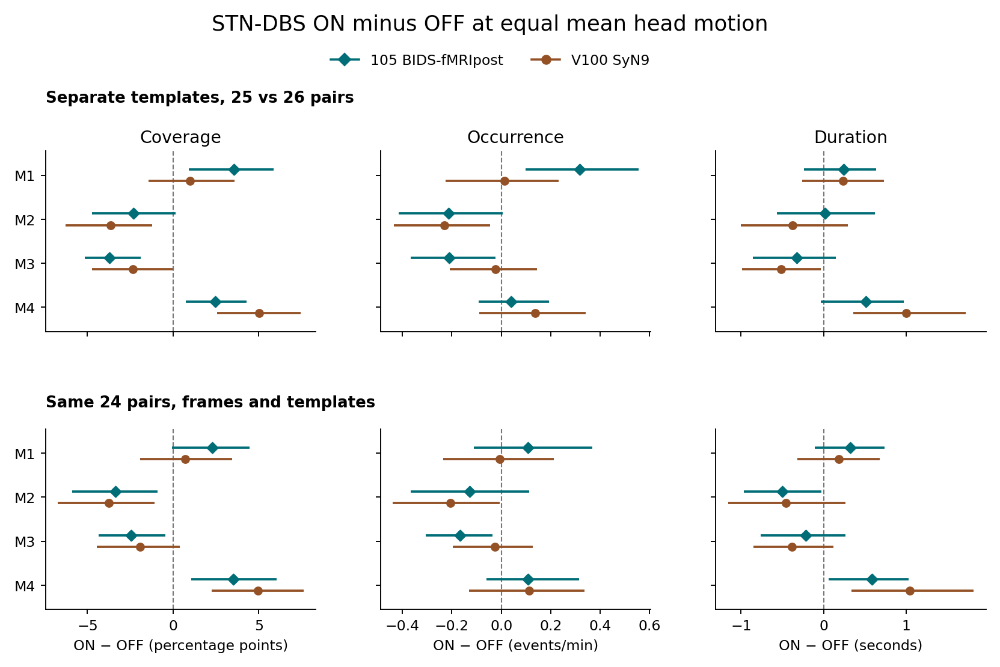

# 105 旧版 AAL78 的头动敏感性复算

2026 年 11 月 21 日，使用 105 旧版 BIDS-fMRIpost 的 AAL78 真实时序，按原清单纳入 25 对 STN 患者和 15 名健康对照。调整 ΔFD 后，M4 覆盖率在 ON 时高 2.46 个百分点（Holm p=0.1180）。唯一通过 12 项 Holm 校正的是 M3 覆盖率，ON 时低 3.71 个百分点（p=0.0108）。四个状态的持续时间均未通过校正。 [完整数值](results/paired_results.csv) · [SyN9 原头动分析](../fd_sensitivity/README.md)

## 旧版时序重建四个状态

覆盖率使用百分点，出现率使用次/分钟，持续时间使用秒。每项均为 25 对。未调整列为配对差值均数，调整列为回归模型在 ΔFD=0 mm 时的 ON−OFF 差值。方括号为逐项 95% 患者 bootstrap 区间。调整前和调整后的 12 项分别做 Holm 校正。

| 状态 | 指标 | 未调整 ON−OFF | 未调整 Holm p | 调整后 ON−OFF［95% 区间］ | 调整后原始 p | 调整后 Holm p |
|---|---|---:|---:|---:|---:|---:|
| M1 | 覆盖率 | +3.89 | 0.0407 | +3.56［0.92，5.86］ | 0.01440 | 0.1296 |
| M1 | 出现率 | +0.349 | 0.0540 | +0.316［0.099，0.555］ | 0.00800 | 0.0880 |
| M1 | 持续时间 | +0.241 | 0.6434 | +0.242［−0.238，0.638］ | 0.37006 | 1.0000 |
| M2 | 覆盖率 | −2.95 | 0.2728 | −2.31［−4.74，0.13］ | 0.09539 | 0.5129 |
| M2 | 出现率 | −0.206 | 0.3066 | −0.214［−0.416，0.005］ | 0.08549 | 0.5129 |
| M2 | 持续时间 | −0.156 | 0.7053 | +0.014［−0.568，0.618］ | 0.96770 | 1.0000 |
| M3 | 覆盖率 | −3.46 | 0.0060 | **−3.71［−5.15，−1.89］** | **0.00090** | **0.0108** |
| M3 | 出现率 | −0.141 | 0.6111 | −0.211［−0.366，−0.023］ | 0.04360 | 0.3488 |
| M3 | 持续时间 | −0.436 | 0.5229 | −0.328［−0.857，0.145］ | 0.20148 | 0.8059 |
| M4 | 覆盖率 | +2.52 | 0.1089 | +2.46［0.73，4.30］ | 0.01180 | 0.1180 |
| M4 | 出现率 | +0.066 | 0.7053 | +0.040［−0.092，0.193］ | 0.58234 | 1.0000 |
| M4 | 持续时间 | +0.463 | 0.4362 | +0.508［−0.035，0.966］ | 0.06109 | 0.4277 |

M1、M2、M3、M4 与对应 SyN9 模板的有符号余弦分别为 0.853、0.863、0.882、0.759。M4 的跨流程空间对应最弱。旧版数据内部，两组额外初始化与主拟合的最低匹配余弦为 0.997。该稳定性描述同一批数据的聚类重复性。 [全部空间匹配](results/template_matches.csv) · [按 SyN9 编号排列的 105 模板](results/templates_105.tsv)

## 同一批 24 人、同样的时间帧和状态模板

两套处理同时具备合格配对的 24 名患者均使用原 SyN9 模板。三次旧扫描在历史处理中去掉了首个非稳态帧，对应 SyN9 扫描按相同的原始帧重新标准化和回填。每套流程均使用自己的头动记录。表中均为头动调整后的估计。

| 状态与指标 | 105 旧版 ON−OFF | 105 Holm p | SyN9 ON−OFF | SyN9 Holm p |
|---|---:|---:|---:|---:|
| M2 覆盖率（百分点） | −3.36 | 0.1925 | −3.74 | 0.1023 |
| M2 持续时间（秒） | −0.500 | 0.3570 | −0.461 | 1.0000 |
| M3 覆盖率（百分点） | −2.44 | 0.2475 | −1.92 | 1.0000 |
| M4 覆盖率（百分点） | +3.50 | 0.0852 | +4.95 | 0.0048 |
| M4 持续时间（秒） | +0.582 | 0.2688 | +1.041 | 0.1023 |

在相同人群和模板下，两套处理均给出 M2 覆盖率下降、M4 覆盖率上升的估计。105 的 12 项均未通过校正，SyN9 仍只有 M4 覆盖率通过。两个 Holm p 分别检验各自流程内的 ON−OFF 差异。当前比较没有直接检验两套流程的效应之差，也无法判定哪套影像质量更好。同期症状评分仍缺少已核实的访视匹配。 [四组完整结果](results/paired_results.csv)



## 数据与预先固定的比较方法

本次选用 105 的 BIDS-fMRIpost `AAL1ctx_MNI_basic36_sm6` ROI-BOLD 时序，直接读取进入 WEiDA 窄带和 Hilbert 步骤前的幅度数据。从已归档的文件指纹、AAL78 列名及次序、原始分组清单和混杂变量记录核对输入。历史批次有一对缺少旧时序，另一对因其中一次扫描有 53 个全零 ROI 已被整对排除。两流程完整配对人群的差异亦包含一对在 SyN9 缺少合格 OFF 扫描的患者。论文最终个体名单仍待核实。

65 次扫描包含 62 份 210 帧和 3 份 209 帧，共 13,647 个有效帧，TR=2.1 秒。每次患者扫描的旧 fMRIPrep 记录均有 209 个有限 FD 值，首帧无 FD。旧版 25 人中 18 人 ON 平均 FD 更高，个人 ΔFD 中位数为 +0.03235 mm。共同的 24 人中，105 和 SyN9 的组平均 ΔFD 分别为 +0.04166 和 +0.04168 mm。 [运行汇总](results/summary.json)

下列比较固定在读取本次配对结果之前。这是看到 SyN9 结果后追加的处理流程敏感性分析。

1. 沿用历史输入清单的 25 对 STN 患者及 15 名 HC。在 65 次扫描上重新训练有符号 K=4，共同模板按人等权。每次扫描先按 ROI 作时间标准化，再对每帧取单位向量。100 次初始化，最多 300 次迭代，随机种子 20261121。通过最大化与原 SyN9 四个模板的有符号余弦总和，一对一匹配 M1–M4，随后计算时间指标。
2. 仅用患者做配对推断。ΔFD 来自对应处理流程的 fMRIPrep 逐帧记录，按扫描平均后取 ON−OFF。12 项先作原配对均值检验，再在 ΔFD=0 处作截距检验。各组 12 个 p 分别作 Holm 校正。沿用既有的双侧患者层符号翻转、调整模型的 HC3 学生化统计量和零模型残差翻转，均为 10,000 次。逐项区间用 2,000 次患者重抽，条件于固定模板。
3. 另取原始影像指纹匹配、两套处理均有合格完整配对的 24 人。两套时序均回填同一组已存档的 SyN9 模板。逐扫描保留相同的原始帧，再做时间标准化。各自使用本流程的 ΔFD。该对照固定了人、观测时段和模板，报告两套条件差的估计及各自的 12 项 Holm 结果。
4. 用所有 26 对 SyN9 患者重算并核对既有的 12 项结果。全部新比较固定 K、ROI、极性、种子和检验家族。

## 实际执行与核验

在保存 105 与 V100 已核实副本的本地 Windows 工作站运行。处理方案与分析代码初版固定于 `69347d25433abb7516e847829e115b6f88a41984`，实际验证与制图代码为 `49eae333baa715114eb0c908bc0d8166c64aa679`。环境为 Python 3.12.7、NumPy 1.26.4、SciPy 1.13.1、pandas 2.2.2、Matplotlib 3.9.2。临时逐扫描文件随运行结束清理。仓库保存组层数值、模板和图。 [分析代码](../../../experiments/bold_microstates_v1/compare_legacy_105.py) · [制图代码](../../../experiments/bold_microstates_v1/plot_legacy_105.py)

从仓库根目录执行以下 PowerShell 命令。复算时将输出换为新的目录。

```powershell
$env:OPENBLAS_NUM_THREADS='1'
$env:MKL_NUM_THREADS='1'
$env:OMP_NUM_THREADS='1'
$env:BLIS_NUM_THREADS='1'
$env:MPLBACKEND='Agg'
$env:PYTHONUTF8='1'
$env:PYTHONDONTWRITEBYTECODE='1'
python -m unittest discover -s experiments/bold_microstates_v1/tests -q
python -u experiments/bold_microstates_v1/compare_legacy_105.py --data-root 'E:\NIT\神经调控数据' --out reports/bold_microstates_v1/legacy_105/results
python experiments/bold_microstates_v1/plot_legacy_105.py --stats reports/bold_microstates_v1/legacy_105/results/paired_results.csv --out reports/bold_microstates_v1/legacy_105/comparison.png
```

29 项手算和合成测试通过。真实数据上，从两批时序重新回填得到的 105 逐扫描指标与标准拟合入口一致，SyN9 的 12 项配对结果复现了原汇总。用独立的 CSV 读入、连续段计数、线性截距公式及 Holm 实现复核旧版 25 对的原始与调整后估计、24 组逐项区间及 12 项各 10,000 次残差翻转的极端计数。全部核验通过。
