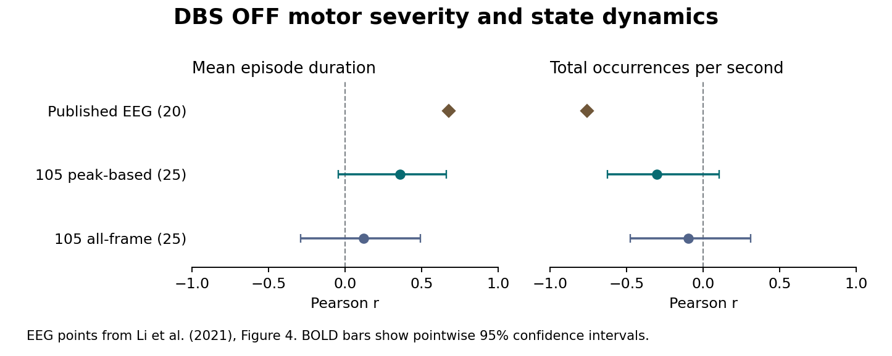

# 105 原始 fMRIpost 队列与 EEG 微状态论文的对照

使用师姐处理的全部 25 名 STN-DBS 患者，各 1 次 OFF、1 次 ON。关机时，运动评分越高，BOLD 状态平均持续越久、每秒出现越少，两个估计方向都与 Li 等 EEG 论文图 4 一致。两项相关的 95% 区间均跨零，未复现论文报道的显著关联。[EEG 原文及图 4](https://www.frontiersin.org/journals/neuroscience/articles/10.3389/fnins.2021.697909/full#F4) · [本次 84 项临床检验](clinical.csv)

## 与论文直接对应的临床指标

主要方法使用脑区间 BOLD 幅度标准差的局部峰判断状态，根据相邻峰为其间各帧分配状态，并排除不完整的边界段。每人每条件贡献一个指标。每个患者的总体持续时间等于保留的总秒数除以状态段数，总出现率为其倒数。两项指标相互关联。运动评分越高表示症状越重。下表的 BOLD r 采用双侧 Pearson 相关，每个区间为逐项 95% 置信区间。

| 指标 | EEG，20 人 | 105 BOLD，25 人 | 原始 p | BH 校正 q |
|---|---|---:|---:|---:|
| OFF 总体平均持续时间与 OFF 运动评分 | r=+0.68，校正 p=0.001 | +0.359 [−0.042, +0.661] | 0.0777 | 0.977 |
| OFF 总出现率与 OFF 运动评分 | r=−0.76，校正 p<0.0001 | −0.304 [−0.624, +0.104] | 0.1395 | 0.977 |
| ON 总体平均持续时间与 ON 运动评分 | 未报告显著关联 | +0.123 [−0.286, +0.494] | 0.5571 | 0.977 |
| ON 总体平均持续时间与个人改善率 | 未报告显著关联 | −0.071 [−0.453, +0.334] | 0.7373 | 0.977 |

峰间回填和逐帧回填各有 42 项计划内临床检验，均为 0 项达到 q<0.01。每种方法单独按 42 项进行 BH 校正。EEG 论文报告使用 FDR 及 0.01 阈值，校正家族的具体范围未列明。个人改善率按每人的 100 ×（OFF 分数 − ON 分数）/ OFF 分数计算。[计算约定](PLAN.md) · [Li 等的统计方法](https://www.frontiersin.org/journals/neuroscience/articles/10.3389/fnins.2021.697909/full)



**主要结果的稳健性。** OFF 持续时间的秩相关为 +0.237，10,000 次置换 p=0.0818，控制当次平均头动的偏 r=+0.341（p=0.103）。逐一移除一名患者，r 在 +0.131 至 +0.457。四类状态的平均持续时间若按类别等权计算，r=+0.405，原始 p=0.0448。这是预设敏感性分析，低于常用的未校正 0.05，高于本次对照论文所采用的 0.01 阈值。逐帧回填的总体 OFF 持续时间相关为 +0.121（p=0.565，q=0.981）。回填和加权方式会影响效应大小。[敏感性结果](verification.json)

## ON 与 OFF 的配对差异

峰间回填下，12 个预设状态指标均未通过 Holm 0.05 校正。逐帧回填下有 3 项通过同一校正。数值是每个条件下 25 名患者的均值，变化量按 ON−OFF 计算。

| 105 自身的状态与指标 | OFF | ON | 变化 | Holm p |
|---|---:|---:|---:|---:|
| 状态 1 平均持续时间 | 4.375 秒 | 3.924 秒 | −0.451 秒 | 0.0230 |
| 状态 4 时间占比 | 24.39% | 31.31% | +6.92 个百分点 | 0.0012 |
| 状态 4 出现率 | 3.543 次/分 | 4.045 次/分 | +0.502 次/分 | 0.0110 |

这三项回答的是同一批人开机后影像指标平均怎样变化。它们只在一种回填下显著。105 的状态 1–4 在本队列中独立学得；现有数据未建立它们与 EEG 头皮电位图 A–D 的一一对应。[两种方法的全部 24 项配对结果](paired.csv)

## 数据、核验和命令

105 原机只读使用原始 DBS 项目中 BIDS-fMRIpost 导出的 AAL78、basic36、sm6 的 ROI-BOLD 时序。输入来自窄带或 Hilbert 相位变换之前。名册确认 25 个不同患者各有一条 ON 和 OFF，50 次扫描均有对应的主版评分，主版和副本的总分一致。头动取各扫描配套 fMRIPrep confounds 的平均 FD。分析不纳入健康对照。EEG 论文另招募患者，采用首次开机前和开机 24 小时后的采集方案，两项研究测量的信号与访视设计均有差异。[EEG 采集方案](https://www.frontiersin.org/journals/neuroscience/articles/10.3389/fnins.2021.697909/full)

逐份核验 TR 为 2.1 秒、78 个脑区及其顺序。47 份为 210 帧，3 份为 209 帧，缺的起始帧均可由 fMRIPrep 非稳态标记解释，共 10,497 帧。主分析使用原始 fMRIpost 文件的实际长度。历史评分项目另存的 210 帧副本中，47 份与原始导出仅差浮点舍入（最大绝对差 1.34×10⁻¹⁵ 以下）；另外 3 份的副本去掉首帧后，最大绝对差仍分别约为 0.0095–0.0112。分析中没有用这些副本补帧。

在读取临床分数前，用 50 次扫描的 2,199 个空间峰学习四个 AAHC 组模板。峰间回填保留 9,808 帧，逐帧回填使用 10,497 帧。对每次扫描独立计数状态段数和帧数。报告导出时再按 r 与样本量重算 84 个双侧 p 值，核验 BH 与 Holm 校正以及所有配对均值差。软件环境为 Python 3.10.20、NumPy 1.26.4、SciPy 1.14.1、pandas 2.3.3。此报告中的数值均来自真实数据。软件测试中的合成病例单独用于核验程序。[组模板](templates.tsv) · [运行核验](verification.json)

105 通过内存调用下列脚本的 `analyze_archive` 入口，BLAS 和 OpenMP 均设为单线程。以下为对应的命令行入口。`BIDS_ROOT` 指原始 DBS 项目，`CLINICAL_ROOT` 指含评分表、归档时序和经验矩阵的研究目录。第二条命令从组级结果导出表格与图。

```bash
python -B experiments/bold_microstates_v1/legacy_clinical25.py --bids-root "$BIDS_ROOT" --clinical-root "$CLINICAL_ROOT" > "$GROUP_JSON"
python -B experiments/bold_microstates_v1/report_legacy_clinical25.py "$GROUP_JSON" reports/bold_microstates_v1/legacy_scored25
```
