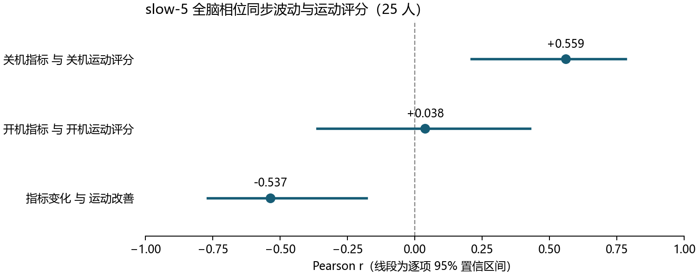

# 关机时，slow-5 全脑同步波动越大的患者，运动评分越高

在 105 原始 DBS 项目中，25 名 STN 患者各有一次关机（OFF）和开机（ON）扫描及对应运动总分。关机时，低频 BOLD 的脑区同步程度随时间起伏越大，患者的运动评分越高（Pearson r=0.559，95% 区间 0.211 至 0.782）。开机时的估计接近零。变化量之间有负相关，但计入患者的关机起点后，剩余关联很小。这批数据支持继续验证关机时的症状关联，对独立疗效指标的支持较弱。[全部组级数值](results.json)

## 每次扫描测了什么

对 78 个 AAL 皮层脑区的 BOLD 时序选取 slow-5（0.010–0.027 Hz，对应约 37–100 秒一个周期）。每个采样点提取各脑区的振荡相位，用 Kuramoto 序参量 R(t) 衡量脑区相位的整齐程度，范围为 0 至 1。将每次扫描内 R(t) 的时间标准差用作全局亚稳态指标。值越大，表示脑区有时较同步、有时较分散。这是全局指标；师姐 WEiDA 论文的局部亚稳态在特定状态内计算，Li 等 EEG 研究的状态持续时间则以毫秒计。三者回答不同问题。[slow-5 的频带定义](https://pmc.ncbi.nlm.nih.gov/articles/PMC2856476/) · [WEiDA 论文](https://doi.org/10.1038/s41531-026-01354-3) · [EEG 微状态论文](https://doi.org/10.3389/fnins.2021.697909)

实际分析 50 份原始 BIDS-fMRIpost AAL78 时序（basic36、sm6），每个患者每项检验贡献一个观测值。47 份为 210 帧，3 份为 209 帧，共 10,497 帧，TR 均为 2.1 秒。每次约 7 分 20 秒，在 0.010 Hz 端约有 4.4 个周期。对滤波前的导出时序计算 Hann 周期图，3,900 条脑区时序均有该频带的功率，各扫描脑区功率占比中位数的中位数为 20.2%。该比例描述导出文件的频谱，上游时域滤波的完整设置仍待核实。[配对及导出文件核验](../README.md)

## 三项患者级检验

运动分越高表示运动症状越重。表中区间为各项的 95% 置信区间，p 为双侧。三个检验共同按 Holm 校正，本轮探索性判断阈值预先设为 0.05。若对同一组校正值采用 0.01 阈值，三项都未达到。检验家族只包括本轮三项，不覆盖此项目曾探索的其他指标。[计算约定](PLAN.md)

| 每位患者贡献的两项测量 | n | Pearson r | 95% 区间 | 原始 p | Holm p |
|---|---:|---:|---:|---:|---:|
| OFF 同步波动与 OFF 运动评分 | 25 | +0.559 | +0.211 至 +0.782 | 0.00365 | 0.01095 |
| ON 同步波动与 ON 运动评分 | 25 | +0.038 | −0.362 至 +0.427 | 0.85617 | 0.85617 |
| 同步波动变化（ON−OFF）与运动改善（OFF−ON 分数） | 25 | −0.537 | −0.769 至 −0.180 | 0.00567 | 0.01133 |



25 人同步波动的组均值为 OFF 0.0833、ON 0.0868。表中第三行比较的是患者之间的差别：改善更多的患者，其同步波动倾向于下降更多或上升更少。不能用这个负相关推出所有患者开机后同步波动都降低。OFF 和 ON 两项相关的差异尚未作正式交互检验。

## 稳健性和基线的影响

| 检查 | OFF 与 OFF 评分 | ON 与 ON 评分 | 影像变化与运动改善 |
|---|---:|---:|---:|
| Spearman 秩相关 | +0.473 | +0.023 | −0.291 |
| 控制头动后的偏 r | +0.550 | −0.037 | −0.490 |
| 去除每端 50.4 秒后，Pearson r | +0.473 | +0.086 | −0.457 |
| 19,999 次患者间评分置换，双侧 p | 0.00285 | 0.85300 | 0.00580 |
| 逐一剔除一名患者后的 r 范围（事后核查） | +0.502 至 +0.605 | −0.090 至 +0.212 | −0.585 至 −0.432 |

由于两个变化量都包含关机测量，看到结果后，额外计算同时控制 OFF 同步波动及 OFF 评分的偏相关。变化量的 r 从 −0.537 降至 −0.105（p=0.635，自由度 21）。它回答的是“对于起点相仿的患者，两种变化还是否相关”。在这一小队列里，没有看到清楚的剩余关联。该检查与未校正的变化量检验回答不同的问题，也无法确定差异的原因。[全部敏感性估计](results.json)

## 复算与核验

105 原机以 Python 3.10.20、NumPy 1.26.4、SciPy 1.14.1、pandas 2.3.3 在内存中调用下列分析入口。读取原始 fMRIpost 实际保留帧，核对扫描名册、TR、脑区顺序、位移记录和两个归档版本的总分。影像指标提取完成后才合并评分。采用相位向量长度与成对相位差余弦的恒等式抽查每条扫描。下列命令为相同计算的命令行入口，第二条复核组级 r、置信区间及双侧 p，并生成图。

```bash
python -B experiments/bold_microstates_v1/slow5_phase_clinical.py --bids-root "$BIDS_ROOT" --clinical-root "$CLINICAL_ROOT" --band slow5 > reports/bold_microstates_v1/legacy_scored25/slow5_phase/results.json
python -B experiments/bold_microstates_v1/report_slow5_phase.py reports/bold_microstates_v1/legacy_scored25/slow5_phase/results.json
```

表及图均为真实队列的组级结果。合成测试单独验证同相时波动为零、两个慢频率产生相位漂移、ROI 重排不改变全局指标，以及控制基线后变化量的符号。[分析代码](../../../../experiments/bold_microstates_v1/slow5_phase_clinical.py) · [合成测试](../../../../experiments/bold_microstates_v1/tests/test_slow5_phase.py)
