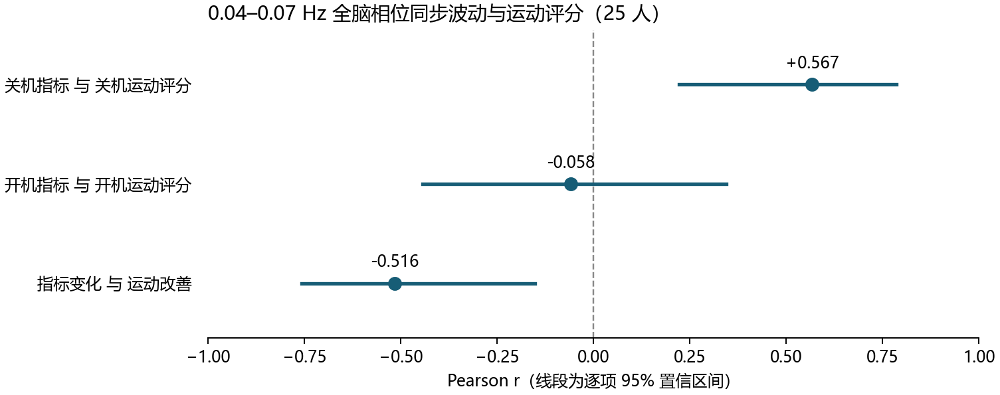

# 0.04–0.07 Hz 的全脑相位同步波动与运动评分

105 的 25 对 STN 患者共 50 次扫描已按主频段独立复跑。关机时，全脑相位同步程度的波动越大，运动评分往往越高（r=+0.567，95% 区间 +0.222 至 +0.786，三项 Holm p=0.00935）。这是同一组患者的计算复核。[实际组级结果](results.json) · [同一频段的微状态分析](../../eeg_replacement_105/README.md)

| 相位指标和运动评分（各 25 人） | Pearson r | 95% 区间 | 双侧原始 p | Holm p |
|---|---:|---:|---:|---:|
| OFF 同步波动与 OFF 评分 | +0.567 | +0.222 至 +0.786 | 0.00312 | 0.00935 |
| ON 同步波动与 ON 评分 | −0.058 | −0.443 至 +0.345 | 0.78193 | 0.78193 |
| 同步波动变化（ON−OFF）与运动改善（OFF−ON 评分） | −0.516 | −0.757 至 −0.152 | 0.00830 | 0.01661 |



每个脑区独立去趋势及主频段带通，Hilbert 变换后求每帧 78 区的 Kuramoto 序参量，取其全扫描样本标准差。原始 fMRIpost 导出共 10,497 帧，TR=2.1 秒。控制平均头动后 OFF 偏 r=+0.559（p=0.00452），去除每端 50.4 秒后 r=+0.593，19,999 次患者评分置换 p=0.00330。控制关机影像值与评分后，变化量相关减弱至偏 r=−0.132（p=0.548）。数据支持关机时的横断面关联；独立疗效预测仍待验证。[频段与配对约定](PLAN.md)

105 在内存中调用相位分析的主频段入口，配对和评分由两个归档版本核验。实际软件环境记录在组级 JSON 中。等价入口和制图命令如下。

```bash
python -B experiments/bold_microstates_v1/slow5_phase_clinical.py --bids-root "$BIDS_ROOT" --clinical-root "$CLINICAL_ROOT" --band weida > "$REPORT/results.json"
python -B experiments/bold_microstates_v1/report_slow5_phase.py "$REPORT/results.json"
```
