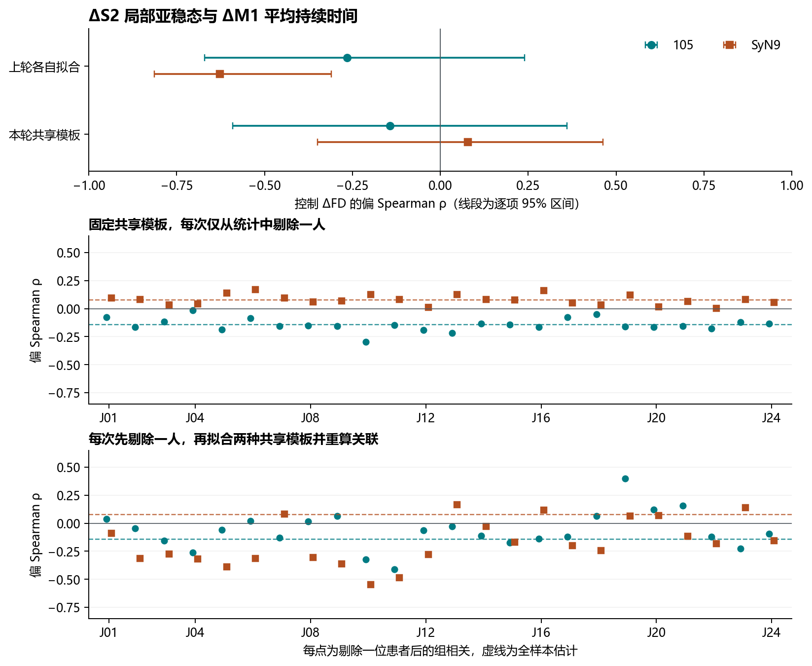

# 共有 24 对 STN-DBS 患者的 S2 局部亚稳态与微状态变化

在 0.04–0.07 Hz，按相同原始帧、相同评分窗口和共享模板重算后，ΔS2 局部亚稳态与 ΔM1 持续时间的偏 Spearman 相关为 **105 −0.144、SyN9 +0.078**。这项关联在两套各自的 12 项 Holm 校正后 p 均为 1.000。SyN9 减 105 的相关系数差为 **+0.222**，按同一患者同步重抽的 95% 区间为 **[−0.479, +0.899]**。本批数据既未复现上一轮 SyN9 的显著负相关，也不足以确定两套效应谁更强。[预先记录的方案](PLAN.md) · [相关系数差及区间](results/focal_gap.csv)

| 分析 | 105 有效人数 | 105 偏 ρ［95% 区间］ | 105 Holm p | SyN9 有效人数 | SyN9 偏 ρ［95% 区间］ | SyN9 Holm p |
|---|---:|---:|---:|---:|---:|---:|
| 上轮整套数据，各自训练模板 | 24 | −0.265［−0.671, +0.239］ | 1.0000 | 26 | −0.627［−0.814, −0.310］ | 0.0138 |
| 本轮共有患者，共享模板和窗口 | 23 | −0.144［−0.590, +0.360］ | 1.0000 | 23 | +0.078［−0.350, +0.462］ | 1.0000 |

上一轮两列来自不同分析样本，点估计相减为 −0.362。本轮两列的患者完全相同。24 人均用于训练模板，一人在 SyN9 的 ON 共同窗口内没有 M1 段，因此两边的 M1 持续时间关联均使用 23 人。所有访视的 S2 帧数都足以计算局部亚稳态。[上一轮结果](../same_band/README.md) · [缺失核对](results/verification.json)

## 四个状态的全部关联

每个数值是患者间的偏 Spearman ρ。预测量为 S2 局部亚稳态的 ON−OFF 差，结局为表内状态指标的 ON−OFF 差，协变量为该套处理的平均 FD 的 ON−OFF 差。p 为各套各自 12 项的 Holm 校正值。各套各有 0/12 项通过 0.05。SyN9 的 M2 出现率原始 p 为 0.0144，经校正为 0.1728。[全部原始 p、校正 p 与逐项区间](results/associations.csv)

| 状态 | 指标 | 共同有效人数 | 105 偏 ρ | 105 Holm p | SyN9 偏 ρ | SyN9 Holm p |
|---|---|---:|---:|---:|---:|---:|
| M1 | 持续时间 | 23 | −0.144 | 1.0000 | +0.078 | 1.0000 |
| M1 | 出现率 | 24 | +0.165 | 1.0000 | −0.147 | 1.0000 |
| M1 | 覆盖率 | 24 | +0.078 | 1.0000 | −0.228 | 1.0000 |
| M2 | 持续时间 | 24 | −0.274 | 1.0000 | +0.037 | 1.0000 |
| M2 | 出现率 | 24 | −0.133 | 1.0000 | +0.509 | 0.1728 |
| M2 | 覆盖率 | 24 | −0.286 | 1.0000 | +0.207 | 1.0000 |
| M3 | 持续时间 | 22 | −0.243 | 1.0000 | −0.145 | 1.0000 |
| M3 | 出现率 | 24 | +0.312 | 1.0000 | +0.274 | 1.0000 |
| M3 | 覆盖率 | 24 | +0.147 | 1.0000 | +0.040 | 1.0000 |
| M4 | 持续时间 | 24 | −0.184 | 1.0000 | −0.166 | 1.0000 |
| M4 | 出现率 | 24 | +0.286 | 1.0000 | +0.176 | 1.0000 |
| M4 | 覆盖率 | 24 | −0.007 | 1.0000 | −0.090 | 1.0000 |

## 逐人剔除

每折删除同一人的两套数据、两次访视。固定模板分析只删除其统计观测，检验单个患者对组相关的影响。重新拟合时，该人也退出相位及幅度模板的训练，其余人的状态标签和有效帧随之重算。每套每折都重新排秩、调整 ΔFD，并校正 12 项。匿名编号在两种分析中指同一次删除。[逐折重点端点](results/leave_one_out.csv) · [逐折全部 1,152 项](results/leave_one_out_families.csv)

固定模板时，24 次剔除中 105 均为负（−0.295 至 −0.016），SyN9 均为正（+0.002 至 +0.168）。差值均为正（+0.056 至 +0.423）。两边 24 次重点端点的 Holm p 都为 1.000。一名患者在全样本中缺少配对 M1 持续时间，删除该人时固定模板点估计相同。

删人后同时重训模板，105 的 24 次结果有 16 次为负，范围为 −0.410 至 +0.399。SyN9 有 18 次为负，范围为 −0.549 至 +0.164。差值范围为 −0.425 至 +0.369，18 次为负。每折有效人数为 20–23，两套各有 **0/24 次**重点关联通过 12 项 Holm，最小校正 p 分别为 0.6550 和 0.1218。重拟合 S2 与全样本 S2 的空间相关为 0.988–0.999，M1 空间绝对相关为 0.755–0.997。多次换人都能改变相关方向；训练样本改变后，标签、片段长度和有足够片段的患者也会一起变化。[影响分析汇总](results/influence_summary.csv)

查看 24 次剔除的相关系数和两套的差值

| 删除折 | 固定 105 | 固定 SyN9 | 固定差值 | 重训 105 | 重训 SyN9 | 重训差值 |
|---|---:|---:|---:|---:|---:|---:|
| J01 | −0.078 | +0.097 | +0.175 | +0.036 | −0.091 | −0.127 |
| J02 | −0.163 | +0.083 | +0.247 | −0.044 | −0.313 | −0.269 |
| J03 | −0.115 | +0.031 | +0.147 | −0.156 | −0.275 | −0.119 |
| J04 | −0.016 | +0.040 | +0.056 | −0.262 | −0.316 | −0.055 |
| J05 | −0.186 | +0.138 | +0.324 | −0.059 | −0.390 | −0.330 |
| J06 | −0.088 | +0.168 | +0.256 | +0.021 | −0.315 | −0.337 |
| J07 | −0.154 | +0.095 | +0.250 | −0.128 | +0.083 | +0.211 |
| J08 | −0.151 | +0.058 | +0.208 | +0.017 | −0.304 | −0.321 |
| J09 | −0.156 | +0.068 | +0.224 | +0.064 | −0.361 | −0.425 |
| J10 | −0.295 | +0.128 | +0.423 | −0.324 | −0.549 | −0.225 |
| J11 | −0.145 | +0.080 | +0.225 | −0.410 | −0.486 | −0.077 |
| J12 | −0.193 | +0.010 | +0.203 | −0.065 | −0.281 | −0.216 |
| J13 | −0.217 | +0.124 | +0.341 | −0.030 | +0.164 | +0.193 |
| J14 | −0.136 | +0.084 | +0.220 | −0.113 | −0.027 | +0.086 |
| J15 | −0.144 | +0.078 | +0.222 | −0.172 | −0.169 | +0.002 |
| J16 | −0.166 | +0.160 | +0.326 | −0.139 | +0.115 | +0.254 |
| J17 | −0.078 | +0.051 | +0.129 | −0.122 | −0.202 | −0.079 |
| J18 | −0.051 | +0.033 | +0.084 | +0.065 | −0.246 | −0.311 |
| J19 | −0.161 | +0.122 | +0.283 | +0.399 | +0.063 | −0.337 |
| J20 | −0.166 | +0.016 | +0.182 | +0.122 | +0.067 | −0.055 |
| J21 | −0.154 | +0.062 | +0.216 | +0.157 | −0.115 | −0.272 |
| J22 | −0.179 | +0.002 | +0.180 | −0.120 | −0.181 | −0.061 |
| J23 | −0.119 | +0.082 | +0.201 | −0.227 | +0.141 | +0.369 |
| J24 | −0.133 | +0.057 | +0.190 | −0.094 | −0.156 | −0.062 |

## 追溯上轮的负相关

看到本轮重点结果后，另做描述性复算，逐步切换原始帧、模板和评分窗口。以下三列均固定为四种定义、两套输入都能计算 M1 持续时间的同一批 **22 人**。每步沿用既定参数，只报告预先关注的 S2–M1 偏相关。此处不增加显著性检验。[分步结果及各步可用样本结果](results/descriptive_bridge.csv)

| 22 人、同一组患者 | 105 偏 ρ | SyN9 偏 ρ | SyN9 − 105 |
|---|---:|---:|---:|
| 沿用上轮各套模板、原始帧和评分窗口 | −0.339 | −0.534 | −0.196 |
| 对齐原始帧，沿用原模板和评分规则 | −0.339 | −0.467 | −0.128 |
| 再换用两套共享模板，沿用原评分规则 | +0.047 | +0.142 | +0.095 |
| 再统一评分窗口，得到本轮定义 | −0.016 | +0.040 | +0.056 |

最大的移动出现在共享模板这一步。该步同时改变了两种方法的组模板及训练人群，无法进一步归因到某一个模板或某项影像预处理。如果保留上一轮的模板和评分规则，仅取共有患者，每套都可评估的 23 人中，105 的相关为 −0.350，SyN9 为 −0.569。依次删除 24 位共有患者后，105 始终为负（−0.476 至 −0.227），SyN9 也始终为负（−0.624 至 −0.526）。这说明原定义下观察到的负向关系能经受单个患者的删除。[原定义的 24 次删除](results/previous_definition_loo.csv)

## 帧、模板与统计核验

- **数据。** 仅用两套均有 OFF/ON 的 24 人，无 HC 参与本轮模板训练或统计。按原始采集索引在滤波前对齐。105 有 1 次 OFF、2 次 ON 缺第 0 帧，沿用既有删帧记录。每套保留 OFF 5,039 帧、ON 5,038 帧，合计 10,077 帧。扫描内先去趋势和去均值，再对相同的带通波形分别提取相位及幅度状态。在两套标签均有效的连续交集评分，全样本模板下每套实际计入 8,650 帧，每访视 130–200 帧，中位数 181.5。[输入核验](results/audit.json) · [各折评分窗及 S2 帧数](results/fold_quality.csv)
- **模板。** 相位侧用作者 MATLAB 逐帧加权特征，合并两套的 20,154 个帧向量后以 K=4、300 次初始化拟合。共享 S2 与论文图 3A 的 V-VA/SM 空间相关为 0.969。幅度侧采用 GFP 局部峰、忽略极性的 AAHC、每位患者等权，两套和两访视各占四分之一。共享 M1 与上轮 105 和 SyN9 的 M1 空间绝对相关分别为 0.881、0.776。模板命名只用空间信息。[共享模板](results/shared_templates.tsv) · [命名质量](results/template_matching.csv) · [各删除折相对全样本模板](results/template_stability.csv)
- **度量。** S2 局部亚稳态为状态内各帧特征到 S2 质心的平方距离和除以 78×(S2 帧数−1)。持续时间是窗口内状态段的平均秒数，出现率是次/分钟，覆盖率是状态帧占比。剔除因取共同窗口而截短的 M1 段后，23 人的相关为 105 −0.134、SyN9 +0.055，差值 +0.190，配对 95% 区间 [−0.568, +0.892]。[边界敏感性](results/focal_gap.csv)
- **推断。** 对每个端点取相同的两套完整对，缺失持续时间不补零。各套分别调整自身 ΔFD，双侧 Freedman–Lane 置换 19,999 次。逐项区间由 5,000 次患者 bootstrap 得到，流程间差值同步重抽同一批患者 19,999 次，每次重新排秩和调整各套 ΔFD。区间以当前模板为条件。逐人重拟合另行评估学习模板的影响。本轮重点端点来自对上一轮结果的追查。
- **同帧共现。** 24 人均可估计。控制 ΔFD 后，105 的实测调整互信息为 0.08950，随机循环移位期望为 0.06553。SyN9 分别为 0.10280、0.07079。两套的单侧移位 p 均为 0.00001，两项 Holm p 均为 0.00002。这个检验比较扫描内的时间对应，患者间变化关联另用上表的 12 项检验。[移位零分布](results/cooccurrence.csv)

方案提交为 `59a28b1`。报告中的效应和 p 值来自真实 AAL78 数据。构造数据仅用于程序测试。公开产物为去标识的组级结果、共享模板及图表。[实际命令和环境](COMMANDS.md) · [独立复算](results/verification.json)
