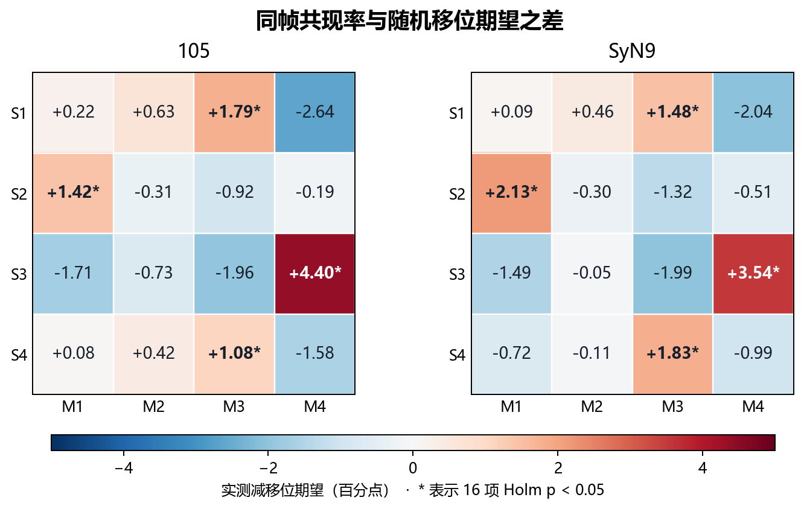

# 共有 24 对患者的 WEiDA × 微状态同帧共现

在 0.04–0.07 Hz，105 和 SyN9 各对 16 个状态组合做单侧循环移位检验及 Holm 校正。两套通过校正的组合完全相同，分别是**S1–M3、S2–M1、S3–M4、S4–M3**。S2 与 M1 的同帧共现均高于随机期望，105 多 **1.42 个百分点**（Holm p=0.00742），SyN9 多 **2.13 个百分点**（p=0.00016）。全表超出期望最多的是 S3–M4，两套分别多 4.40、3.54 个百分点。[预先记录的逐格方案](PLAN.md) · [全部 32 格的精确数值](results/cells.csv)

## 两套并排的 4×4 共现表

每格为 **实测共现率 / 随机移位期望**，单位为占全部有效帧的百分比。先在每名患者内等权平均 OFF 和 ON 的访视比例，再按各套自身的 ΔFD 调整，取 ΔFD=0 时的组估计。加粗表示共现率高于随机时间移位且本套 16 项 Holm p < 0.05。每套包括同一批 24 人、48 次访视，共 8,650 个有效帧。

| WEiDA | 105 M1 | 105 M2 | 105 M3 | 105 M4 | SyN9 M1 | SyN9 M2 | SyN9 M3 | SyN9 M4 |
|---|---:|---:|---:|---:|---:|---:|---:|---:|
| S1 | 8.50 / 8.28 | 8.25 / 7.62 | **8.41 / 6.62** | 4.20 / 6.84 | 6.54 / 6.44 | 7.37 / 6.91 | **7.68 / 6.19** | 3.49 / 5.53 |
| S2 | **8.06 / 6.64** | 5.63 / 5.95 | 3.94 / 4.86 | 6.50 / 6.69 | **8.44 / 6.32** | 5.66 / 5.96 | 3.76 / 5.08 | 5.55 / 6.06 |
| S3 | 4.46 / 6.17 | 4.54 / 5.27 | 2.78 / 4.73 | **11.18 / 6.77** | 4.80 / 6.30 | 6.91 / 6.96 | 3.97 / 5.96 | **10.17 / 6.64** |
| S4 | 6.56 / 6.49 | 6.31 / 5.89 | **6.42 / 5.34** | 4.27 / 5.85 | 6.08 / 6.80 | 6.40 / 6.51 | **8.04 / 6.21** | 5.15 / 6.13 |



### 各格的 16 项 Holm p

| WEiDA | 105 M1 | 105 M2 | 105 M3 | 105 M4 | SyN9 M1 | SyN9 M2 | SyN9 M3 | SyN9 M4 |
|---|---:|---:|---:|---:|---:|---:|---:|---:|
| S1 | 1.00000 | 0.88656 | **0.00075** | 1.00000 | 1.00000 | 1.00000 | **0.01196** | 1.00000 |
| S2 | **0.00742** | 1.00000 | 1.00000 | 1.00000 | **0.00016** | 1.00000 | 1.00000 | 1.00000 |
| S3 | 1.00000 | 1.00000 | 1.00000 | **0.00016** | 1.00000 | 1.00000 | 1.00000 | **0.00016** |
| S4 | 1.00000 | 1.00000 | **0.04160** | 1.00000 | 1.00000 | 1.00000 | **0.00042** | 1.00000 |

每次移位保持一次扫描中两种标签各自的占比和时间结构。每套单独校正所有 16 格。低于期望的格子也列入了完整检验家族，单侧上尾 p 回答的是“共现是否多于随机期望”。[原始单侧 p、极端次数及移位零分布区间](results/cells.csv)

<details>
<summary>查看同一有效时间窗内的原始同帧计数</summary>

两套的每一格分别累加 48 次访视的帧数。每套的 16 格合计 8,650 帧。上面的推断使用患者内访视等权并经 ΔFD 调整的比例。

| WEiDA | 105 M1 | 105 M2 | 105 M3 | 105 M4 | SyN9 M1 | SyN9 M2 | SyN9 M3 | SyN9 M4 |
|---|---:|---:|---:|---:|---:|---:|---:|---:|
| S1 | 759 | 715 | 737 | 362 | 576 | 633 | 651 | 327 |
| S2 | 725 | 463 | 356 | 531 | 730 | 471 | 326 | 500 |
| S3 | 416 | 381 | 247 | 940 | 430 | 544 | 339 | 887 |
| S4 | 587 | 531 | 551 | 349 | 547 | 530 | 705 | 454 |

</details>

## S2 最常对应哪一个微状态

在替换峰间等距帧的判定规则、或仅纳入两套两次访视均达到脑区覆盖门槛的患者后，S2–M1 在 105 和 SyN9 中仍通过 16 项 Holm 校正。[空间覆盖及峰间判定的补充分析](quality_sensitivity/README.md)

**两套均为 M1**。以组估计的 S2 帧为分母，105 有 **33.39%** 同时为 M1，移位期望为 **27.51%**。SyN9 分别为 **36.05%** 和 **26.97%**。S2 行的其他三个微状态在两套的实测共现率都低于移位期望。

| 微状态 | 105 在 S2 中实测 / 期望（%） | 105 超额（全部帧百分点） | 105 重抽第一 | SyN9 在 S2 中实测 / 期望（%） | SyN9 超额（全部帧百分点） | SyN9 重抽第一 |
|---|---:|---:|---:|---:|---:|---:|
| M1 | 33.39 / 27.51 | +1.42 | 94.4% | 36.05 / 26.97 | +2.13 | 98.7% |
| M2 | 23.34 / 24.65 | −0.31 | 0.9% | 24.19 / 25.46 | −0.30 | 0.3% |
| M3 | 16.34 / 20.14 | −0.92 | 0.0% | 16.08 / 21.70 | −1.32 | 0.0% |
| M4 | 26.93 / 27.70 | −0.19 | 4.7% | 23.69 / 25.87 | −0.51 | 1.0% |

“最强”按同一套数据 S2 行内的实测减移位期望排序。在固定共享模板的 19,999 次患者配对 bootstrap 中，两套排名第一的微状态在 **93.2%** 的重抽样本中相同。表中“重抽第一”给出每个微状态达到第一名的频率。这些频率描述排序的稳定性。[S2 条件占比及排名](results/s2_ranking.csv)

### 流程间的超额共现差值

在同一次 bootstrap 中两套抽取完全相同的患者，重估各自的 ΔFD 回归，计算 SyN9 减 105。四格区间采用每次重抽四个中心化差值的最大绝对偏差构造，单位均为占全部有效帧的百分点。

| 组合 | SyN9 − 105 | S2 四格 95% 同时区间 |
|---|---:|---:|
| S2–M1 | +0.71 | [−1.05, +2.46] |
| S2–M2 | +0.02 | [−1.74, +1.77] |
| S2–M3 | −0.40 | [−2.16, +1.36] |
| S2–M4 | −0.32 | [−2.08, +1.43] |

S2–M1 在两套的排序和校正后结论一致。SyN9 的超额点估计比 105 高 0.71 个百分点，其区间跨零，目前不能确定两套强度有差异。两套处理使用同一批患者。这里的同帧对应是扫描内现象，上一轮的患者间 ΔS2 局部亚稳态与 ΔM1 持续时间关联在两套均未通过校正。[配对差值及区间](results/s2_pipeline_differences.csv) · [上一轮患者间关联](../README.md)

## 数据、检验与复核

- 复用提交 `40b3342` 的真实 105 与 SyN9 AAL78 数据、已对齐的原始帧和两套共享的四状态模板。TR 为 2.1 秒。每套从 10,077 个已对齐的输入帧得到 8,650 个共同有效帧。逐文件核验两套输入和作者 WEiDA 特征摘要，重新回填状态标签。共同有效窗口和原报告的两套总体调整互信息、移位零分布分位数及 p 都得到复现。24 人均纳入同帧共现估计。
- 每次扫描枚举从零到该扫描有效段长度减一的所有循环位移。按该访视 S 与 M 边际比例之积求精确移位期望。各套各生成 99,999 组随机位移，同一组中每次访视独立抽一个位移，16 格共用该访视的偏移量。患者内先平均 OFF、ON，再用该套 ΔFD=0 的截距计算观察值和每组零模型值。两套的 ΔFD 均跨越零。原始单侧 p 为（大于或等于观察值的组数 + 1）/ 100,000。
- 对每次访视的每一个位移用直接循环计数逐格复核。用单独最小二乘回归核对所有零模型的截距、极端计数及两套完整 Holm 家族。真实分析独立执行两次，三个数值 CSV 逐字节一致。程序测试共 43 项构造测试通过。环境记录将本轮分析标为真实数据。[输入与环境记录](results/audit.json) · [分析代码](../../../../experiments/bold_microstates_v1/matched24_cells.py)

分析方案提交为 `aef4f41`。运行于既有 Windows 工作站归档，输出均为去标识的组级汇总。以下命令在仓库根目录执行。已有结果的复跑可将输出参数改为尚未创建的目录。

```powershell
$env:PYTHONIOENCODING = 'utf-8'
$env:OPENBLAS_NUM_THREADS = '1'
$env:MKL_NUM_THREADS = '1'
$env:OMP_NUM_THREADS = '1'
python -B experiments/bold_microstates_v1/matched24_cells.py --data-root 'E:\NIT\神经调控数据' --out reports/bold_microstates_v1/matched24_primary/cooccurrence_cells/results
python -B -m pytest -q -p no:cacheprovider experiments/bold_microstates_v1/tests
```
