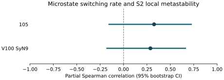

# 微状态切换率与 WEiDA 局部亚稳态

2026-11-23。在同一批 24 名 STN 患者中，微状态切换率的 ON−OFF 变化与 WEiDA 状态 S2 局部亚稳态的 ON−OFF 变化，在 V100 SyN9 和 105 处理中均呈正向点估计。两个 95% 区间均跨零，Holm 校正后 p 均为 0.2527。这批数据提示一个同方向的探索性结果，对关联的方向和强度仍有较大不确定性。[计算前固定的补充约定](PLAN.md)

## 整体切换率

在 0.04–0.07 Hz 的同一段 BOLD 上，沿用共有患者分析的两套共享四状态模板。一套从幅度空间图中选峰并忽略极性，另一套从 WEiDA 相位特征划分状态。每次扫描只计连续有效窗口内相邻帧标签实际改变的次数，再除以有效分钟数。S2 局部亚稳态衡量处于 S2 时，相位特征围绕 S2 群体质心的分散程度。每人先计算两项指标各自的 ON−OFF 差，再在患者之间计算偏 Spearman 相关，控制该套数据的平均帧间位移变化。

| 处理 | 患者数 | OFF 切换次数/分钟，均值 | ON 切换次数/分钟，均值 | 偏 ρ | 逐项 95% 区间 | 双侧置换 p | 两项 Holm p |
|---|---:|---:|---:|---:|---:|---:|---:|
| V100 SyN9 | 24 | 2.613 | 2.571 | +0.287 | [−0.177, +0.661] | 0.18790 | 0.2527 |
| 105 归档 | 24 | 2.593 | 2.437 | +0.326 | [−0.155, +0.723] | 0.12635 | 0.2527 |

两列均值描述每种刺激条件下的组平均切换速度。相关系数回答患者之间的问题，即亚稳态变化值较高的人，其切换率变化值是否也往往较高。两套流程使用相同患者和原始扫描，区间以本次共享模板为条件。2 项校正只覆盖这项补充问题的两个处理结果。[精确数值](results/associations.csv)



## 分状态的时间占比和出现率

同一批 24 人、同一套模板下，以下数值为各状态指标变化与 S2 局部亚稳态变化的偏 ρ。时间占比指该类占有效帧的比例，出现率指每分钟进入该类的片段数。原分析在每套处理的全部 12 项上做 Holm 校正。表内 8 个替代指标在两套处理中均未通过。V100 的 M2 出现率原始 p 为 0.0144，校正后为 0.1728，105 中该效应方向相反。其余单元格的校正 p 均为 1.0000。[原始与校正 p、置信区间全表](https://github.com/vanor-lavigine/WEiDA-DBS-Reproduction/blob/75a4504e3a268d0b8babdd5b3bf12bef10d61a22/reports/bold_microstates_v1/matched24_primary/results/associations.csv)

| 幅度状态 | V100 时间占比 | 105 时间占比 | V100 出现率 | 105 出现率 |
|---|---:|---:|---:|---:|
| M1 | −0.228 | +0.078 | −0.147 | +0.165 |
| M2 | +0.207 | −0.286 | +0.509 | −0.133 |
| M3 | +0.040 | +0.147 | +0.274 | +0.312 |
| M4 | −0.090 | −0.007 | +0.176 | +0.286 |

在较早的 V100 全部 26 对分析中，S2 局部亚稳态变化与 M1 持续时间变化呈负相关（偏 ρ=−0.627，12 项 Holm p=0.0138）。统一训练人群、模板和窗口后，这个端点有 23 对可估计，V100 为 +0.078，105 为 −0.144，两者的 Holm p 均为 1.0000。该持续时间关联对分析定义敏感。[共有患者的前后对照与逐人复核](https://github.com/vanor-lavigine/WEiDA-DBS-Reproduction/blob/75a4504e3a268d0b8babdd5b3bf12bef10d61a22/reports/bold_microstates_v1/matched24_primary/README.md)

## 同一时刻的状态对应

另一项逐帧检验发现，幅度微状态 M1 与相位状态 S2 一起出现的比例高于随机循环移位期望。V100 多 2.13 个百分点（16 项 Holm p=0.00016），105 多 1.42 个百分点（p=0.00742）。两套处理均检出 S1–M3、S2–M1、S3–M4 和 S4–M3 四种组合。这项结果描述同一帧所属的状态类别。上面的相关分析衡量 S2 内部相位特征的分散程度与微状态指标如何随刺激共同变化。[逐格检验及完整共现表](https://github.com/vanor-lavigine/WEiDA-DBS-Reproduction/blob/75a4504e3a268d0b8babdd5b3bf12bef10d61a22/reports/bold_microstates_v1/matched24_primary/cooccurrence_cells/README.md)

## 执行与核验

实测输入为既有 AAL78 时序、作者 MATLAB 相位特征、头动记录和冻结的共享模板。两套各有 48 次访视，计入相同的 8,650 个帧位置。实算切换计数与四类片段总数减一逐扫描一致。独立公式复算已发布的 24 个偏相关，人数全部一致，相关系数最大绝对误差为 2.22×10⁻¹⁶。对新增的两项结果，另用完整秩回归的 t 统计量复核 19,999 次置换的极端次数，并用三变量相关公式复核 5,000 次患者重抽区间。既有实验测试 43 项通过，另有 4 个构造序列检查切换计数及无效标签处理。表和图来自真实扫描。[程序与数据核验记录](results/verification.json) · [计算代码](https://github.com/vanor-lavigine/WEiDA-DBS-Reproduction/blob/experiment/bold-microstates-v1/experiments/bold_microstates_v1/matched24_switch_rate.py)

实跑使用 Windows PowerShell、Python 3.12.7、NumPy 1.26.4、SciPy 1.13.1、pandas 2.2.2、scikit-learn 1.5.1、Matplotlib 3.9.2、threadpoolctl 3.5.0。上游代码版本为 `75a4504`，补充方案提交为 `7071295`。以下保留实跑入口与参数。执行分析时的工作目录为本地数据根目录，`$exp` 指向实验仓库的 `experiments/bold_microstates_v1`，`$output` 指向新的输出目录。

```powershell
$env:PYTHONPATH = $exp
python -B -X utf8 "$exp/matched24_switch_rate.py" --data-root . --output "$output"
python -B -m pytest -q -p no:cacheprovider "$exp/tests"
```
