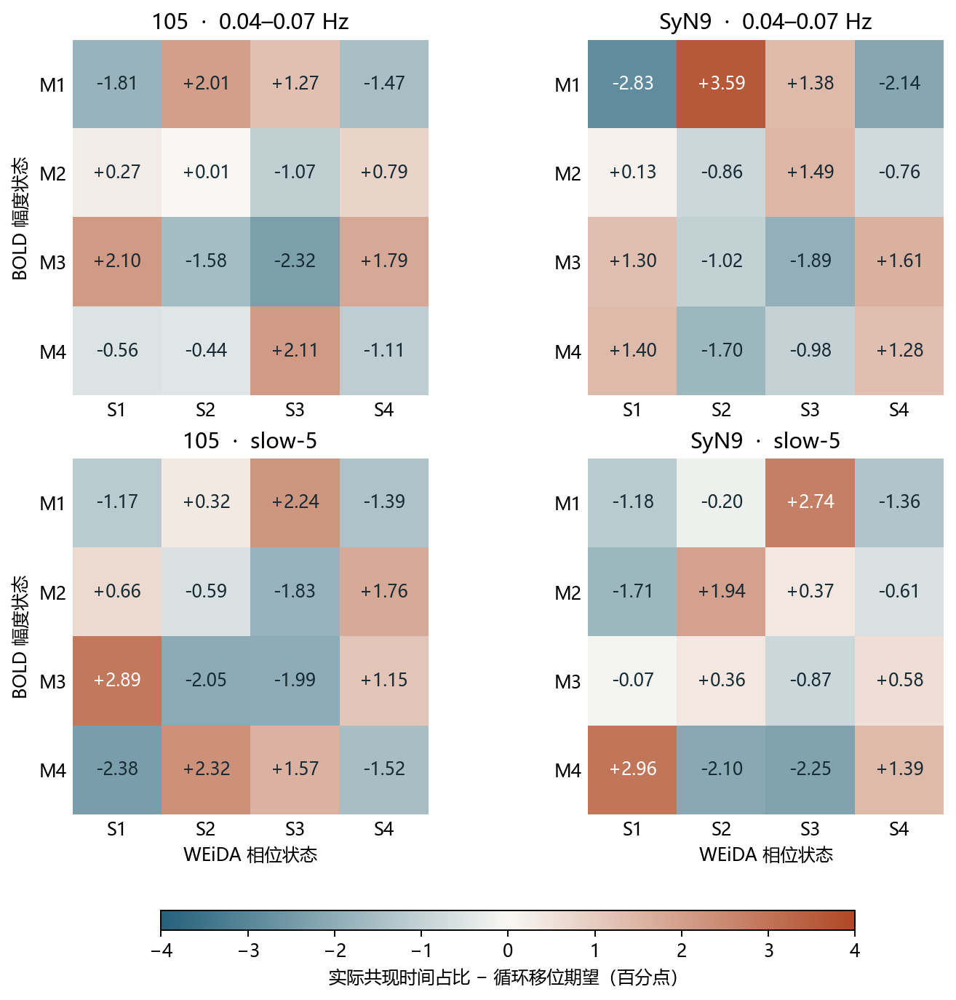
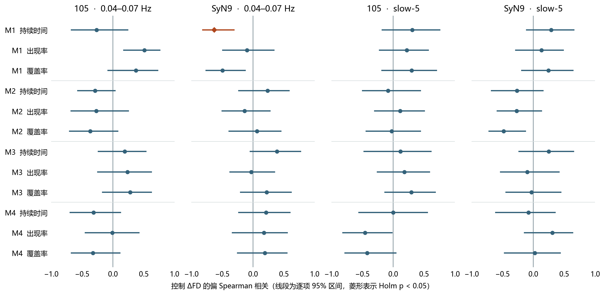

# 同频 BOLD 上的 WEiDA 局部亚稳态与微状态

2026 年 11 月 22 日。105 和 SyN9 两套真实数据在主频段 0.04–0.07 Hz 和探索性 slow-5（0.01–0.027 Hz）均显示幅度状态与相位状态的时间对应超过随机循环移位。患者间的 ON−OFF 变化关联中，只有 SyN9 主频段的状态 2 局部亚稳态变化与 M1 持续时间变化通过本组 12 项 Holm 校正（偏 Spearman ρ=−0.627，Holm p=0.0138）。105 主频段该关联同向，ρ=−0.265，Holm p=1.0000。预先固定的方案提交为 `9b6eb0f`。[分析约定](PLAN.md) · [此前两频段的可行性](../eeg_peaks/INFRASLOW_FEASIBILITY.md)

## 同一时刻的空间状态

在每次扫描两路均有效的帧上比较完整 4×4 标签分布。调整互信息（AMI）越大，知道一类标签时对另一类标签的预测信息越多。每位患者先取 OFF、ON 的 AMI 均值，再估计 ΔFD=0 的组值。每次扫描的所有循环移位（含零移位）构成该扫描的零模型，保留状态占比和时间序列结构。患者组随机组合这些移位 99,999 次。表中的“极端次数”为随机组值大于或等于实测值的次数，单侧 p 用加一公式计算。最后一列对四个总体共现检验一起作 Holm 校正。[总体共现检验与零分布区间](results/cooccurrence.csv)

| 频段 | 来源 | 患者对数 | 同帧 AMI | 移位期望 | 差值 | 极端次数 | 移位 p | 四项 Holm p |
|---|---|---:|---:|---:|---:|---:|---:|---:|
| 主频段 | 105 | 25 | 0.0894 | 0.0644 | +0.0250 | 0 | 0.00001 | 0.00004 |
| 主频段 | SyN9 | 26 | 0.1060 | 0.0640 | +0.0420 | 0 | 0.00001 | 0.00004 |
| slow-5 | 105 | 25 | 0.2046 | 0.1352 | +0.0694 | 0 | 0.00001 | 0.00004 |
| slow-5 | SyN9 | 26 | 0.1616 | 0.1326 | +0.0290 | 15 | 0.00016 | 0.00016 |

主频段 M1 与 WEiDA S2 共同出现的时间占比在 105 为 8.11%，移位期望为 6.10%（+2.01 个百分点）。SyN9 为 9.53% 对 5.94%（+3.59 个百分点）。slow-5 对应超额分别为 +0.32 和 −0.20 个百分点。下图各格是患者等权、两次访视等权的描述值。总体 AMI 的显著性不能赋给其中任一单格。[完整 64 格](results/state_pairs.csv) · [OFF、ON 和 HC 的描述均值](results/cooccurrence_by_visit.csv)

## 局部亚稳态变化与三个微状态时间指标

所有差值均取同一患者 ON−OFF。预测量是 WEiDA 论文状态 2（V-VA/SM）的整扫描局部亚稳态变化。局部亚稳态越大，该状态内部的相位特征相对群体质心越分散。在患者间以偏 Spearman 相关估计它和各指标变化的关系，对 ΔFD 秩作调整。每个单元格依次为 **偏 ρ / 本组 12 项 Holm p / 有效患者对数**。粗体表示 Holm p<0.05。[原始 p、全部区间及校正 p](results/associations.csv)

| 幅度状态指标 | 105 主频段 | SyN9 主频段 | 105 slow-5 | SyN9 slow-5 |
|---|---:|---:|---:|---:|
| M1 持续时间 | −0.265 / 1.0000 / 24 | **−0.627 / 0.0138 / 26** | +0.309 / 1.0000 / 18 | +0.285 / 1.0000 / 22 |
| M1 出现率 | +0.509 / 0.1590 / 24 | −0.098 / 1.0000 / 26 | +0.220 / 1.0000 / 24 | +0.129 / 1.0000 / 26 |
| M1 覆盖率 | +0.372 / 0.8971 / 24 | −0.495 / 0.1424 / 26 | +0.297 / 1.0000 / 24 | +0.245 / 1.0000 / 26 |
| M2 持续时间 | −0.287 / 1.0000 / 24 | +0.234 / 1.0000 / 26 | −0.083 / 1.0000 / 21 | −0.266 / 1.0000 / 22 |
| M2 出现率 | −0.270 / 1.0000 / 24 | −0.139 / 1.0000 / 26 | +0.114 / 1.0000 / 24 | −0.270 / 1.0000 / 26 |
| M2 覆盖率 | −0.369 / 0.8971 / 24 | +0.064 / 1.0000 / 26 | −0.027 / 1.0000 / 24 | −0.483 / 0.1842 / 26 |
| M3 持续时间 | +0.193 / 1.0000 / 24 | +0.387 / 0.5620 / 26 | +0.118 / 1.0000 / 20 | +0.248 / 1.0000 / 20 |
| M3 出现率 | +0.234 / 1.0000 / 24 | −0.032 / 1.0000 / 26 | +0.181 / 1.0000 / 24 | −0.100 / 1.0000 / 26 |
| M3 覆盖率 | +0.278 / 1.0000 / 24 | +0.221 / 1.0000 / 26 | +0.292 / 1.0000 / 24 | −0.030 / 1.0000 / 26 |
| M4 持续时间 | −0.316 / 1.0000 / 24 | +0.212 / 1.0000 / 25 | −0.002 / 1.0000 / 17 | −0.080 / 1.0000 / 24 |
| M4 出现率 | −0.012 / 1.0000 / 24 | +0.177 / 1.0000 / 26 | −0.454 / 0.3756 / 24 | +0.305 / 1.0000 / 26 |
| M4 覆盖率 | −0.323 / 1.0000 / 24 | +0.188 / 1.0000 / 26 | −0.424 / 0.4895 / 24 | +0.022 / 1.0000 / 26 |

SyN9 主频段 M1 持续时间的逐项 95% 患者 bootstrap 区间为 −0.814 至 −0.310，双侧置换原始 p=0.00115。局部亚稳态的变化值越低，M1 持续时间的变化值倾向越高。105 主频段同项的 95% 区间为 −0.671 至 +0.239。slow-5 两套均未检出经校正的关联。24 对患者在两套处理中重合，处理间相关系数差异未作假设检验。本分析检验脑影像指标之间的变化关联，临床量表未进入模型。

## 样本与空间对应

- 105 纳入 25 对患者和 15 名 HC，SyN9 纳入 26 对和 15 名 HC。HC 参与状态模板拟合和共现描述。两个频段的共现推断均保留全部患者对。105 两个频段各有一对患者至少一次访视少于两个 WEiDA S2 帧，无法计算成对的局部亚稳态差，故关联最多 24 对。幅度状态未出现时覆盖率和出现率计零，持续时间缺失。slow-5 各持续时间关联在 105 有 17–21 对，在 SyN9 有 20–24 对。SyN9 主频段 M4 持续时间有 25 对。
- 从论文图 3A 数字化读出四张空间图的 78 区权重，以带符号空间相关作一对一匹配。S2 与论文图的空间 r 在 105、SyN9 主频段分别为 0.998、0.941，slow-5 为 0.924、0.947。实际对应的 MATLAB 类号依次为 2、4、2、2。跨处理的主频段 M1 绝对空间相关为 0.928，SyN9 的主频段与 slow-5 M1 绝对相关为 0.636。M1–M4 来自 BOLD 幅度图。M1 和 S2 是否代表相同生理状态仍需独立证据。[空间对应全表](results/state_matching.csv) · [群体模板](results/templates.tsv)
- 主频段共同有效帧数的扫描中位数分别为 191、187，slow-5 为 166、168。slow-5 最少分别有 55、46 个共同有效帧，少数状态缺少完整片段。局部亚稳态用整次扫描、相应 WEiDA 状态内的帧计算。共现比较仅用幅度状态回填后的有效内段。两路标签均来自同一带限 BOLD 信号，循环移位衡量时序对齐程度，生理机制仍需独立证据。105 早期缓存的完整上游滤波参数缺记录。[运行质控](results/summary.json) · [原文的局部亚稳态定义](https://pmc.ncbi.nlm.nih.gov/articles/PMC13280393/)

## 实现与复核

两套输入矩阵、ROI 顺序、配对与每次扫描原始帧号均经核验，105 保留三次 209 帧扫描。MATLAB R2020b Update 8 复用作者特征计算，同一滤波输出同时传给相位和幅度两条路径。主频段使用归档标签并逐帧核对最近质心归属，105 共 13,647 帧、SyN9 共 14,070 帧。SyN9 主频段 S2 局部亚稳态与原 MATLAB 输出的最大绝对差为 6.1×10⁻¹⁸。slow-5 使用同样的 K=4 和 300 次初始化重新聚类。每套每个频段的幅度状态均独立选峰、忽略极性做 AAHC、用受试者等权的组模板回填，并排除不完整边缘段。编号通过空间匹配固定。[MATLAB 实现](../../../experiments/bold_microstates_v1/same_band_weida.m) · [两路分析与输入核对](../../../experiments/bold_microstates_v1/same_band_analysis.py)

关联检验用 19,999 次 Freedman–Lane 约化模型残差置换，5,000 次成对患者 bootstrap 重新排秩并调整 ΔFD。每个来源、频段各自的 12 项用 Holm 校正。独立复核从已滤波帧和群体模板重建幅度标签，用最近质心重建相位标签，并从状态内方差和均值偏移量重算局部亚稳态。以超几何分布求随机边际期望互信息，复算四个总体时间移位分布、64 个单格、分访视均值。另以完整回归的 t 统计量和三变量秩相关公式复核 48 项的系数、置换极端计数、置信区间和 Holm p。38 项代码测试通过，真实数据输出来自上述两套衍生时序。[统计实现](../../../experiments/bold_microstates_v1/same_band_stats.py) · [独立复核](../../../experiments/bold_microstates_v1/verify_same_band.py)

运行环境为 Windows、MATLAB 9.9.0.2037887、Python 3.12.7、NumPy 1.26.4、SciPy 1.13.1、scikit-learn 1.5.1、pandas 2.2.2、Matplotlib 3.9.2。以下命令在仓库根目录运行。MATLAB 的缓存和 Python 的结果目录在运行前均选新路径。中间帧数据使用本地私有缓存，仓库中的数值文件均为去标识汇总。

~~~powershell
& 'G:\matlab\bin\matlab.exe' -singleCompThread -sd 'E:\NIT\微状态\WEiDA-DBS-Reproduction' -batch "addpath(fullfile(pwd,'experiments','bold_microstates_v1')); same_band_weida('E:\NIT\神经调控数据',fullfile(pwd,'local_results','sameband_20261122a'))"
$env:OMP_NUM_THREADS='1'
$env:MKL_NUM_THREADS='1'
$env:OPENBLAS_NUM_THREADS='1'
$env:BLIS_NUM_THREADS='1'
$env:PYTHONUTF8='1'
$env:MPLBACKEND='Agg'
python -B -u experiments/bold_microstates_v1/same_band_analysis.py --data-root 'E:\NIT\神经调控数据' --cache local_results/sameband_20261122a --out reports/bold_microstates_v1/same_band/results
python -B -u experiments/bold_microstates_v1/verify_same_band.py --data-root 'E:\NIT\神经调控数据' --cache local_results/sameband_20261122a --results reports/bold_microstates_v1/same_band/results
python -B -m unittest discover -s experiments/bold_microstates_v1/tests -q
python -B experiments/bold_microstates_v1/plot_same_band.py --report reports/bold_microstates_v1/same_band
~~~
