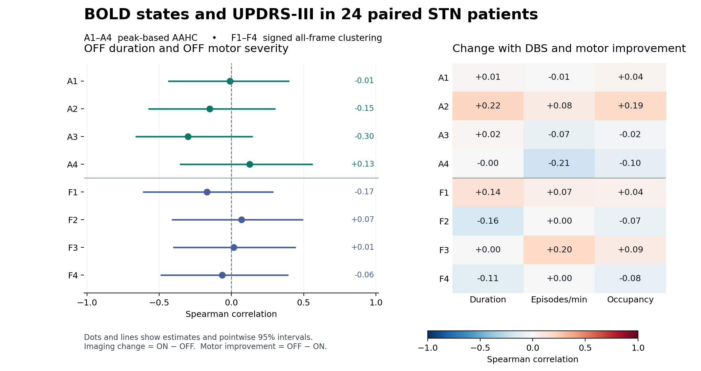

# 24 名有评分 STN-DBS 患者的 BOLD 微状态

2026 年 11 月 24 日。仅用 24 名有配对运动评分患者的 48 次 V100 扫描重新建模。主方法发现，开机后状态 A1 的占比上升 6.23 个百分点，出现率上升 0.53 段/分钟。占比通过跨两种方法的校正。两种方法均未检出关机持续时间与运动严重程度的显著关联，开机后影像指标的变化与运动改善也未检出显著关联。[计算前固定的规则](PLAN.md) · [全部效应量、95% 区间及 p 值](stats.csv)

## 上次的“趋势”怎样得到

上一轮用全部 67 次扫描拟合共同模板，从有评分的 24 名患者中，每人取一组影像变化（ON−OFF）和运动改善（OFF 总分−ON 总分），再比较两组数值在患者间的秩次。旧 M3 的持续时间变化与运动改善的 Spearman ρ 为 −0.430，双侧置换 p=0.0394，同组 12 项 Holm 校正 p=0.4728。负号表示改善较多的人，旧 M3 的持续时间倾向于缩短。关机时长与同条件严重程度是另一个问题，旧四项 ρ 为 −0.101 至 +0.023。两项问题都要看各自的校正结果。[上一轮逐项结果](../clinical_archive/README.md)

## 本轮如何从这批数据识别微状态

| 步骤 | 实际输入和计算 |
|---|---|
| 先确定 24 对 | 105 归档有 25 对 STN 的评分记录，V100 有 26 对合格时序，两者交集为 24 对。建模前已核实每人各有一次 OFF、ON，并核对原始 BOLD、T1w 来源及 ROI 时序清单。健康对照和其余患者均未进入拟合。 |
| 读取影像 | 每次读取 210 帧 × 78 个 AAL 皮层区的 SyN9/XCP-D 去噪 BOLD 时序，TR 2.1 秒。沿用 0.01–0.08 Hz 时序和冻结的 ROI 顺序，取 WEiDA 窄带滤波与 Hilbert 之前的输入。 |
| 主方法 AAHC，A1–A4 | 先把每个脑区的时间序列标准化，再在每一帧按脑区去均值。取脑区间标准差的局部峰，每次扫描从峰值空间图聚成四个状态，再以 48 次扫描等权建立四个共同模板。逐帧按绝对空间相关最大值赋予状态，空间图整体反号可以匹配同一状态。 |
| 对照方法，有符号球面 k-means，F1–F4 | 从同一批扫描的全部有效帧重新拟合。按脑区做时间标准化，每帧归一化，保留空间模式正负方向。K=4，100 次初始化，四个模板独立编号。每位患者权重相同。 |
| 回填和计量 | 每种方法给 10,080 帧全部赋予一个状态。对于每次扫描，连续若干帧属于同一状态记作一段。平均持续时间是该状态的总帧数 × 2.1 秒 ÷ 段数，出现率是段数 ÷ 有效分钟数，占比是该状态帧数 ÷ 210。 |
| 加入临床评分 | 模板、标签和各次扫描指标算好后，才在 105 读取每次访视的归档 UPDRS-III 总分。旧归档的影像指纹只用于核实评分行的访视身份。训练使用的全部空间图都来自患者自己的 V100 ROI 时序。 |

主方法共用了 **2,185 个空间峰**（每次扫描 38–52 个），回填使用每次扫描的全部 210 帧。四个组模板在峰上的加权空间解释方差为 19.64%。BOLD 持续时间以秒计，A、F 和旧 M 编号均是各次聚类的标签。此实验没有建立与 EEG 字母状态的一一对应。[8 张组模板的 78 区权重](templates.tsv)

## 关机时，状态持续越久的人运动症状是否越重

每人贡献一个 OFF 期平均持续时间和一个 OFF 运动评分。ρ 为正表示持续时间更长的人评分倾向更高。区间是按患者重采样的逐项 95% 区间。

| 方法与状态 | Spearman ρ | 95% 区间 | 原始 p | 四项 Holm p |
|---|---:|---:|---:|---:|
| A1 | −0.010 | −0.434 至 +0.395 | 0.9612 | 1.0000 |
| A2 | −0.152 | −0.571 至 +0.299 | 0.4705 | 1.0000 |
| A3 | −0.302 | −0.659 至 +0.143 | 0.1497 | 0.5987 |
| A4 | +0.127 | −0.354 至 +0.558 | 0.5510 | 1.0000 |
| F1 | −0.169 | −0.608 至 +0.285 | 0.4326 | 1.0000 |
| F2 | +0.069 | −0.410 至 +0.492 | 0.7518 | 1.0000 |
| F3 | +0.015 | −0.400 至 +0.440 | 0.9434 | 1.0000 |
| F4 | −0.064 | −0.486 至 +0.387 | 0.7639 | 1.0000 |

八个估计的方向有正有负，置信区间均跨过零。主方法中相关绝对值最大的是 A3，方向为负。24 人的结果仍容许一定幅度的正、负关联。

## DBS 开机后，状态本身发生了哪些变化

表中为 24 人的平均配对差 ON−OFF。括号中是该方法 12 项比较内的 Holm p。占比用百分点，出现率用段/分钟，持续时间用秒。

| 状态 | 占比变化（Holm p） | 出现率变化（Holm p） | 持续时间变化（Holm p） |
|---|---:|---:|---:|
| A1 | +6.230 (0.0096) | +0.533 (0.0396) | +0.379 (0.6703) |
| A2 | −3.393 (0.5237) | −0.204 (1.0000) | −0.321 (0.0820) |
| A3 | −0.754 (1.0000) | −0.147 (1.0000) | −0.030 (1.0000) |
| A4 | −2.083 (1.0000) | −0.255 (1.0000) | −0.097 (1.0000) |
| F1 | −1.230 (1.0000) | −0.113 (1.0000) | +0.002 (1.0000) |
| F2 | +1.746 (1.0000) | +0.193 (1.0000) | +0.003 (1.0000) |
| F3 | −0.357 (1.0000) | +0.068 (1.0000) | −0.227 (1.0000) |
| F4 | −0.159 (1.0000) | +0.068 (1.0000) | −0.174 (1.0000) |

主方法下，A1 的平均占比由 OFF 24.78% 升至 ON 31.01%，配对差的 95% 区间为 +3.33 至 +9.33 个百分点。出现率由每分钟 3.61 段升至 4.14 段，配对差的 95% 区间为 +0.23 至 +0.81 段/分钟。将两种方法同家族的 24 项检验一起校正，A1 占比 p=0.0192，A1 出现率 p=0.0828。有符号聚类的 12 项 ON/OFF 检验均未通过该方法内的 Holm 校正。

## 影像变化较大的患者，运动改善是否也较多

下表按 24 名患者各自的成对变化计算 Spearman ρ。改善以 UPDRS-III 的绝对分差（OFF−ON）计，正值表示开机时评分下降。

| 状态 | 占比变化与改善 ρ | 出现率变化与改善 ρ | 持续时间变化与改善 ρ |
|---|---:|---:|---:|
| A1 | +0.036 | −0.006 | +0.012 |
| A2 | +0.194 | +0.080 | +0.217 |
| A3 | −0.024 | −0.073 | +0.019 |
| A4 | −0.097 | −0.209 | −0.002 |
| F1 | +0.043 | +0.066 | +0.143 |
| F2 | −0.069 | +0.002 | −0.162 |
| F3 | +0.086 | +0.199 | +0.001 |
| F4 | −0.080 | +0.002 | −0.112 |

主评分下两种方法各 12 项相关的 Holm p 均为 1.0000。虽然 A1 开机后占比总体上升，患者之间占比增加的大小与改善分数的 ρ 仅为 +0.036。组平均变化和个体获益回答不同的问题。

## 评分版本与推断范围

主评分版本的 50 次 STN 访视总分与另一份归档逐条一致，也均能由 12 个分项求和。备用版本中，有 7 名共有患者的 OFF 和 ON 总分均有出入。固定本轮 48 次扫描的新模板，分别用备用评分的全体 24 人、以及各版本都一致的 17 人复算临床关联。在两种方法的两组敏感性分析中，严重程度和运动改善均无通过 Holm 校正的关联。各评分方案的估计和逐项区间均保留。[全部 120 行统计](stats.csv)

本轮为同一批患者的探索性重分析。每位患者各有 OFF、ON 两次观察。影像的 10,080 帧用于学习模板，统计样本量是 24 人。逐项区间在已拟合的模板上计算，未包含重新抽样建模板的不确定性。归档表按患者和刺激条件核验，逐人评分日期及用药状态仍缺独立记录。配对比较中没有另行调整头动或固定的扫描顺序。结果支持这批患者在 AAHC 下出现组水平的开关机差异，对个体严重程度和改善幅度的临床关联证据有限。[实际命令与运行核验](RUN.md)
