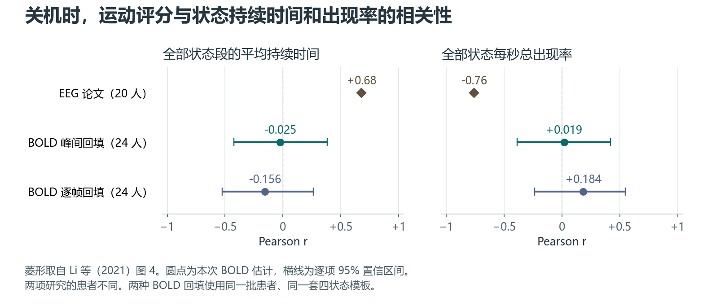

# STN-DBS 关机时的运动评分与微状态持续时间

Li 等在 20 名患者的 EEG 中发现，关机时运动评分越高，微状态平均持续越久（r=+0.68）。在本次 24 名有配对评分的患者中，同一临床问题对应的 BOLD 相关为 **r=−0.025，95% 置信区间 −0.424 至 +0.382**。点估计接近零，更换状态回填方式或控制头动后也未见接近 EEG 的正相关。这个区间仍容许一定程度的正向或负向关联。[Li 等，图 4](https://www.frontiersin.org/journals/neuroscience/articles/10.3389/fnins.2021.697909/full#F4) · [完整统计](stats.csv)

## 评分与影像怎样配对

本次只纳入 V100 影像与 105 主评分能按患者、开关机条件逐次核对的 24 人。每人有 OFF 和 ON 各一次，共 48 份 210 帧 × 78 脑区的时序。固定上轮 24 人学出的四张 AAHC 组模板。主要方法先在脑区间 BOLD 幅度标准差的局部峰值上判定状态，再为相邻峰之间的帧分配状态，首尾不完整的状态段排除。另一种方法逐帧判断状态，用同一套模板。每个临床相关中，一名患者贡献一个观测。[计算前约定](PLAN.md) · [前一轮患者分析](../README.md)

| 临床问题 | 每个人拿哪两个数做相关 |
|---|---|
| 关机时谁的运动症状更重 | OFF 扫描的时间指标，与该患者的 OFF 运动评分。分数越高表示症状越重。 |
| 开机时谁的运动症状更重 | ON 扫描的时间指标，与该患者的 ON 运动评分。 |
| 谁从刺激中获益更多 | ON 扫描的时间指标，与个人改善率 `100 × (OFF评分 − ON评分) / OFF评分`。正数表示运动评分下降。 |

这三项配对沿用 EEG 原文的临床问题。上轮用影像的 ON−OFF 变化对照评分下降的绝对分数，回答的是个体影像改变量是否和临床改变量一起变化。[EEG 论文的统计方法](https://www.frontiersin.org/journals/neuroscience/articles/10.3389/fnins.2021.697909/full) · [上轮结果](../README.md)

## 真实患者的结果

表内为 Pearson r，括号内为多重检验校正值。EEG 列取自原文图 4 或临床结果段。BOLD 的 q 为每种回填的 42 项检验共同进行 Benjamini–Hochberg 校正的结果。EEG 论文说明使用 FDR 和 0.01 阈值，未列明具体在哪些检验之间校正。[EEG 图 4](https://www.frontiersin.org/journals/neuroscience/articles/10.3389/fnins.2021.697909/full#F4)

| 影像指标与临床指标 | EEG，20 人 | BOLD 峰间回填，24 人 | BOLD 逐帧回填，24 人 |
|---|---:|---:|---:|
| OFF 平均持续时间 × OFF 评分 | +0.68（校正 p=0.001） | −0.025（q=0.977） | −0.156（q=0.743） |
| OFF 总出现率 × OFF 评分 | −0.76（校正 p<0.0001） | +0.019（q=0.977） | +0.184（q=0.743） |
| ON 平均持续时间 × ON 评分 | 未报告显著关联 | −0.187（q=0.977） | −0.545（q=0.122） |
| ON 平均持续时间 × 个人改善率 | 未报告显著关联 | +0.300（q=0.977） | +0.254（q=0.646） |

**症状严重程度。** 峰间回填的主要结果原始 p=0.908，10,000 次置换 p=0.909。改用 Spearman 得 ρ=−0.073，控制 OFF 平均头动后偏 r=−0.031。每次去掉一名患者，r 在 −0.218 至 +0.100 之间。按四种状态等权平均持续时间，r=+0.099（95% 区间 −0.317 至 +0.483）。四种状态分别计算的 OFF 持续时间相关为 A1 −0.205、A2 +0.154、A3 +0.016、A4 +0.222。本次 BOLD 的编号只标识本次模板，尚无对应 EEG A–D 的空间映射。[敏感性分析与核验](verification.json)

**刺激获益。** 峰间回填下，ON 平均持续时间与个人改善率的 95% 区间为 −0.117 至 +0.628，原始 p=0.154。现有样本不足以判断这项正向估计能否重复。逐帧回填下，ON 持续时间和总出现率与 ON 评分的原始 p 分别为 0.0059 和 0.0041，校正后两者均为 q=0.122。峰间回填下这两项原始 p 分别为 0.381 和 0.493。每种方法的 42 项检验均有 24 人，达到预设 q<0.01 的项数均为 0。[全部 84 行，含逐项区间及原始 p](stats.csv)

## 哪些差异仍影响解释

- 两种 BOLD 方法的原始输入、组模板和评分相同，得出的状态段长度随回填规则改变。将全部 OFF 患者保留的状态段汇总，峰间回填为 4,680 帧、741 段，合计平均每段 13.26 秒；逐帧回填为 5,040 帧、2,535 段，合计平均每段 4.18 秒。用于临床相关的是每人各自的持续时间。EEG 的采样率为 1,000 Hz，论文表 1 报告 OFF 状态段平均约 75 毫秒。BOLD 每 2.1 秒采一帧，时间尺度和测量对象均有差异。[BOLD 帧数与段数](verification.json) · [EEG 原文表 1](https://www.frontiersin.org/journals/neuroscience/articles/10.3389/fnins.2021.697909/full)
- BOLD 总体持续时间定义为每人的保留帧数 × TR / 全部状态段数，总出现率为其倒数，两项提供相关联的信息。EEG 论文发表了总体估计，逐人加权的具体实现仍缺作者文件。两种 BOLD 加权方式得到的 OFF 严重程度相关均较小。[计算前约定](PLAN.md)
- EEG 论文选择刺激疗效良好的患者，先记录首次开机前的 OFF，再记录开机 24 小时后的 ON。原 fMRI 队列先测正在接受刺激的 ON，再在关机一小时或症状重现后测 OFF。原 fMRI 论文表 1 采用 MDS-UPDRS-III，105 文件列名为 `UPDRS3`，EEG 论文写作 UPDRS-III。本次 48 条评分的患者和开关机条件已核对，逐人的实际评估日、停药时长仍需原始访视记录确认。[EEG 纳入与采集](https://www.frontiersin.org/journals/neuroscience/articles/10.3389/fnins.2021.697909/full) · [fMRI 原研究的临床流程及表 1](https://pmc.ncbi.nlm.nih.gov/articles/PMC13280393/#Tab1)

若要检验同一个人的 EEG 与 BOLD 是否都能反映运动严重程度，最直接的补充是同一批患者在相同刺激、用药条件下的 EEG 微状态指标、BOLD 指标及当次运动评分。现有两个独立队列可以比较效应方向，不能区分时间分辨率、入组人群和访视方案各自造成了多少差异。
